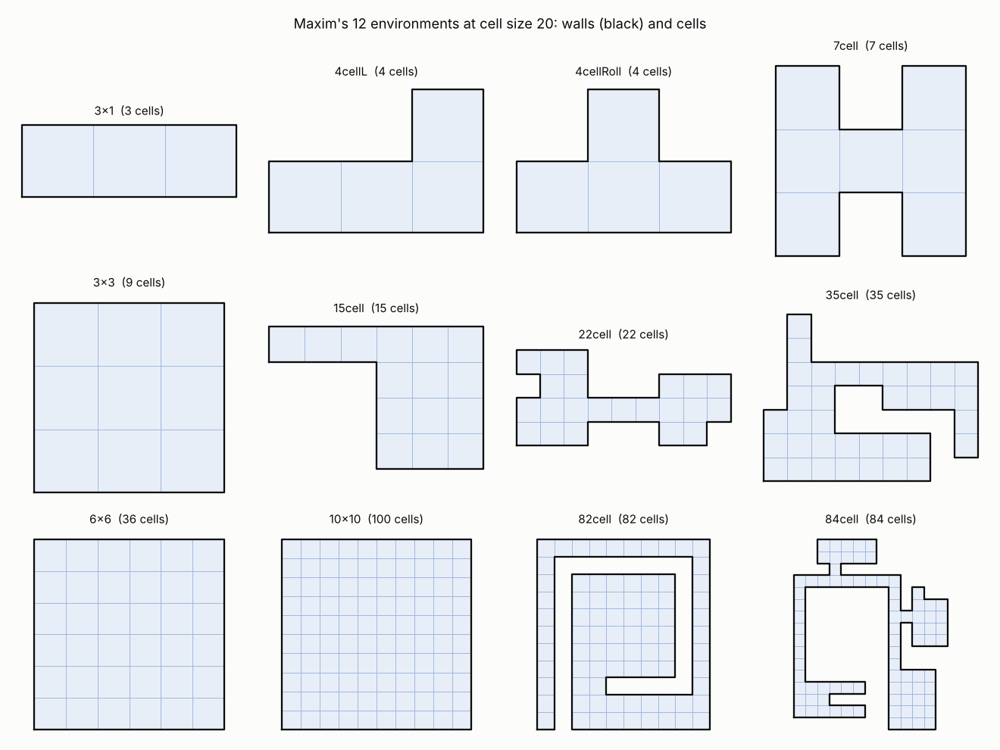
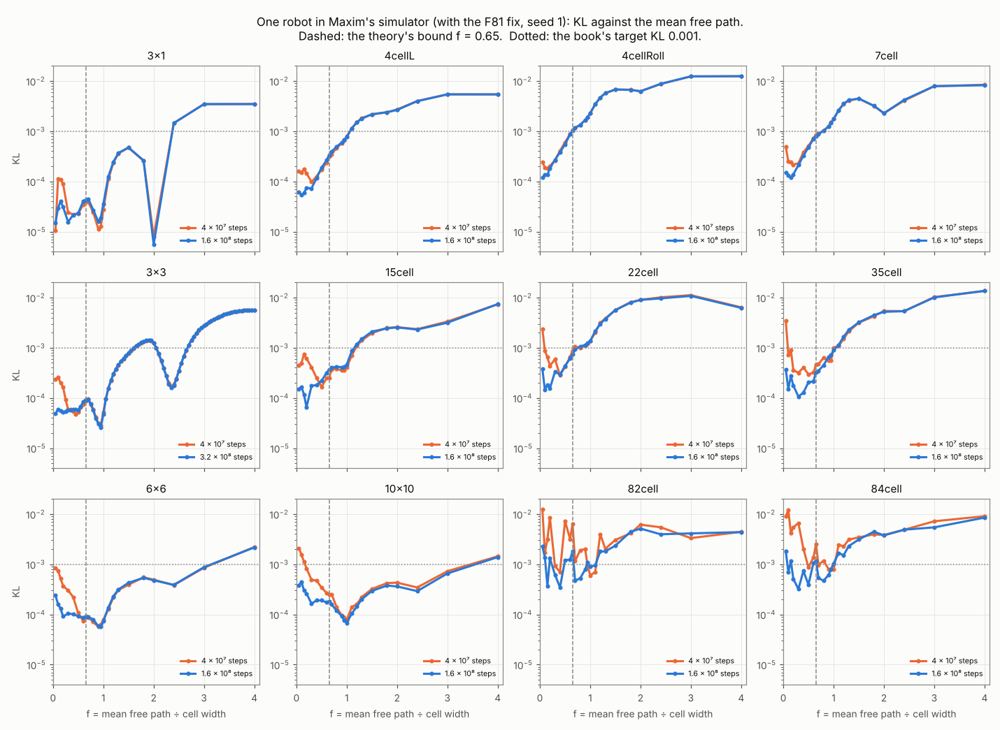

# Ch. 11 — Uniform coverage: Table 11.1 on Maxim's simulator; the mean free path in 2D and 3D

Two entries of `BOOK.md`: 11.8 (Table 11.1, Sec. 11.8, PDF 383–386), first
below, and 11.7 (the mean free path, Sec. 11.3), after it; between them,
the mean free path's bound tested on Maxim's simulator (with Ch. 4.3).

## Table 11.1: 12 environments × 5 cell sizes (entry 11.8)

Maxim's simulator and environments, as William sent them (2026-10-25,
`forclaude.zip`), are in `maxim/` (source, Makefile, configs, the
environments; his result files as the counts in `maxim_counts.txt`; the
32-bit binaries left out). One robot, one sensor of range 1, moving 1 a
step, turning to a uniform random heading at a wall or after
floor(0.6 × cell size) steps; KL = Σ p_i ln(p_i C) over the C cells.

| File | What |
| --- | --- |
| `maxim/` | Maxim's code and environments (`src/coverage_simulation.c`; `coverage_simulation.save.c` is an older version) |
| `maxim.lua` | His C as plain Lua, operation for operation, single-precision positions included: exact against the C (any Lua 5.1–5.4) |
| `maxim_counts.txt` | The visit counts in Maxim's own result files (every 10⁷ steps and the last sample), one line a sample |
| `runs_counts.txt` | Ours: his C built as it is (`gcc -O2`, x86-64) and run for 40 million steps, then 160 million where 40 had not settled |
| `c_reference.txt` | Five short runs of the C (2 × 10⁵ steps), the reference for `checks/ch11.lua` |
| `table11_1.lua` | Prints the table below from the two counts files |
| `wedge.lua` | Finds the step at which the robot gets stuck on a wall (below) |
| `maxim_fixed.diff`, `c_reference_fixed.txt` | His C with F81's fix and a seed argument (`./coverage_sim config.ini env.ini F SEED`), used for the mean free path sweep; a short run of it, the check's reference |
| `mfp_sweep.lua`, `mfp_sweep_counts.txt` | The mean free path sweep on all 12 environments (below) and its counts |
| `plot_mfp_sweep.py`, `environments.png`, `mfp_sweep.png` | The figures: the 12 environments' walls and cells at cell size 20, and each one's KL against f after 4 × 10⁷ and 1.6 × 10⁸ steps (`python3 ch11/plot_mfp_sweep.py`, matplotlib) |
| `../checks/ch11.lua` | 20 tests, 6 s |

**Stopping rule** (William: one seed, starting at the text's 40 million
steps and doubling until the KL changes by less than a few percent; Sec.
11.2.6: the chain is ergodic, so one long run stands for many). Every
entry runs 40 million steps; an entry has settled at T when |KL(T) −
KL(T/2)| ≤ 5% of KL(T); unsettled entries go on to 160 million, which
gives the 80 million point too. The last column is KL at the first
settled T, or at 160 million marked \*; w marks a run that ended where
the robot got stuck on a wall.

| Environment | Size | Book | Maxim's file | Ours at 10M | 20M | 40M | 80M | 160M | Ours (run length) |
| --- | --- | --- | --- | --- | --- | --- | --- | --- | --- |
| 3x1 | 10 | 0.00011 | 0.00011 | 0.00013 | 0.00014 | 0.00013 | 0.00013 | 0.00013 | 0.00013 (80M) |
| 3x1 | 15 | 0.00005 | 0.00005 | 0.00006 | 0.00007 | 0.00006 | 0.00007 | 0.00007 | 0.00007 (160M) |
| 3x1 | 20 | 0.00003 | 0.00003 | 0.00003 | 0.00005 | 0.00004 |  |  | 0.00004 (40M) |
| 3x1 | 25 | 0.00003 | 0.00003 | 0.00003 | 0.00003 | 0.00003 | 0.00003 | 0.00004 | 0.00004* (160M) |
| 3x1 | 30 | 0.00002 | 0.00002 | 0.00002 | 0.00002 | 0.00003 | 0.00002 | 0.00003 | 0.00003* (160M) |
| 4cellL | 10 | 0.00026 | 0.00026 | 0.00040 |  |  |  |  | 0.00037w (12.3M) |
| 4cellL | 15 | 0.00022 | 0.00022 | 0.00030 | 0.00030 | 0.00029 |  |  | 0.00029 (40M) |
| 4cellL | 20 | 0.00019 | 0.00019 | 0.00028 | 0.00030 | 0.00027 | 0.00027 | 0.00027 | 0.00027 (80M) |
| 4cellL | 25 | 0.00016 | 0.00016 | 0.00020 | 0.00031 | 0.00028 | 0.00024 | 0.00025 | 0.00025* (160M) |
| 4cellL | 30 | 0.00022 | 0.00022 | 0.00022 | 0.00022 | 0.00025 | 0.00023 | 0.00024 | 0.00024 (160M) |
| 4cellRoll | 10 | 0.00090 | 0.00090 |  |  |  |  |  | 0.00130w (6.88M) |
| 4cellRoll | 15 | 0.00082 | 0.00082 | 0.00094 | 0.00090 | 0.00094 |  |  | 0.00094 (40M) |
| 4cellRoll | 20 | 0.00068 | 0.00068 | 0.00085 | 0.00089 | 0.00086 |  |  | 0.00086 (40M) |
| 4cellRoll | 25 | 0.00066 | 0.00066 | 0.00076 | 0.00082 | 0.00076 | 0.00078 | 0.00079 | 0.00078 (80M) |
| 4cellRoll | 30 | 0.00071 | 0.00071 | 0.00081 | 0.00082 | 0.00075 | 0.00073 | 0.00075 | 0.00073 (80M) |
| 7cell | 10 | 0.00078 | 0.00078 | 0.00100 | 0.00096 | 0.00100 |  |  | 0.00100 (40M) |
| 7cell | 15 | 0.00075 | 0.00075 | 0.00076 | 0.00073 | 0.00073 |  |  | 0.00073 (40M) |
| 7cell | 20 | 0.00064 | 0.00064 | 0.00067 | 0.00066 | 0.00065 |  |  | 0.00065 (40M) |
| 7cell | 25 | 0.00056 | 0.00056 | 0.00078 | 0.00065 | 0.00063 |  |  | 0.00063 (40M) |
| 7cell | 30 | 0.00061 | 0.00061 | 0.00056 | 0.00066 | 0.00058 | 0.00059 | 0.00063 | 0.00059 (80M) |
| 3x3 | 10 | 0.00018 | 0.00018 | 0.00027 | 0.00024 | 0.00024 |  |  | 0.00024 (40M) |
| 3x3 | 15 | 0.00010 | 0.00010 | 0.00013 | 0.00014 | 0.00013 | 0.00014 | 0.00014 | 0.00014 (160M) |
| 3x3 | 20 | 0.00007 | 0.00007 | 0.00011 | 0.00010 | 0.00009 | 0.00009 | 0.00010 | 0.00010* (160M) |
| 3x3 | 25 | 0.00007 | 0.00007 | 0.00009 | 0.00007 | 0.00008 | 0.00007 | 0.00008 | 0.00008* (160M) |
| 3x3 | 30 | 0.00006 | 0.00006 | 0.00006 | 0.00007 | 0.00007 | 0.00007 | 0.00007 | 0.00007 (160M) |
| 15cell | 10 | 0.00019 | 0.00019 | 0.00027 | 0.00033 | 0.00045 | 0.00045 | 0.00049 | 0.00045 (80M) |
| 15cell | 15 | 0.00010 | 0.00010 | 0.00013 | 0.00020 | 0.00024 | 0.00030 | 0.00031 | 0.00031 (160M) |
| 15cell | 20 | 0.00015 | 0.00015 | 0.00015 | 0.00009 |  |  |  | 0.00016w (30.8M) |
| 15cell | 25 | 0.00016 | 0.00016 | 0.00020 | 0.00009 | 0.00013 | 0.00018 | 0.00019 | 0.00019* (160M) |
| 15cell | 30 | 0.00019 | 0.00019 | 0.00010 | 0.00008 | 0.00011 | 0.00015 | 0.00019 | 0.00019* (160M) |
| 22cell | 10 | 0.00088 | 0.00088 | 0.00135 | 0.00085 | 0.00087 |  |  | 0.00087 (40M) |
| 22cell | 15 | 0.00124 | 0.00124 | 0.00172 | 0.00087 | 0.00067 | 0.00067 |  | 0.00067 (80M) |
| 22cell | 20 | 0.00188 | 0.00188 | 0.00074 | 0.00055 | 0.00052 | 0.00055 | 0.00055 | 0.00055 (80M) |
| 22cell | 25 | 0.00137 | 0.00137 | 0.00086 | 0.00071 | 0.00060 | 0.00060 | 0.00056 | 0.00060 (80M) |
| 22cell | 30 | 0.00145 | 0.00145 | 0.00090 | 0.00075 | 0.00053 | 0.00058 | 0.00055 | 0.00055 (160M) |
| 35cell | 10 | 0.00138 | 0.00138 | 0.00096 | 0.00060 | 0.00046 |  |  | 0.00045w (73.3M) |
| 35cell | 15 | 0.00079 | 0.00079 | 0.00156 | 0.00132 | 0.00123 | 0.00058 | 0.00045 | 0.00045* (160M) |
| 35cell | 20 | 0.00067 | 0.00067 | 0.00088 | 0.00066 | 0.00055 | 0.00043 | 0.00031 | 0.00031* (160M) |
| 35cell | 25 | 0.00067 | 0.00067 | 0.00083 | 0.00094 | 0.00103 | 0.00052 | 0.00030 | 0.00030* (160M) |
| 35cell | 30 | 0.00106 | 0.00106 | 0.00067 | 0.00084 | 0.00053 | 0.00047 | 0.00026 | 0.00026* (160M) |
| 6x6 | 10 | 0.00021 | 0.00021 | 0.00028 | 0.00021 | 0.00021 |  |  | 0.00021 (40M) |
| 6x6 | 15 | 0.00011 | 0.00011 | 0.00021 | 0.00015 | 0.00011 | 0.00014 | 0.00013 | 0.00013* (160M) |
| 6x6 | 20 | 0.00009 | 0.00009 | 0.00014 | 0.00017 | 0.00009 | 0.00009 | 0.00010 | 0.00009 (80M) |
| 6x6 | 25 | 0.00008 | 0.00008 | 0.00013 | 0.00016 | 0.00008 | 0.00007 | 0.00009 | 0.00009* (160M) |
| 6x6 | 30 | 0.00009 | 0.00010 | 0.00018 | 0.00017 | 0.00010 | 0.00006 | 0.00007 | 0.00007* (160M) |
| 82cell | 10 | 0.00223 | 0.00223 | 0.00628 | 0.00247 | 0.00223 | 0.00108 | 0.00181 | 0.00181* (160M) |
| 82cell | 15 | 0.00114 | 0.00114 | 0.00145 | 0.00170 | 0.00114 | 0.00131 |  | 0.00146w (140.9M) |
| 82cell | 20 | 0.00269 | 0.00269 | 0.00300 | 0.00762 | 0.00269 | 0.00123 | 0.00063 | 0.00063* (160M) |
| 82cell | 25 | 0.00097 | 0.00097 | 0.00650 | 0.00101 | 0.00097 |  |  | 0.00097 (40M) |
| 82cell | 30 | 0.00059 | 0.00060 | 0.00168 | 0.00073 | 0.00060 | 0.00071 | 0.00113 | 0.00113* (160M) |
| 84cell | 10 | 0.00210 | 0.00210 | 0.00543 | 0.00108 | 0.00210 | 0.00076 | 0.00075 | 0.00075 (160M) |
| 84cell | 15 | 0.00309 | 0.00309 | 0.00531 | 0.00779 | 0.00309 | 0.00073 | 0.00077 | 0.00077 (160M) |
| 84cell | 20 | 0.00067 | 0.00068 | 0.00942 | 0.00413 | 0.00068 | 0.00099 | 0.00086 | 0.00086* (160M) |
| 84cell | 25 | 0.00156 | 0.00156 | 0.01008 | 0.00637 | 0.00156 | 0.00098 | 0.00051 | 0.00051* (160M) |
| 84cell | 30 | 0.00064 | 0.00064 | 0.00638 | 0.00205 | 0.00064 | 0.00054 | 0.00065 | 0.00065* (160M) |
| 10x10 | 10 | 0.00051 | 0.00051 | 0.00060 | 0.00024 | 0.00027 | 0.00023 | 0.00017 | 0.00017* (160M) |
| 10x10 | 15 | 0.00057 | 0.00057 | 0.00051 | 0.00028 | 0.00015 | 0.00018 | 0.00013 | 0.00013* (160M) |
| 10x10 | 20 | 0.00009 | 0.00053 | 0.00042 | 0.00052 | 0.00016 | 0.00016 | 0.00011 | 0.00016 (80M) |
| 10x10 | 25 | 0.00057 | 0.00057 | 0.00048 | 0.00056 | 0.00017 | 0.00013 | 0.00011 | 0.00011* (160M) |
| 10x10 | 30 | 0.00065 | 0.00065 | 0.00084 | 0.00052 | 0.00025 | 0.00010 | 0.00013 | 0.00013* (160M) |

**What the table shows:**

- **Maxim's files give every printed value**, to the fifth decimal
  (`checks/ch11.lua`), except 10x10 size 20: his file has 0.00053, the
  book prints 0.00009, a misprint. The book rounds most values and cuts
  three (0.0000953 is printed 0.00009, 0.0006773 is 0.00067, 0.0005972 is
  0.00059).
- **The table mixes run lengths.** The text says 40 million steps (PDF
  383), but 9 environments come from Maxim's 2008 runs of 10 million
  steps; only 6x6, 82cell and 84cell are from his 2009 runs of 40
  million. 22cell size 20 is 0.00188 at 10 million in his file and 0.00050
  at 40 million in a second file of his.
- **His C, built today, reproduces the 2009 runs visit for visit**: every
  run of the C draws the same random numbers (RandomInitialise(1,
  time(NULL)) gets a seed above the generator's limit, 30081, and falls
  back to (1802, 9373)), so our 40-million-step runs of 6x6, 82cell and
  84cell are his. **The 2008 runs used another stream** that we could not
  recover (tried: srandom(time) with both of the old u01 forms the source
  shows, and Bourke's generator without its range check, around the
  time stamp in each file's name), so for those 9 environments our numbers
  are a second sample, not his.
- **31 of the 60 entries settle by 160 million steps** (12 at 40, 11 at
  80, 8 at 160), most of them in the small environments, which have a
  real bias: 7cell 0.0006–0.0010, 4cellRoll 0.0007–0.0009, 22cell
  0.0005–0.0009. The book's values are 10 million steps of another
  stream, and differ from these by 3–35% in 7cell, 4cellRoll, 4cellL and
  3x3, and by up to 3× in 15cell and 22cell (15cell's KL grows with the
  run: 0.00013 at 10 million, 0.00031 at 160, for size 15).
- **24 do not settle**: the large environments (35cell, 6x6, 82cell,
  84cell, 10x10) and 3x1's and 3x3's tiny values. There the KL is mostly
  sampling noise: it keeps falling as the runs get longer, by 2–6×
  between 10 and 160 million steps (35cell size 30: 0.00067 → 0.00026;
  10x10 size 25: 0.00048 → 0.00011), with large swings on the way
  (82cell size 10: 0.00223 at 40 million, 0.00108 at 80, 0.00181 at 160;
  the spiral's cells are visited in long runs). The book's values for
  these environments measure the run length as much as the environment.
  The text's ranking of the environments still holds in the large: the
  big, irregular ones (82cell, 84cell, 22cell, 35cell) stay the least
  uniform.

**The robot can get stuck on a wall** (FINDINGS F81). In 6 of the 60
runs the C stops making progress: 4cellRoll size 10 at step 6,882,790,
4cellL 10 at 12,319,606, 15cell 20 at 30,857,255, 35cell 10 at
73,355,887, 22cell 15 at 131,680,428 and 82cell 15 at 140,972,056, about
one per 10⁹ steps. The C tests the way ahead with the sensor's end point,
(float)(cos h + x), rounded once, and then moves to x + (float)cos h,
which rounds cos h first. In 4cellRoll the sensor ended at x = 119.999992,
clear of the wall at 120, and the move put the robot at exactly 120. On a
wall, every sensor line touches it except lines along it, so the robot
can only creep along the wall on the rare heading within ~10⁻⁵ rad of it
(15cell 20 crept along its bottom wall for 700,000 steps in 40 minutes;
4cellL 10 and 22cell 15 made not one more sample of 10⁴ steps). Maxim's
own files show no creeping and all reach their full length. The stream
is fixed, so a longer run sticks at the same step: these entries end at
the last sample before it. Our runs used a watchdog (stop when a run
gains fewer than 10⁶ steps in 30 s). Fixing it (move to the point the
sensor tested) would change every run after the first step that
differs, so his simulator is kept as it is.

**Run it:**

    lua5.4 ch11/table11_1.lua          # the table above, from the counts
    lua5.4 ch11/wedge.lua 4cell.roll 10 7000000
    lua5.1 checks/ch11.lua

To rerun the C (needs GLUT and an X display, e.g. `Xvfb :99`): `cd
ch11/maxim && make LIBS="-lglut -lGLU -lGL -lm"`, set `time_steps` in
`config.ini`, then `DISPLAY=:99 ./coverage_sim config.ini
4cell.roll.environment/environment_10.ini 0.6`; it writes
`cell_visit_counter_<size>_1.00_side_<seed>.out`, the counts every 10⁴
steps. Each run of 160 million steps takes 2–5 minutes.

## The mean free path as an upper bound, on Maxim's simulator

Ch. 4.3's question (PDF 144–146; `../ch04/README.md` has it on the
Android rule) asked of Ch. 11's simulator: the theory's 0.65 × cell size
(0.6079 with the wall buffer, Sec. 11.3) is an **upper bound**. A
shorter mean free path covers as evenly but crosses the region more
slowly; a longer one leaves a bias that time does not remove. One run per
environment and turn length (seed 1: the time average stands for the
ensemble, Sec. 11.2.6), cell size 20, Maxim's C with F81's fix and a seed
argument (`maxim_fixed.diff`; the Lua copy with `fixed = true` matches it,
`checks/ch11.lua`), 1.6 × 10⁸ steps (the 3x3: every turn length 1–80, 3.2
× 10⁸ steps). `mfp_sweep.lua` prints the tables from
`mfp_sweep_counts.txt`; f = turn length / 20.

KL at the end of each run (`lua5.4 ch11/mfp_sweep.lua`; the book's target
for simulation is 0.001):

| env | 0.05 | 0.10 | 0.15 | 0.20 | 0.30 | 0.40 | 0.50 | 0.60 | 0.65 | 0.70 | 0.80 | 0.90 | 0.95 | 1.00 | 1.10 | 1.20 | 1.30 | 1.50 | 1.80 | 2.00 | 2.40 | 3.00 | 4.00 | floor (f <= 0.5) |
| --- | --- | --- | --- | --- | --- | --- | --- | --- | --- | --- | --- | --- | --- | --- | --- | --- | --- | --- | --- | --- | --- | --- | --- | --- |
| 3x1 | 0.00002 | 0.00003 | 0.00004 | 0.00003 | 0.00002 | 0.00002 | 0.00002 | 0.00004 | 0.00004 | 0.00004 | 0.00003 | 0.00002 | 0.00002 | 0.00004 | 0.00013 | 0.00024 | 0.00037 | 0.00047 | 0.00026 | 0.00001 | 0.00145 | 0.00346 | 0.00347 | 0.00002 |
| 4cell.L | 0.00006 | 0.00005 | 0.00006 | 0.00007 | 0.00007 | 0.00012 | 0.00019 | 0.00027 | 0.00034 | 0.00039 | 0.00050 | 0.00060 | 0.00067 | 0.00077 | 0.00115 | 0.00149 | 0.00178 | 0.00218 | 0.00239 | 0.00265 | 0.00398 | 0.00541 | 0.00543 | 0.00005 |
| 4cell.roll | 0.00012 | 0.00014 | 0.00014 | 0.00018 | 0.00027 | 0.00038 | 0.00055 | 0.00086 | 0.00103 | 0.00115 | 0.00134 | 0.00167 | 0.00191 | 0.00228 | 0.00344 | 0.00470 | 0.00573 | 0.00679 | 0.00666 | 0.00626 | 0.00877 | 0.01238 | 0.01249 | 0.00012 |
| 7cell.dumbbell | 0.00015 | 0.00013 | 0.00012 | 0.00014 | 0.00021 | 0.00032 | 0.00048 | 0.00070 | 0.00080 | 0.00087 | 0.00102 | 0.00125 | 0.00144 | 0.00175 | 0.00262 | 0.00353 | 0.00415 | 0.00447 | 0.00320 | 0.00228 | 0.00419 | 0.00792 | 0.00823 | 0.00012 |
| 3x3 | 0.00005 | 0.00006 | 0.00006 | 0.00005 | 0.00006 | 0.00006 | 0.00006 | 0.00008 | 0.00009 | 0.00009 | 0.00006 | 0.00003 | 0.00003 | 0.00005 | 0.00016 | 0.00030 | 0.00046 | 0.00078 | 0.00135 | 0.00125 | 0.00017 | 0.00277 | 0.00564 | 0.00005 |
| 15cell | 0.00015 | 0.00017 | 0.00012 | 0.00007 | 0.00017 | 0.00018 | 0.00022 | 0.00032 | 0.00037 | 0.00040 | 0.00042 | 0.00041 | 0.00041 | 0.00046 | 0.00086 | 0.00117 | 0.00150 | 0.00210 | 0.00244 | 0.00254 | 0.00230 | 0.00315 | 0.00740 | 0.00007 |
| 22cell | 0.00038 | 0.00015 | 0.00018 | 0.00015 | 0.00033 | 0.00029 | 0.00043 | 0.00061 | 0.00074 | 0.00092 | 0.00106 | 0.00114 | 0.00123 | 0.00136 | 0.00214 | 0.00299 | 0.00375 | 0.00563 | 0.00791 | 0.00897 | 0.00961 | 0.01079 | 0.00622 | 0.00015 |
| 35cell | 0.00037 | 0.00015 | 0.00028 | 0.00018 | 0.00011 | 0.00013 | 0.00020 | 0.00021 | 0.00033 | 0.00035 | 0.00045 | 0.00066 | 0.00072 | 0.00089 | 0.00114 | 0.00166 | 0.00226 | 0.00320 | 0.00445 | 0.00520 | 0.00534 | 0.01005 | 0.01360 | 0.00011 |
| 6x6 | 0.00024 | 0.00016 | 0.00013 | 0.00009 | 0.00010 | 0.00010 | 0.00009 | 0.00009 | 0.00009 | 0.00009 | 0.00008 | 0.00006 | 0.00006 | 0.00007 | 0.00014 | 0.00023 | 0.00031 | 0.00043 | 0.00054 | 0.00048 | 0.00039 | 0.00087 | 0.00217 | 0.00009 |
| 10x10 | 0.00038 | 0.00045 | 0.00030 | 0.00026 | 0.00016 | 0.00019 | 0.00019 | 0.00017 | 0.00018 | 0.00016 | 0.00012 | 0.00009 | 0.00008 | 0.00007 | 0.00010 | 0.00014 | 0.00020 | 0.00029 | 0.00038 | 0.00036 | 0.00029 | 0.00066 | 0.00139 | 0.00016 |
| spiral82 | 0.00226 | 0.00138 | 0.00037 | 0.00131 | 0.00062 | 0.00035 | 0.00121 | 0.00124 | 0.00181 | 0.00048 | 0.00052 | 0.00078 | 0.00111 | 0.00090 | 0.00096 | 0.00180 | 0.00181 | 0.00235 | 0.00442 | 0.00514 | 0.00396 | 0.00412 | 0.00437 | 0.00035 |
| 84cell | 0.00183 | 0.00069 | 0.00117 | 0.00051 | 0.00032 | 0.00074 | 0.00039 | 0.00107 | 0.00116 | 0.00053 | 0.00047 | 0.00061 | 0.00080 | 0.00104 | 0.00166 | 0.00152 | 0.00230 | 0.00311 | 0.00446 | 0.00376 | 0.00488 | 0.00544 | 0.00850 | 0.00032 |

- **At f = 0.6, every environment is at or below the book's target**:
  KL 0.00004–0.00086, and 0.00107 and 0.00124 in the two largest (84cell,
  82cell). The largest f that stays below 0.001 is 0.6–0.65 in the
  hardest small environments (4cellRoll 0.00086 at 0.6, 0.00103 at 0.65;
  22cell 0.00092 at 0.7), so the theory's bound is close to tight there
  and conservative elsewhere.
- **Above the bound, coverage gets worse in every environment and stays
  so**: KL rises with f to the walls-only value (f = 4: 0.0035–0.014) and
  is about the same at 4 × 10⁷ and 1.6 × 10⁸ steps (`mfp_sweep.lua kl 40000000`
  for the earlier one). In the concave environments (4cellL, 4cellRoll,
  7cell, 15cell, 22cell, 35cell) the rise starts at small f: no flat
  region, the bias grows steadily with the path.
- **Below the bound, time is what matters**: in the large environments a
  short path is far from even at 4 × 10⁷ steps and keeps improving (f =
  0.05: 84cell 0.0090 → 0.0018, 10x10 0.0021 → 0.0004, 35cell 0.0035 →
  0.0004 from 4 × 10⁷ to 1.6 × 10⁸ steps), as a robot that turns every
  step or two takes long to reach far cells.
- **The rectangles have flat curves with layout dips**, as Ch. 4.3's
  nine cells do: 3x1, 3x3, 6x6 and 10x10 stay low to f ≈ 1.0, with a dip
  just under one cell width (3x3: KL 0.00003 at f = 0.9–0.95) and the 3x3's
  dip at 2.3–2.4 (Fig. 4.19's 53–65 in its units: f = 2.0–2.45).
- **Maxim's simulator has a small floor the Android rule does not**:
  the 3x3's deviation stays at 0.0033–0.0036 for f = 0.3–0.5 from 4 × 10⁷
  to 3.2 × 10⁸ steps (smaller f falls to it), with the centre visited most (0.1135), the edges
  (0.1117) and the corners least (0.1099), the reverse of Fig. 4.17's
  walls-only order. His robot stops a response range (1) short of a wall
  ahead, so cells with more wall have a little less room; the Android
  robot is clamped onto the arena's edge. As KL the floor is 0.00005,
  far under the target.
- **The two simulators agree in f** on the 3x3 (`../ch04/README.md`):
  good to f ≈ 1.0, worse from 1.05, the dip just under one cell width,
  the dip at 2.3–2.4, and the walls-only 0.035 (KL 0.0056; the book's
  E11.5, 0.0057).
- Our earlier reading of the same sweep, "the f with the lowest KL at 4 ×
  10⁷ steps" (2026-10-26, not kept), asked the wrong question: the bound
  is on the largest good f, not the best one.

## The mean free path in 2D and 3D (entry 11.7)

Entry 11.7 of `BOOK.md` (Sec. 11.3, PDF 380–383, Listing 11.4,
Eqs. 11.2–11.4). The mean free path is the mean distance a robot travels to
enter an adjacent cell: the robot uniform in a unit cell, the entry point
uniform on the side it shares with the next cell. A coverage run on cells of
size c uses a mean free path of f × c.

In 3D the cells are cubes with face neighbours: the robot is uniform in a unit
cube and the entry point uniform on a shared face.

### Results

| Case | f (exact) | Closed form | Simulated, 10⁷ samples (entry at 1.001) | Exact at 1.001 | z |
| --- | --- | --- | --- | --- | --- |
| 2D | 0.651757 | (2 + √2 + 5 ln(1+√2)) / 12 | 0.652431 ± 0.000087 | 0.652501 | −0.80 |
| 2D, 5% buffer | 0.607939 | — | 0.608751 ± 0.000081 | 0.608693 | 0.71 |
| **3D** | **0.771992** | **(4 + 17√2 − 6√3 − 7π + 21 ln(1+√2) + 42 ln(2+√3)) / 90** | 0.772657 ± 0.000084 | 0.772620 | 0.44 |
| **3D, 5% buffer** | **0.713804** | — | 0.714453 ± 0.000078 | 0.714445 | 0.09 |

- **2D reproduces the book:** the integral is 0.651757 (Eq. 11.4) and the 5%
  buffer gives 0.6079, as on PDF 383.
- **3D: f = 0.7720 × cube edge, or 0.7138 with the 5% buffer.** In BPP's
  coverage box (80 units, three cells a side, edge 26⅔) that is a mean free
  path of 20.6, or 19.0 with the buffer, against 17⅓ in 2D.
- **The closed forms** come from an integer-relation search (PSLQ) on the
  integrals computed to 60 digits; they agree to 50 digits. The 2D one equals
  the book's Eq. 11.3–11.4 in one line. The 3D one is very strong evidence but
  not a proof; it uses the same constants as Robbins' mean distance between
  two random points in a cube.
- **The book's printed 0.6517** (FINDINGS F14). Listing 11.4 puts the entry
  at x₂ = 1.001, which raises the mean to 0.6525 (exact, and our simulation
  agrees). The printed 0.6517 matches an entry at exactly 1 (0.65176).
  `listing_11_4.lua` runs the listing line for line with the book's own
  generator and seed: x₂ = 1.001 gives 0.652454, about 9 standard errors
  from 0.6517, while x₂ = 1 gives 0.651711, which prints as 0.6517. So the
  run behind the text most likely used x₂ = 1 (our inference; the original
  output is not available). Small: both support f ≈ 0.65.

### How it was done

- `mfp_exact.py` (mpmath): with u = 1 − x₁ uniform and the lateral
  differences triangular on [−1, 1], the integral over u has a closed form,
  leaving a 1D integral (2D case) or 2D integral (3D case) of smooth
  functions. About 40 s.
- `mfp_theory.lua`: Listing 11.4 as written, extended to 3D (a third
  coordinate pair z₁, z₂) and to the buffer, on the shared generator
  (`lib/rng.lua`). `lua5.1 ch11/mfp_theory.lua`, about a minute.
- `listing_11_4.lua`: Listing 11.4 exactly as printed, on the C library's
  generator (glibc, srandom(1), as the book's C code), at x₂ = 1.001 and 1.
  `lua5.1 ch11/listing_11_4.lua`, about 6 s; only Lua 5.1 gives the book's
  exact stream (5.2 and 5.3 discard the first number after seeding).
- `checks/mfp_theory.lua`: the simulation within 4 standard errors of the
  exact values, 10⁶ samples per case, about 5 s.

### Choices where the book is silent

- **Buffer in 3D:** the same as in 2D, applied to each lateral axis: the
  robot's depth range is [0.05, 1] and both lateral ranges are [0.05, 0.95].
- **Wall rule:** BPP keeps the Android app's wall rule (turn on touching the
  boundary), not NetLogo's patch probes, by decision; see `FIXES.md` item 36.

### Next

A 27-cell 3D version of Uniform Coverage, swept over the mean free path as
Maxim did in 2D, to check that the best value sits near 0.71–0.77 × edge.
