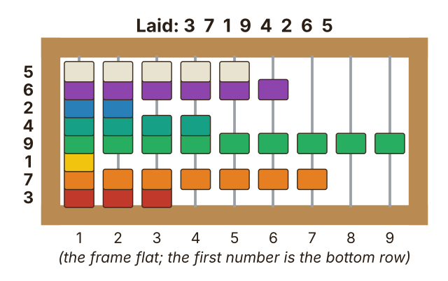
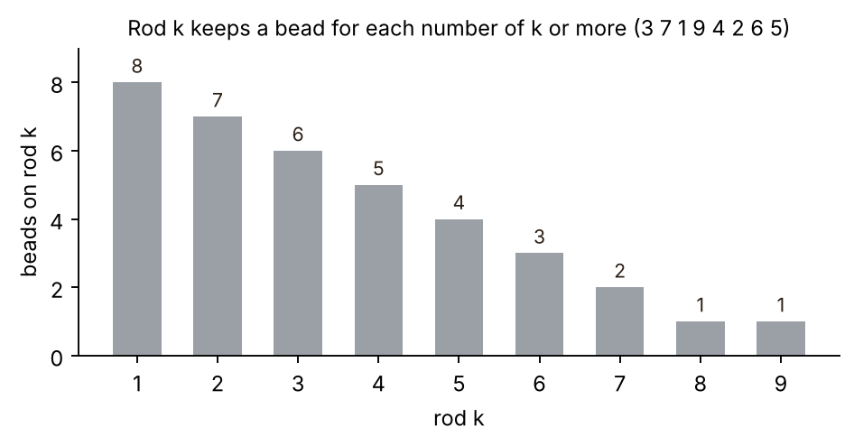
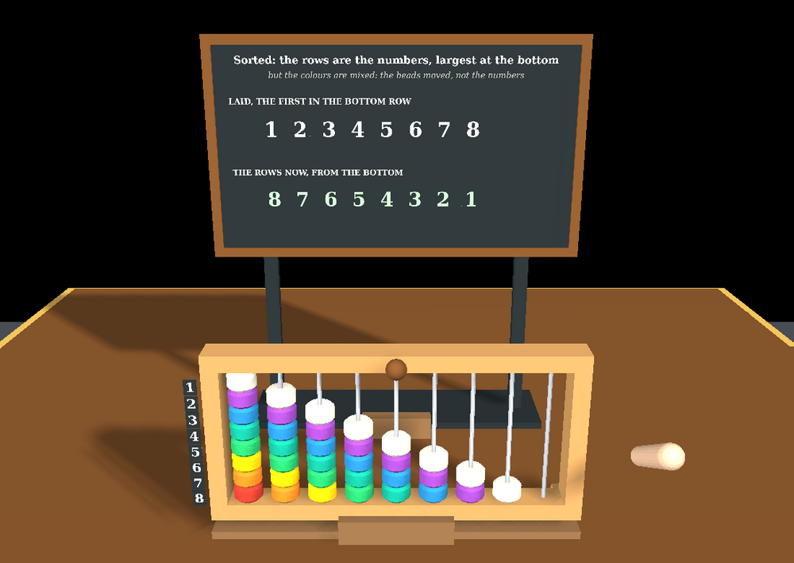
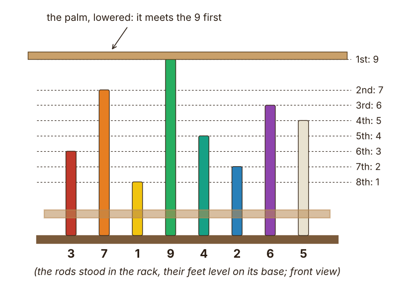
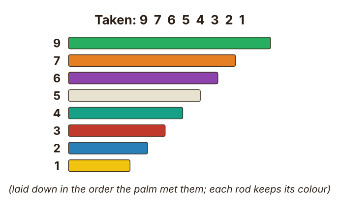
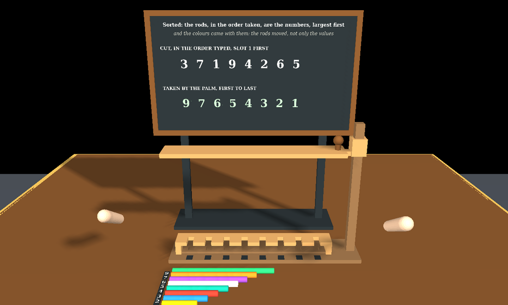

# The Bead Sort: a manual

`MANUAL.pdf` beside this file is a typeset copy of it. In Babbage's Hall,
press `H` at the bead sort to open it.

How the bead sort works and why it sorts, what it can and can't sort, and
how long it takes. Then the exhibit in the hall, and making one. Section 8
is the exhibit's second way, **the spaghetti sort**: the same numbers,
sorted by rods stood on end.

The pictures are drawn by `manual/make-figures.py` (and, for section 8,
`manual/make-figures-spaghetti.py`) with the exhibit's sizes and colours,
and sorted by the machine's own rule: on each rod the beads fall to the
bottom, none passing another; the palm meets the tallest rod first.

**The whole idea in one paragraph.** Write each number as a row of beads
from the left, one row under another, on vertical rods. Let go. Each bead
falls until it lands on the bead below it. On each rod the beads simply
pile up at the bottom, so rod 4 ends up holding one bead for every number
that was 4 or more. Read the rows from the bottom up: the first reaches as
far as the largest number, the next as far as the next largest. The
numbers are sorted, and nobody compared any two of them.

## 1. Laying the numbers

The frame has nine rods, numbered 1 to 9 from the left, and room for eight
rows of beads. A number from 0 to 9 is laid as a row: a bead on each of
rods 1 to n. So 3 is three beads, on rods 1, 2 and 3; 9 fills the row;
0 is an empty row. The first number goes in the bottom row (nearest the
hinge), the next above it, and so on.

The frame lies flat while the numbers are laid, so the beads stay where
they are put: nothing pulls them along the rods.

## 2. Turning it upright

Now turn the frame upright on its hinge. Gravity pulls every bead down its
rod, and it slides until it rests on the bead below it, or on the bottom
bar. A bead can't pass the one below it, but where a row below has no bead
on that rod, the bead falls through the gap.

Read the rows from the bottom: 9, 7, 6, 5, 4, 3, 2, 1. The numbers,
largest first.

Look at the colours. The bottom row holds a red bead, an orange one, a
green one and more: beads from several numbers. **The beads moved; the
numbers didn't.** No row is "the 9" that was laid: the bottom row is nine
beads long because nine rods each kept a bead at the bottom. A bead sort
sorts values. If each number had a name with it (sort these people by
age), the names would be lost.

## 3. Why it sorts

Look at one rod at a time. Rod k gets a bead from every row whose number
is k or more, and keeps them all, piled at the bottom. So the number of
beads on rod k is the number of numbers that are at least k.

Now read row r. It has a bead on rod k exactly when rod k holds at least r
beads, that is, when at least r of the numbers are k or more. Going along
the row from the left, that stays true until k passes the r-th largest
number. So row r reaches exactly as far as the r-th largest number: the
bottom row the largest, the second row the second largest. That is the
whole proof. Every rod counts for itself, at the same time.

This is close to a sort computers use, the counting sort, which counts how
many numbers are at least each value; here each rod does its own counting,
by gravity.

## 4. What it can't do, and what it costs

- **Only whole numbers, not less than 0,** each as many beads as its value:
  this frame takes 0 to 9, and at most eight of them.
- **It sorts values, not records.** As above: the beads mix.
- **It needs a bead for every unit of every number:** eight numbers up to
  9 need up to 72 beads. A thousand numbers up to a million would need a
  billion.
- **It is fast.** All the beads fall at once. However many numbers there
  are, the time is how long a bead takes to fall the frame's height: here,
  about a seventh of a second (10 cm), though the frame takes three
  seconds to turn. A
  computer imitating it must move each bead itself, and is slow.

Joshua Arulanandham, Cristian Calude and Michael Dinneen, at the
University of Auckland, described the bead sort in 2002 ("Bead-Sort: a
natural sorting algorithm", *Bulletin of the EATCS* 76), as an algorithm
found in nature: "gravity sort".

## 5. Mistakes to avoid

- **Don't leave a gap in a row.** A number's beads go on rods 1 to n with
  none missing; 3 as beads on rods 1, 2 and 5 is not 3, and the sort will
  give nonsense.
- **Turn it the right way up.** The rows are read from the bottom, where
  the beads land. Upside down, the beads fall the other way and the
  largest number ends at the top.
- **Sticky beads.** A bead must slide freely on its rod. If one sticks
  where it was laid, the rows below it are short a bead and above it have
  one too many. The exhibit counts every row and says so if they aren't
  sorted.

## 6. The bead sort in the hall

The bead sort stands in the west bay 3. Type up to eight digits and press
Return: the hand threads each number's beads onto its row (the frame
flat), lifts the frame by its knob and turns it upright, waits for the
beads to settle, and reads the rows. The slate shows the numbers as laid,
the rows as they are now, counted from the beads as they fall, and what
the hand is doing; green when the rows are the numbers sorted.

| Key | |
|---|---|
| `0`–`9` | a number, laid as the next row (up to eight) |
| `Return` | sort them |
| `Backspace` | the last number off |
| `R` | eight numbers at random, sorted |
| `C` | lay the frame down and take the beads off |
| `T` | the tour: 3 7 1 9 4 2 6 5; 5 0 5 2 8 2; 1 2 3 4 5 6 7 8 |
| `H` or `F1` | this manual |
| `I` | in the hall: the lectern's label close up, and `PgDn` turns its pages |

The beads are bodies on their rods, and they fall by physics; the rows are
read from where they end up. Threading the beads on and taking them off,
turning the frame, the slate and the counting are the script's. Resting
the mouse on a bead says which number it was laid in and which row it is
in now. The sliders set how fast the hand turns the frame, the beads'
friction on their rods (too much, and they don't fall: see `FINDINGS.md`),
and the simulation's speed.

On its own, outside the hall: `bpp -f bead-sort.lua`.

## 7. Making one

Every part is printed but the rods and the hinge's pin; `./make-stls.sh`
makes the STL files from `parts/bead-sort.scad`, each turned to lie on the
bed, and all fit a 200 mm printer.

| Part | Print | |
|---|---|---|
| `bead.stl` | 72 | eight colours, nine of each; a loose 3.6 mm hole |
| `bar-bottom-*.stl`, `bar-top-*.stl` | 1 each | the end bars, in halves; the bottom bar has the hinge's knuckles |
| `bar-side.stl` | 2 | |
| `foot-*.stl` | 1 each | the foot in halves, with the stop |
| `rest.stl`, `knob.stl` | 1 each | |

Buy nine 3 mm steel rods, 116 mm long, and a 3 mm steel pin, 264 mm long.

1. Glue each end bar's halves. Push the rods into the bottom bar, the top
   bar onto them, and glue the side bars between.
2. Glue the foot's halves; put the frame's knuckles outside the foot's and
   push the pin through.
3. Glue on the knob, and set the rest under the top bar.
4. A bead must fall freely on a rod held upright: open the holes to 3.8 mm
   if they stick.

`README.md` has the details, and `FINDINGS.md` what was measured in the
simulation.

## 8. The second way: the spaghetti sort

In the hall, `Tab` at the bead sort steps on to its second way (on its
own: `BS_WAY=spaghetti bpp -f bead-sort.lua`). The same numbers, 0 to 9,
up to eight of them, sorted another way.

**The whole idea in one paragraph.** Cut a strand of spaghetti to the
length of each number. Gather them in your fist and stand the bundle on
the table, so that their lower ends are level. Lower your other hand, flat,
onto the top: the first strand it touches is the longest. Take it out and
lay it down. Lower your hand on: the next it touches is the next longest.
Laid side by side in the order you took them, the strands are the numbers,
largest first. A. K. Dewdney described it in his *Computer Recreations*
column in *Scientific American* in June 1984, with other "analogue
gadgets"; he called such ideas folklore.

### Cutting and standing the rods

Here the strands are printed rods, 8 mm across. A number n is a rod
30 + 12 n mm long: 0 is 30 mm, 9 is 138 mm. (The 30 mm is so that 0 has a
rod to hold; adding the same length to every rod changes no comparison.)
The hand cuts a rod for each number, in the order typed, and drops it into
the next slot of the rack. The rack is the fist and the table: a base the
rods stand on, so that their feet are level; a notch on the base for each
foot; and a comb whose slots hold the rods upright and let them out toward
you.

### Lowering the palm

The palm is a flat board on a post. The hand lowers it slowly. With every
foot on the base, a longer rod stands taller, so the palm meets the rods in
order of height: the first it touches is the largest number. The hand
takes that rod out of its slot (toward you, its top sliding out under the
palm) and lays it in the row in front; the palm goes on down to the next.
When the last rod is out, the row is the numbers sorted.

Two equal numbers stand equally tall, and the palm meets both at once
(5 0 5 2 8 2 in the tour has two of these): the hand takes one, then the
other at once, the palm no lower. Either order is right.

### Why it sorts, and what it is good for

The palm compares every rod with every other at once: whichever stands
tallest stops it, however many rods there are. That is the trick: the
hand, the rods and the table are a parallel machine for finding the
largest. Cutting the rods takes a step for each number, and so does taking
them out, so the work grows only as the count; a computer comparing
numbers two at a time needs more, about n log n comparisons. (The catch:
a bigger bundle needs a bigger hand, and a finer difference a steadier
one.)

**Look at the colours.** Each rod keeps the colour of its slot, and the
row comes out in order, colours and all. The bead sort's beads move one by
one and mix; the spaghetti sort moves each number whole. If each number had
a name with it (sort these people by age), the spaghetti sort would keep
the names.

### Mistakes to avoid

- **Level feet.** The palm reads heights, not lengths: a rod standing on a
  crumb, or held up in its slot, reads longer than it is. The rack's base
  is what makes height mean length.
- **A level palm.** A palm lower at one end meets the rods at that end
  early. Here a difference of one is 12 mm across at most 182 mm of rack,
  so a palm out of level by 3.8 degrees could take a 4 before a 5; sooner
  than that, at 2.8 degrees, its low end grounds on the comb before it
  reaches a short rod at the other end (`FINDINGS.md`).
- **Lower it gently.** The palm stops on the rod it meets; pressed hard, a
  thin rod bends or tips, and spaghetti breaks.

### The spaghetti sort in the hall

Type up to eight digits and press Return. The slate shows the numbers as
cut (slot 1 first), the numbers as the palm took them, and what the hands
are doing; green when they are sorted. The digit on the base under each
slot is its rod's number, and the digit at the end of each rod laid in the
row is its number.

| Key | |
|---|---|
| `0`–`9` | a number, a rod cut for it (up to eight) |
| `Return` | sort them: the rods stood in the rack, the palm lowered |
| `Backspace` | the last number off |
| `R` | eight numbers at random, sorted |
| `C` | the rods away, the palm up |
| `T` | the tour: 3 7 1 9 4 2 6 5; 5 0 5 2 8 2; 1 2 3 4 5 6 7 8 |
| `H` or `F1` | this manual |

The rods are bodies that stand in the rack by physics, and the palm is a
body that the hand lowers on a slide; which rod it touched is read from the
contact between them. Cutting the rods and dropping them in, taking them
out and laying them down, the slate and the digits are the script's. The
sliders set how fast the palm comes down, the rods' friction, and the
simulation's speed. Resting the mouse on a rod says its number, its length
and where it is.

### Making one

`./make-stls.sh` makes these too, from `parts/spaghetti-sort.scad`:

| Part | Print | |
|---|---|---|
| `rod-0.stl` … `rod-9.stl` | as needed | 8 mm across, 30 + 12 n mm long, the number on the foot; two of each is a good set (or cut 8 mm dowel) |
| `base-left.stl`, `base-right.stl` | 1 each | the base in halves, with the feet's notched strip |
| `comb-left.stl`, `comb-right.stl` | 1 each | the comb in halves, slots open toward you |
| `post.stl` | 1 | the palm's post |
| `palm-left.stl`, `palm-right.stl`, `palm-knob.stl` | 1 each | the palm in halves (the right one with its sleeve) and its knob |

Glue the base's halves, the comb onto its cheeks over the notches, and the
post at the base's right end; glue the palm's halves and the knob, and
slide the sleeve onto the post. Nothing is bought. `README.md` has the
details.
