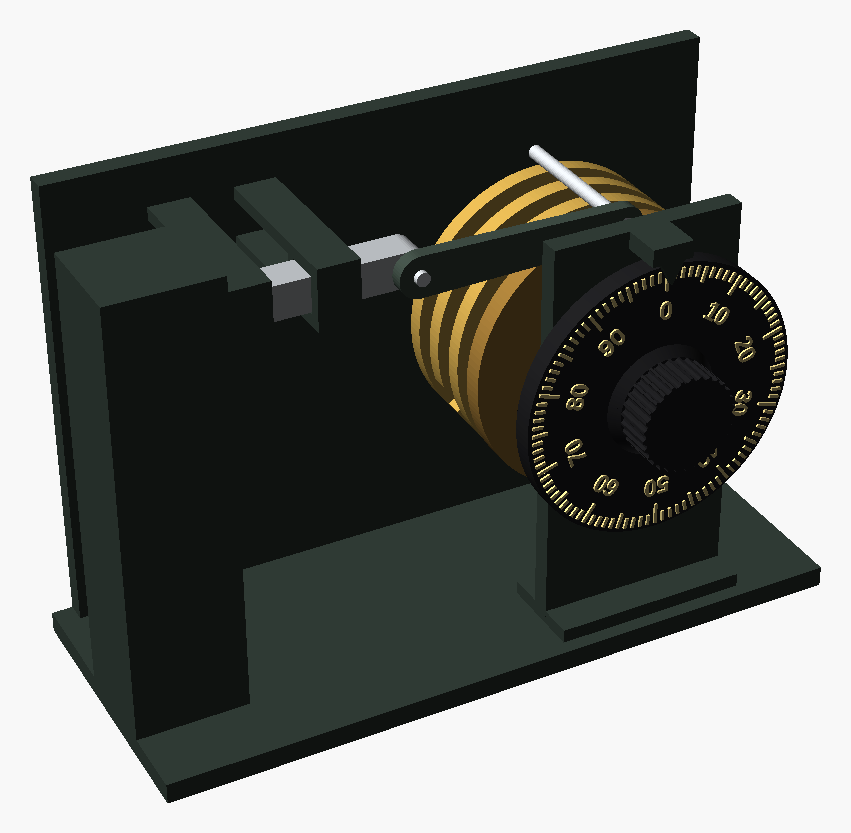
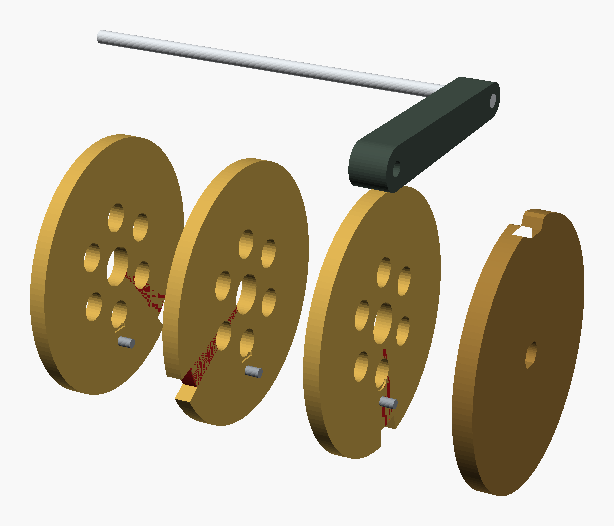
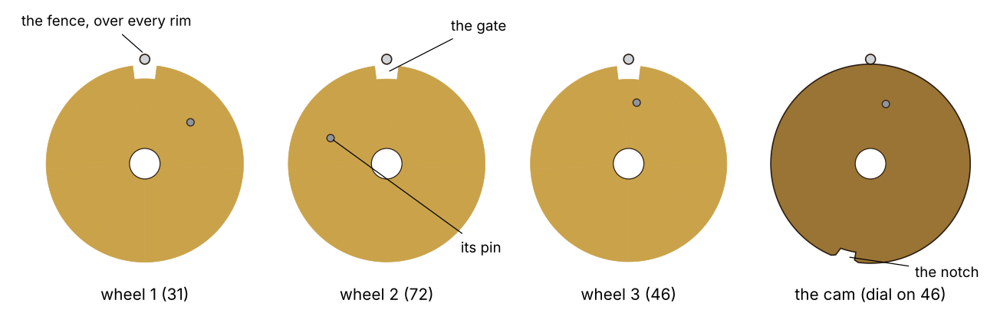
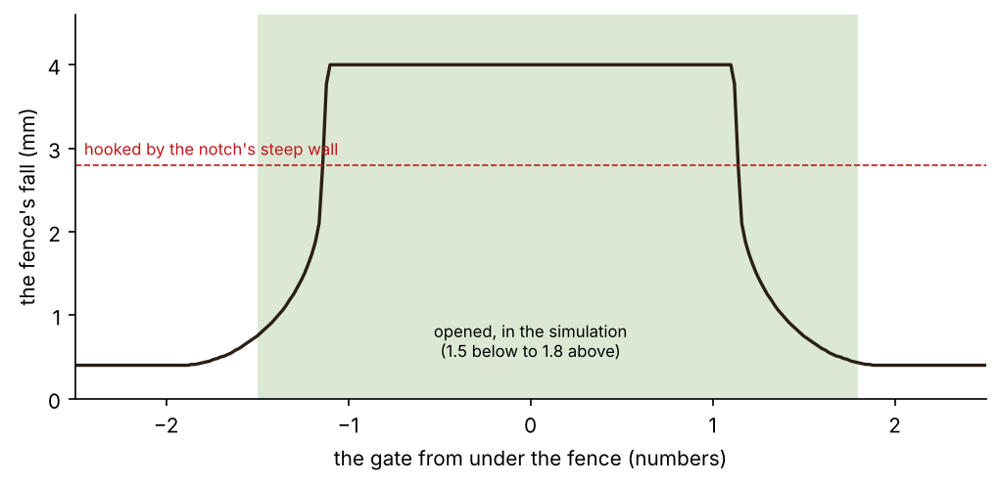
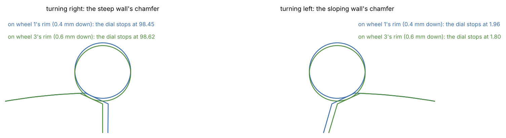
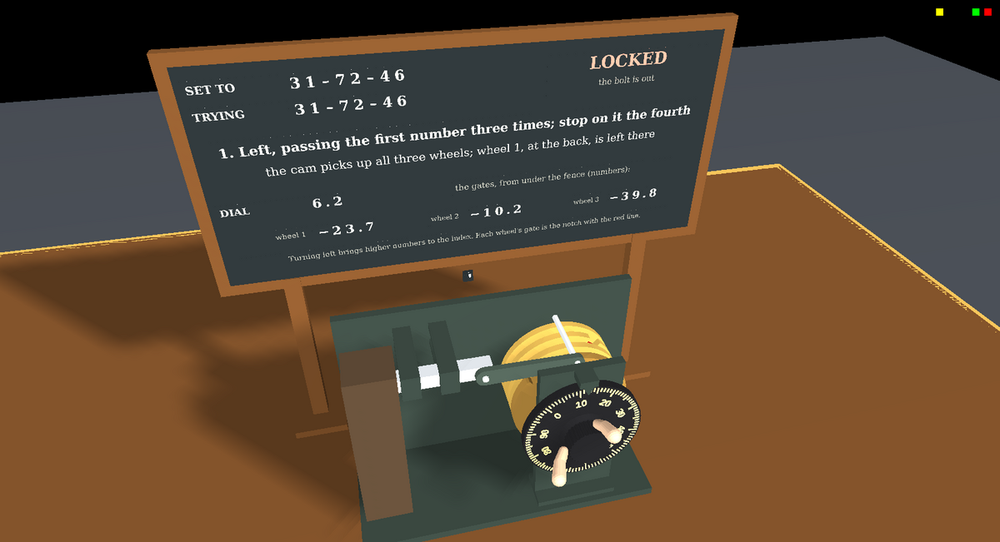

# The Combination Lock: a manual

`MANUAL.pdf` beside this file is a typeset copy of it. In Babbage's Hall,
press `H` at the combination lock to open it.

How a dial combination lock works, how to dial a combination and why the
rules are what they are; how exact you must be, and which combinations a
lock can't take; how a safecracker reads the combination off the lock;
then the exhibit in the hall, and making one.

The wheels, the cam and the chart of the wheels turning in these pictures
are drawn from the exhibit's own `lock.lua`: the same outlines its bodies
are made of, and its model of the wheels, turned as the rules say. The
pictures of the lock are OpenSCAD's drawings of the printed parts
(`manual/make-figures.py`).

**The whole idea in one paragraph.** Behind the dial three wheels turn
loose, each with a notch in its rim, its gate. They aren't fixed to the
dial: a pin on each picks up the next only after nearly a whole turn. So
by turning the dial back and forth, and counting turns, you can leave each
wheel where you want it, one at a time. A bar, the fence, lies across all
three rims; only when every gate is under it can it fall in, and only then
can the bolt be drawn. The lock tests a number, three times over, with
nothing but where it has left its wheels.

## 1. The lock

From the front to the back:

- **The dial**, numbered 0 to 99 round its edge. The numbers go up
  clockwise round the dial, so turning it **left** (anticlockwise) brings
  higher numbers to the **index** at the top.
- **The spindle** runs from the dial through the door (here, the front
  standard) to **the drive cam**, which turns with the dial. In the cam's
  back is a steel pin, and in its rim a **notch**.
- **Three wheels** behind the cam, loose on a fixed post, with spacers
  between them. Each has a **gate** in its rim and a steel pin through it,
  sticking out both sides. Wheel 3 is next to the cam, wheel 1 at the back.
- **The lever**, pivoted on the end of the bolt, carries **the fence**, a
  steel rod lying across the rims of all three wheels and the cam. A spring
  presses it down. The cam is a little bigger than the wheels, so the fence
  rests on the cam, just clear of the wheels.
- **The bolt** slides in its guides; thrown, its end is in **the keeper**
  on the door's frame, and the door is locked.

## 2. One dial, three wheels

Turn the dial, and the cam turns with it. Its pin comes round to wheel 3's
pin and pushes it: from then on wheel 3 turns with the dial. Keep turning,
and wheel 3's pin comes round to wheel 2's, and then wheel 2's to wheel
1's. Each **pick-up** takes up to a whole turn (less the width of two
pins, 1.9 numbers each here).

Turn back the other way and the cam's pin leaves wheel 3's pin where it
was: wheel 3 stays put until the cam's pin has gone all the way round to
its other side, nearly a turn. That **lost motion** is the whole trick: a
wheel moves only while the dial pushes it, and stays where it was left.

## 3. Dialling a combination

The lock in the hall is set to **31-72-46**. Wheel 1, at the back, holds
the first number; wheel 2 the second; wheel 3 the third.

1. **Left, passing 31 three times; stop on it the fourth.** However the
   wheels were left, three turns pick up all three. Then all turn together,
   and you stop with 31 at the index: wheel 1's gate is under the fence.
2. **Right, passing 72 twice; stop on it the third.** Turning back leaves
   wheel 1 where it is. After nearly a turn the cam picks up wheel 3 from
   its other side, after another wheel 2; you stop on 72, and wheel 2's gate
   is under the fence. Wheel 2 never comes round to wheel 1.
3. **Left, passing 46 once; stop on it the second.** Wheels 1 and 2 stay;
   the cam picks up wheel 3, and you leave it on 46.
4. **Right, until the dial stops.** The cam's notch comes round under the
   fence. If every gate is there too, the fence falls in, the notch catches
   it, and the dial draws the bolt back as you turn, until the bolt stops:
   here the dial stops near 94. The door is open.

"Passing it three times" means the number comes under the index three
times before you stop on it the fourth; the place you start from doesn't
count. The turns are counted that generously so that it never matters
where the wheels were.

In the chart, wheel 3 (green) starts moving first, after under a turn;
wheel 2 next; wheel 1 last, about 210 numbers in. At the end of move 1 all
three move together and wheel 1 (blue) stops at 0. In move 2 wheel 1 stays
at 0 while wheels 3 and 2 go round; wheel 2 (red) stops at 0. In move 3
only wheel 3 moves.

## 4. Opening and closing

The fence rests on the cam, 0.4 mm above the wheels' rims. When the cam's
notch comes under it, it can fall, but only as far as the wheels let it:

- **Every gate under the fence:** it falls 4 mm, into the gates and the
  notch. Turning right, the notch's steep wall pulls the fence, the lever
  and the bolt. The wheels, with the fence in their gates, are pushed round
  a few numbers too; they don't matter now.
- **Any gate not under it:** that wheel's rim holds it up. The notch's
  chamfered edge lifts it out again, and the dial turns on as if nothing
  had happened. Nothing obvious tells you which wheel was wrong (a real
  lock leaks a little, through the feel of the dial, and safecrackers
  learn to listen to it).

**To lock again,** turn the dial left. The notch's other wall pushes the
fence back the other way, throwing the bolt out into the keeper; when the
bolt can go no further, the fence rides up out of the notch. Turn on a
couple of turns, and the wheels are scrambled: the combination can't be
read off the lock.

## 5. How exact?

A gate needn't be exactly under the fence. The gates are wider than the
fence, so it still falls far enough to be hooked when a gate is up to 1.14
numbers off, in this lock's geometry; and in the simulation a little more,
because the round fence, pressing on the edge of a gate that is nearly
there, turns that wheel the last bit itself (it opened up to 1.5 numbers
below and 1.8 above). Two numbers off, it never opens.

So each of your numbers may be one out: 30, 31 or 32 for the first, and so
on. Of the million combinations, **27 open this lock**, and a thief trying
them all has about 37,000 to try, not a million. Matt Blaze estimated a
real three-wheel safe lock's at 22,000 to 111,000.

## 6. Choosing a combination

Not every combination can be used.

- **The second number must not be 0 to 11 above the first.** Setting it,
  wheel 2 would travel more than a turn and come round to wheel 1, and
  carry it off its number.
- **The third must not be 0 to 7 below the second**, for the same reason:
  wheel 3 would carry wheel 2 off.
- **The last must not be 90 to 99, the forbidden zone.** Turning right to
  open, the cam must reach the fence and draw the bolt before its pin comes
  round to wheel 3's. From a last number just below 0 that is nearly a
  turn, and the cam picks up wheel 3 first, taking its gate away from the
  fence.

`lock-test.lua` checks every one of the million: these rules are exact for
this lock (with its 1.9-number pins). Within them, nothing else can go
wrong: no combination opens early.

## 7. Mistakes to avoid

- **Going past a number.** If you turn past the number on the last pass,
  don't turn back to it: turning back leaves the wheel where it is, past
  its place. Start again from step 1.
- **Miscounting.** Counting the number you start on as a pass, or losing
  count, leaves a wheel a whole turn wrong. Start again.
- **Turning back too early in step 4.** Turn right until the dial stops of
  itself, firmly but without forcing.
- **A forbidden or too-close combination.** See section 6: the lock will
  never open to it.

## 8. The safecracker's way

A lock that is never told its combination can still give it away. In the
hall, press `Tab` at the lock: a second lock, the same, set to a
combination the safecracker isn't told.

**The leak.** No two wheels are exactly alike. Here wheel 1 is 0.1 mm
larger in radius than wheel 2, and wheel 2 than wheel 3 (on purpose, and
more than careful printing would leave them, so it can be seen). When the
cam's notch comes under the fence, the fence drops off the cam, but only
onto the largest wheel whose gate isn't under it. Rock the dial gently,
first right, then left, and it stops each way where the fence meets one of
the notch's chamfered walls: the **contact points**. If the fence is
lower, it meets the walls further in, and the two come closer together.

So when a gate comes under the wheel that holds the fence up, the fence
drops onto the next wheel, 0.1 mm lower, and the gap between the contact
points narrows by 0.16 numbers. Safecrackers learn to read differences
like that off the dial, and graph them just as here; the exhibit's hand
reads them to a hundredth.

1. **Park all three wheels together on a number**: left four times to it
   (as for a first number). Turn right to the notch and feel the two
   contact points; write down the gap. Then left to the next number, every
   2.5 numbers round the dial. The gap stays the same, but near one number
   it is narrower: there wheel 1's gate (the largest wheel's) is under the
   fence. Then find the narrow stretch's two edges, going on a half number
   at a time from the last reading outside it until it narrows, and from
   the last reading inside until it widens again. Halfway between the edges
   is wheel 1's number, 31.
2. **Leave wheel 1 there; park wheels 2 and 3 together**: left four times
   to 31, then right to each number in turn, feeling the contact points
   from the other side each time. Now wheel 2 holds the fence up (wheel 1's
   gate is under it), and the gap narrows at wheel 2's number, 72. Wheels 2
   and 3 can only be taken round from just below 31 to just above it:
   further, and wheel 2 would carry wheel 1 off. (Where an edge falls in
   the part of the dial the hand can't feel from, the other edge and the
   narrowing's width, the first graph's, give the middle: every gate is cut
   the same.)
3. **The last wheel needs no graph**: dial 31 and 72 by the rules, then try
   every second number for the third, turning right to open each time; a
   number one off still opens it. Start just above the second number (74)
   and go on round, each time turning left from where the last try left
   wheel 3, two more: wheel 3 can't be taken past 72 without carrying wheel 2
   off, so the tries end just below it, at 64. The forbidden zone, 90 to 99,
   is passed by. The lock opens on 46.

**The whole dial.** The exhibit's safecracker stops each graph at the
first reading back up after the narrowing. A real one graphs the whole
dial, and again from the other side: his readings scatter more than
these (0.01 numbers against a narrowing of 0.16), false gates and worn
wheels give narrowings that aren't the gate, and the deepest one only
shows once he has them all. Here, with all three wheels parked together,
only one wheel can narrow the gap, so the rest of the graph would only
show it level.

The slate keeps the combination hidden (`??-??-??`), shows what has been
found, the contact points and their gap as each is felt, and draws the
graphs in chalk, a dot a number: white for the first, green for a closer
look, orange for the second. `F` feels the contact points once, wherever
the wheels are. The simulation's gaps agree with the model's to 0.02
numbers (`FINDINGS.md`).

**Listening.** Contact can be heard as well as felt. A contact
microphone on the case picks up a click as the fence meets a wall, and
safecrackers have used amplifiers for that. The exhibit plays one each
time a wall stops the gentle dial: a bright click for the steep wall
(turning right), a duller one for the sloping wall (turning left). The
clicks tell when contact happens; the reading is still the dial at that
moment, and a 0.16-number narrowing changes the time between the clicks by
only a twentieth of a second. So after each pair the exhibit also sounds a
tone pitched by the gap: E (330 Hz) for the gap on wheel 1's rim, a
fourth higher for each 0.159 numbers narrower, so A when wheel 1's gate is
under the fence and D when wheel 2's is too. The tone is the exhibit's,
made to be heard; a real lock makes only the clicks. `F` plays the clicks
alone. In the hall, the lock is heard only while you're at it.

Some numbers can't be graphed this way. From 93 round to 7 the dial
would have to come round to the wheels again while feeling; a real
safecracker would graph them from the other side. And the method only
works because the wheels differ: lockmakers answered with wheels cut to
finer tolerances, **false gates** that give false narrowings, and levers
kept off the wheels until the dial is at one point. Sargent & Greenleaf's
best locks are tested against expert manipulation for 20 man-hours.

## 9. The lock in the hall

The operator's hand turns the dial as a person does, slowing to stop on a
number, and the slate shows the combination the lock is set to, the one
being tried, each step, the dial's reading, where each wheel's gate stands
from under the fence (in the dial's numbers), and whether the bolt is out.
Watch the gate numbers: in each move one of them comes to 0.0 and stays.
`G` shows the gates from above, where the fence lies across them: each
gate's floor is painted red.

| Key | |
|---|---|
| `0`–`9` | a combination: six figures (31 72 46), then `Return` dials it and turns right to open |
| `Backspace` | a figure off |
| `L`, `R` | the dial one number left, right (for dialling by hand) |
| `Space` | right until the dial stops: opens the lock if the fence can fall |
| `C` | close: left two turns, the bolt thrown, the wheels scrambled |
| `M` | the camera close to the dial and its index; again: back |
| `G` | the camera above the gates under the fence; again: back |
| `T` | the tour: the lock's own combination (it opens), the last number five off (it doesn't), every number one off (it opens). In the safecracker's way, its tour (section 8) |
| `F` | (the safecracker's way) feel the contact points, the wheels where they are (the clicks, no tone) |
| `H` or `F1` | this manual |
| `Tab` | in the hall: on to the safecracker's way, and on |
| `I` | in the hall: the lectern's label close up, and `PgDn` turns its pages |

The sliders set the hand's speed, the wheels' drag and the simulation's
speed. The slate warns before you dial a combination that breaks the rules
of section 6, and then the lock does what it does.

## 10. Making one

Every part but the steel pins, the fence, the spindle, a small spring and
a wave washer can be printed; the wheels' gates are cut for the
combination you choose, and their sizes differ by 0.2 mm across, for the
safecracker's way. The README lists the parts, what to buy, and how to
put it together, and `FINDINGS.md` what was measured in building it.
