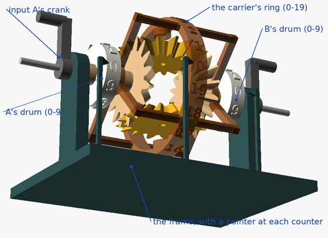
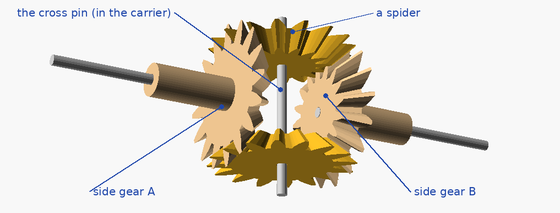
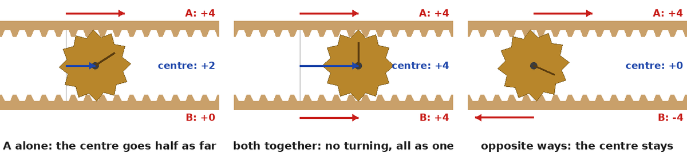
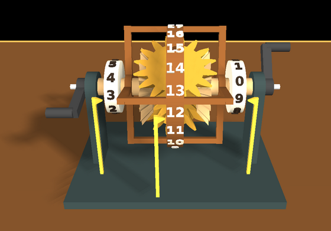

# The Differential: a manual

`MANUAL.pdf` beside this file is a typeset copy of it. In Babbage's Hall,
press `H` at the Differential to open it.

How four bevel gears add and subtract: the parts, why the carrier always
turns by the average of its two inputs, how to read the counters, what it
was used for, and how to make one. Then the exhibit in the hall.

The pictures of the machine are OpenSCAD's drawings of the printed parts,
put together as in `parts/differential.scad`, the same shapes the
simulation turns (`manual/make-figures.py`, `manual/views.scad`).

**The whole idea in one paragraph.** Put a gear between two racks and hold
its axle in a carriage. Move one rack and the gear rolls along the other,
taking the carriage half as far; move both and the carriage goes half as far
as the two together. The carriage always stands at the **average** of the
two racks. A differential is the same thing bent round into a circle: two
side gears for the racks, spider gears for the rolling gear, and the
carrier round them for the carriage. Count the carrier's turn at twice the
scale, and it shows the **sum**.

## 1. The machine

Two inputs, A on the left and B on the right, each a rod with a **crank**
outside and a **number drum** (0 to 9) inside. Between them is the
**carrier**, a ring with twenty numbers round its rim (0 to 19). Each
counter is read at the front, where its pointer points.

Inside, each input's rod ends in a **side gear**. Between the two side
gears, meshing with both, are two **spider gears** on a **cross pin**; the
pin goes through the carrier, so the carrier must turn when the spiders'
pin goes round. All four gears are alike: 16 teeth, 60 mm across, at 45
degrees, so each meshes square with its neighbours.

## 2. Why the carrier turns by the average

Think of it flat first. A gear meshes with a rack above (A) and a rack
below (B), and its centre is held by a carriage.

- **A alone.** Move A along by 4 teeth and hold B: the gear rolls on B,
  and its centre goes 2, half as far. (The top of a rolling wheel moves
  twice as fast as its centre.)
- **Both the same way.** Move A and B by 4: nothing has to roll, the gear
  is carried along with both, and its centre goes 4.
- **Opposite ways.** A by 4 one way, B by 4 the other: the gear only spins
  in place, and its centre stays.

In every case the centre goes **(A + B) / 2**: it is the average of the
racks, whatever they do.

The differential is this, bent round. The side gears are the racks, the
spiders the rolling gear, and the carrier the carriage, so

    carrier = (A + B) / 2

counted in turns. Turn A alone and the spiders roll round the held B,
carrying the ring half as far. Turn both the same way and the whole
cluster turns as one, the spiders not spinning on their pin. Turn them
opposite ways and the spiders spin while the ring stands still. (There are
two spiders only to balance the load; one would do.)

## 3. Reading it

The drums count ten units to a turn. The ring has twenty numbers round it,
so a unit on the ring is half as far round as a unit on a drum: the ring,
turning half as far, counts the units of both. **The ring reads A + B.**

- To **add**: turn A forward to the first number, B forward to the
  second, and read the ring. 3 on A, 4 on B: the ring shows 7.
- To **add more**: turn either input on. From 3 + 4, five more on B makes
  B 9 and the ring 12.
- To **subtract**: turn an input back. From 3 + 9 = 12, two back on A:
  A 1, ring 10.
- **A − B**: set A forward and B *back*; the ring shows A − B (the
  inputs turned opposite ways, the ring the difference). If B is the
  larger, the ring goes back past 0: 2 − 5 shows 17, which is 20 − 3.

The ring reads the sum of the inputs' *turns*. A drum shows only the units
(0 to 9) and the ring counts round to 19; if an input has been turned past
9, read the ring as the sum of how far each input has gone, not of the
numbers on the drums. 9 + 9 = 18 is the most it shows without going
round.

Read each counter straight at its pointer. The ring may stand a little off
a number: the gears have a little play (backlash) between their teeth, and
it is read to the nearest.

## 4. Worked: the exhibit's tour

What the simulation read, at the end of each step, from where the gears
lay:

| Step | A | B | Ring | A + B |
|---|---|---|---|---|
| 3 + 4 | 3.00 | 4.00 | 6.99 | 7 |
| add 5 to B | 2.99 | 8.99 | 11.98 | 12 |
| take 2 from A | 1.00 | 9.00 | 10.00 | 10 |
| both back to 0 | 0.00 | 0.00 | 0.00 | 0 |

The hundredths are the teeth's play: the ring is pushed round only by the
teeth, never set.

## 5. What differentials were for

- **The car.** In the back axle the engine drives the carrier, and the two
  wheels are the side gears: (left + right) / 2 = the carrier. Going round
  a corner, the outer wheel turns faster and the inner slower, and the
  differential lets them, while the average stays what the engine gives.
  (Lift one wheel and it spins twice as fast while the other stands.)
- **Calculating.** Fire-control computers of the Second World War added and
  subtracted ranges, speeds and angles with dozens of differentials, every
  quantity a shaft's turn. The Differential Analyser, further on in the
  hall, adds with them too. It is the analog machines' adder.
- **The south-pointing chariot** of ancient China kept a figure pointing
  one way however the cart turned, by the difference of its wheels' turns;
  it is usually rebuilt with a differential.

## 6. Mistakes to avoid

- **Reading the ring as the average.** It turns by the average, but its
  numbers are drawn at twice the scale: it reads the sum.
- **Holding one input loosely.** When you turn A, B must stay where it is.
  If B is free to turn, the spiders turn it backward instead of rolling the
  carrier. (In the exhibit the hand holds the other input.)
- **Going past 9 on a drum** and then adding the drums' numbers: the ring
  is right, the drums show only the units.
- **Turning backward to subtract and forgetting which way is back:** the
  numbers on the drum go down.

## 7. The Differential in the hall

The Differential stands in the west bay 4. A hand turns the inputs, one
at a time, holding the other; the carrier and the spiders move only as the
teeth push them.

| Key | |
|---|---|
| `1` / `Q` | input A: one unit forward / back |
| `2` / `W` | input B: one unit forward / back |
| `0` | both back to 0 |
| `T` | the tour: 3 + 4, add 5 to B, take 2 from A, back to 0 + 0 |
| `H` or `F1` | this manual |
| `I` | in the hall: the lectern's label close up, and `PgDn` turns its pages |

The four gears are the printed ones, each simulated as its body and its
sixteen teeth, and they turn each other by their teeth alone (friction 0.3,
a slider). The sliders set the friction, the simulation's speed and the
hand's turning rate. Resting the mouse on a part says what it is.

On its own, outside the hall: `bpp -f differential.lua`.

## 8. Making one

`./make-stls.sh` makes the parts from `parts/differential.scad`, each
turned to print without supports (PLA, 0.2 mm layers, 50% infill).

| Part | Print | |
|---|---|---|
| `side.stl` | 2 | a side gear with its hub, printed teeth down |
| `spider.stl` | 2 | the spiders |
| `carrier-half.stl` | 2 | the carrier, glued at the ring's middle |
| `drum.stl` | 2 | the input counters (paint the raised numbers) |
| `crank.stl` | 2 | mounted mirror images, the handles outward |
| `frame.stl` | 1 | base, posts and pointers |

You also need two 5 mm steel rods about 75 mm long (the inputs), one about
100 mm (the cross pin), glue, and a little grease for the teeth.

1. Glue each side gear on its rod.
2. Thread the carrier's halves over the hubs, put the spiders on the cross
   pin between them, and glue the halves together.
3. Slide the drums onto the rods, and the rods through the posts.
4. Turn everything to 0 at the pointers, then glue the drums and the cranks
   to the rods, each crank's handle pointing outward.

`README.md` has the details, and `FINDINGS.md` what was measured in the
simulation.
