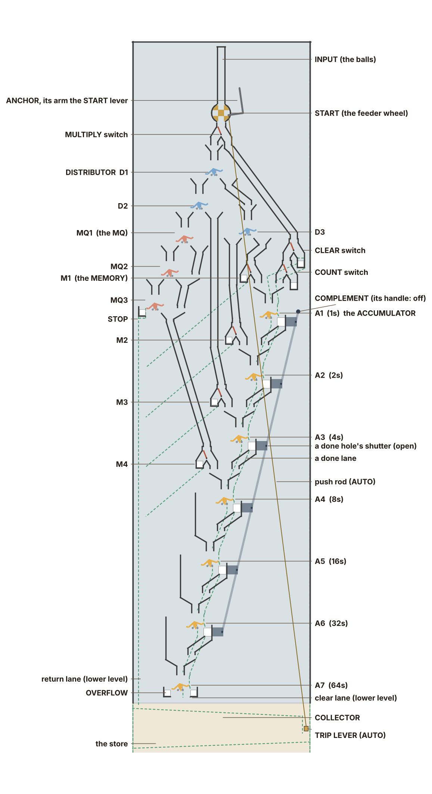
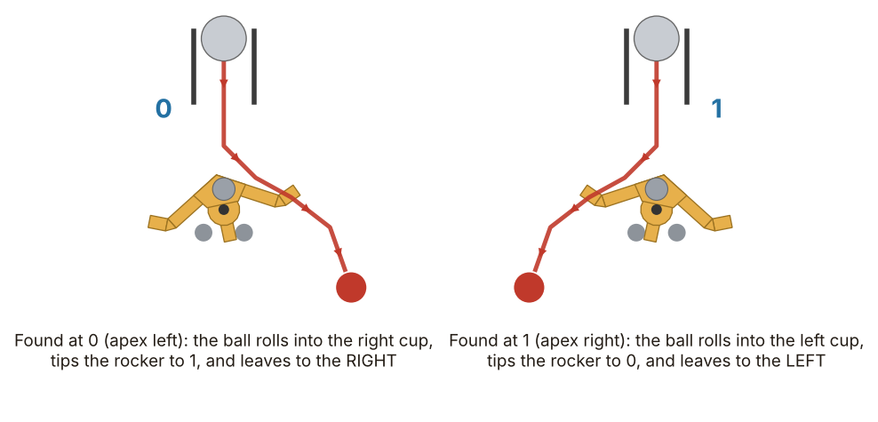
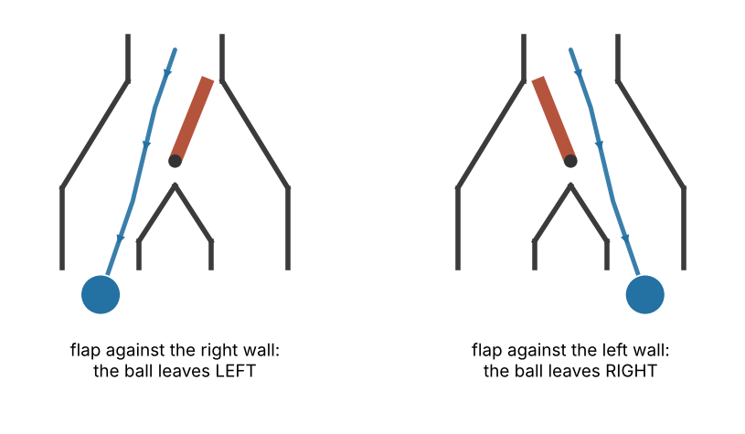
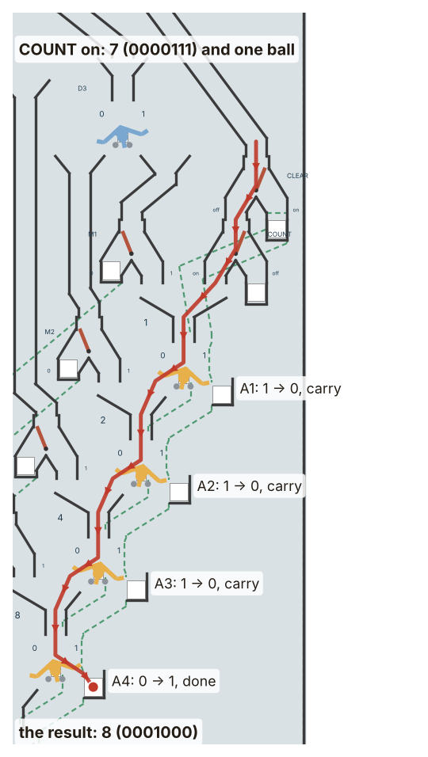
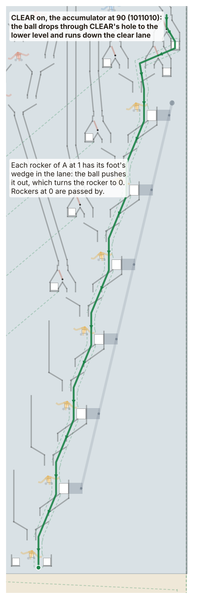
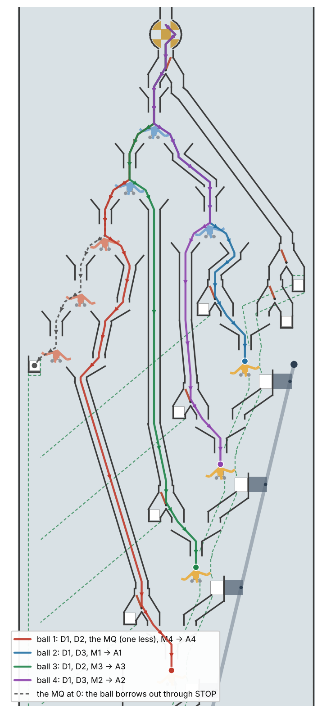
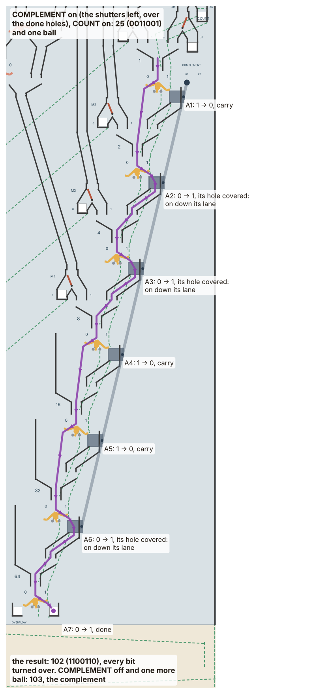
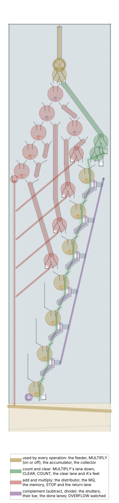

# The Digi-Comp II: an illustrated manual

`MANUAL.pdf` beside this file is a typeset copy of it.

How Babbage's Hall's Digi-Comp II computes, operation by operation: count,
clear, add, multiply, complement, subtract and divide, and what follows
from them, and running by itself (AUTO), with the parts each one needs, for
anyone who wants to build only some of it.

Every picture of the board is drawn from `digicomp2-geometry.lua`, the same
numbers the simulation and the printed parts use (`manual/make-figures.sh`
redraws them); only the arrows and labels are added. Where this board does
a thing differently from E.S.R.'s, the original's way is given too, from its
manual (Evil Mad Scientist's copy:
cdn.evilmadscientist.com/KitInstrux/DCII-manual.pdf).

**The whole idea in one paragraph.** A flip-flop is a rocker that a ball
always tips over, and the ball leaves on the side the rocker used to read.
Chain them so that a ball leaving one side goes on to the next, and a ball
adds one in binary, carrying as it goes: that is the accumulator. Let a
set of switches (the memory) choose where balls go into it, and they add a
number. Let three flip-flops (the distributor) deal the balls out to those
switches in turn, and every four balls add the memory once. Let three
more (the MQ) count those turns down, and stop when they run out, and the
machine multiplies. Cover the holes where balls finish, so a ball goes on
through every flip-flop and turns each one over, and the machine finds a
number's complement, which subtracts. Everything else on the board is lanes
and holes.

**Contents**

1. The parts: the flip-flop, the switch, the registers, reading binary
2. Counting
3. Clearing
4. Adding
5. Multiplying, and what else that does
6. The complement: subtracting, counting out, dividing; running by itself (AUTO)
7. Which parts each operation needs, and building only part of it
8. Settings at a glance
9. Programs: the operator's part, written down

## 1. The parts



The board slopes toward you at 15 degrees, so a ball let go at the top
rolls down it. It has two levels. The balls compute on the **upper
plate**. A ball that has finished its work drops through a hole to the
**lower level** and rolls under everything else to the **collector** at the
bottom. Every ball ends there.

There are only two kinds of moving part, the flip-flop and the switch.

### The flip-flop



A **flip-flop** is a rocker on a pin: a roof with a cup at each end, a small
steel ball pressed in under its apex for weight, and a tail that rests on
one of two stop pegs. Its weight sits a little above the pin, so it falls
over to one side or the other and stays there. That is one bit of memory:
**apex right reads 1, apex left reads 0** (the 0 and 1 are printed on the
plate on either side of each apex).

A ball rolling down onto it meets the roof on its raised side, rolls into
that side's cup, and its weight tips the rocker over; at the end of the
swing the cup tips the ball out. So **every ball flips the rocker**, and
**leaves on the side the rocker used to read**:

| The rocker read | It now reads | The ball leaves |
|---|---|---|
| 0 | 1 | to the right |
| 1 | 0 | to the left |

That is all a flip-flop does. What it is used for depends on where its two
exits lead. All thirteen on this board are the same printed part.

### The switch



A **switch** is a flap on a pin between two outlets, set by hand. Its free
end rests against one wall of the inlet and closes the outlet on that
side. A ball only pushes the flap harder against the wall and leaves by the
other outlet, so the switch stays as it was set. Each switch has an "on"
side, printed on the plate.

### The registers and switches

| Name | What it is | What it does |
|---|---|---|
| **START** | the feeder: a wheel with four notches under the **INPUT** channel of waiting balls, turned by a weight and held by an anchor | each push on the START lever (the anchor's arm) lets the wheel a quarter turn round: one ball out |
| **AUTO/MANUAL** | a latch pin: the push rod's crank, from the trip lever at the bottom, locked to the anchor or swinging idle | AUTO: each ball reaching the bottom lets the next go. MANUAL: one ball per push |
| **MULTIPLY** | a switch | on: the ball goes to the distributor. Off: down to CLEAR |
| **CLEAR** | a switch | on: the ball drops into the clear lane. Off: on to COUNT |
| **COUNT** | a switch | on: the ball goes into A1. Off: it drops out |
| **A**, the accumulator | seven flip-flops, A1 (1s) to A7 (64s) | holds the answer, 0 to 127 |
| **M**, the memory | four switches, M1 (1s) to M4 (8s) | holds a number, 0 to 15, set by hand |
| **MQ**, multiplier-quotient | three flip-flops, MQ1 (1s) to MQ3 (4s) | counts down by one each cycle; 0 to 7 |
| **D**, the distributor | three flip-flops, D1 to D3 | deals the balls out four ways, in turn |
| **STOP** | a hole beside MQ3 | a ball dropping through it means "finished" |
| **OVERFLOW** | a hole beside A7 | a carry out of A7 (past 127) drops through it |
| **COMPLEMENT** | six shutters over A1 to A6's done holes, on one bar with a handle | on: a ball goes on through every flip-flop below where it comes in, turning each over (section 6) |

### Reading binary

Each flip-flop of A stands for a power of two: A1 the 1s, A2 the 2s, A3 the
4s, and on to A7, the 64s (the numbers are printed beside them). A number is
the sum of the places that read 1. Written the usual way, the 64s first:
**0101101** is 32 + 8 + 4 + 1 = **45**. The sign beside the machine shows
each register in binary and as a number, but the rockers are the machine's
own reading.

## 2. Counting

**Set up:** A as you want it (0 to start), MULTIPLY off, CLEAR off, COUNT
on. **Then:** START, once for each ball.



The accumulator's flip-flops form a staircase. Each one's **right** exit is
a hole to the lower level, so the ball is finished. Its **left** exit runs
down into the next flip-flop. So a ball arriving at a flip-flop:

- finds it at **0**: sets it to 1 and drops out. One has been added.
- finds it at **1**: sets it to 0 and goes on to the next flip-flop, which
  is the **carry** (1 + 1 = 10 in binary).

A ball let into A1 therefore **adds one**, carrying as far as it must. A ball
let into A3 adds four, and so on: the memory uses this when it adds.

**Overflow.** At 127 (1111111) the next ball carries through all seven and
out of A7 through the OVERFLOW hole, leaving 0000000.

## 3. Clearing

**Set up:** MULTIPLY off, CLEAR on. **Then:** START, one ball.



Under each flip-flop of A, on the lower level, is its **foot**: an arm
joined to the rocker through the plate, ending in a wedge. When the rocker
reads 1, its wedge leans into the **clear lane**. A ball sent down the
clear lane pushes every wedge it meets back out of its way, and pushing the
wedge turns the rocker to 0. Rockers already at 0 are passed by. **One ball
clears the whole accumulator.**

(You can also clear by hand: set every rocker of A to 0.)

## 4. Adding

**Set up:** A = the first number; M = the second (at most 15); MQ = 1; the
distributor set to start (D1 = 1, D2 = 1, D3 = 0; key `D`); MULTIPLY on.
**Then:** START until a ball drops through STOP: **five balls.**

Adding is a multiply by 1 (section 5): the first four balls add M to A,
and the fifth finds the MQ used up and stops. Three things make it work.

**The memory.** Each memory switch stands beside one of A1 to A4. Set to
1, it sends a ball that reaches it into that flip-flop, which adds 1, 2, 4
or 8 there (with any carry). Set to 0, it drops the ball out. The memory
itself never changes.

**The distributor** deals the balls out in turn. D1 sends them to D2 and D3
alternately, and each of those alternately to its two sides: four balls,
four places, then round again. Set to start, the four balls of each cycle go:

| Ball of the cycle | Way through the distributor | Then |
|---|---|---|
| 1st | D1 left, D2 left | through the MQ (one taken away), on to M4 |
| 2nd | D1 right, D3 right | M1 |
| 3rd | D1 left, D2 right | M3 |
| 4th | D1 right, D3 left | M2 |

So **every four balls add the memory to A once.**

**The MQ** counts the cycles (section 5).

**Worked example: 37 + 11** (the tour's). A = 0100101 (37), M = 1011 (11:
M4, M2, M1 on; M3 off), MQ = 1:

| Ball | Goes to | A after it | MQ after it |
|---|---|---|---|
| 1 | the MQ (1 to 0), then M4 = 1: adds 8 | 0101101 = 45 | 0 |
| 2 | M1 = 1: adds 1 | 0101110 = 46 | 0 |
| 3 | M3 = 0: drops out | 0101110 = 46 | 0 |
| 4 | M2 = 1: adds 2 (carries through A2, A3, A4 to A5) | 0110000 = 48 | 0 |
| 5 | the MQ, at 0: through STOP | **0110000 = 48** | 7 |

Keep the sum at 127 or less (the total passes through OVERFLOW otherwise).

## 5. Multiplying

**Set up:** A = 0 (CLEAR it); M = the multiplicand (at most 15); MQ = the
multiplier (at most 7); distributor set to start; MULTIPLY on. **Then:**
START until a ball drops through STOP: **4 x MQ + 1 balls.**



Multiplying is adding over and over: every four balls add M to A, and the
MQ counts how many times.

**The MQ** is three flip-flops in a staircase like A's, but it is read the
other way round: **1 with the apex to the left** (printed so on the plate).
Read that way, a ball through it **takes one away**. A ball that finds an
MQ flip-flop at 1 sets it to 0 and leaves to the right, which means done;
it runs on to M4. One that finds it at 0 sets it to 1 and goes on to the
next, which is the **borrow** (10 - 1 = 01). A borrow out of MQ3 means the
MQ was already 0. That ball drops through **STOP**, and the hand (you)
stops pushing START (in AUTO the machine stops by itself: the ball through
STOP never reaches the trip lever).

**Worked example: 13 x 3** (the tour's). M = 1101 (13: M4, M3, M1 on),
MQ = 3, A = 0:

| Balls | Cycle | A after the cycle | MQ |
|---|---|---|---|
| 1 to 4 | first: adds 8, 1, 4, 0 | 13 | 2 |
| 5 to 8 | second | 26 | 1 |
| 9 to 12 | third | 39 | 0 |
| 13 | the MQ at 0: STOP | **0100111 = 39** | 7 |

Put the smaller number in the MQ: 5 x 7 takes 21 balls with 5 in the MQ, 29
with 7.

### What else multiplying does

These need nothing more than the multiply set-up, with different numbers.

- **Multiply and add.** A isn't cleared by MULTIPLY, so whatever is in A is
  added to: A + M x MQ. Two multiplies in a row add up: 4 x 14, then 5 x
  13 without clearing, gives 56 + 65 = **121**.
- **Squaring.** The same number in M and the MQ: 7 x 7 = **49** (29 balls).
- **Shifting.** Multiplying by 2, 4 or 8 moves a number's bits one, two
  or three places left: put 2, 4 or 8 in M and the number in the MQ, or
  the number in M and 2 or 4 in the MQ. M = 1101 (13), MQ = 4:
  **0110100** (52).
- **Decimal to binary** (from E.S.R.'s manual). To find 57 in binary, write
  it as 5 x 10 + 7: A = 7, M = 10 (1010), MQ = 5. Twenty-one balls later A
  reads **0111001**. (The MQ's 7 limits this to 79; split bigger numbers,
  as the original manual does for 123 = 64 + 59.)

## 6. The complement: subtracting, counting out, dividing

### The complement

Subtracting is done by adding a **complement**. The two's complement of a
7-bit number is what you add to it to make 128 (0000000 with an overflow).
Turn every bit over (the **ones' complement**), then add one:

| | binary | |
|---|---|---|
| 25 | 0011001 | |
| every bit turned over | 1100110 | the ones' complement: 102, which is 127 - 25 |
| plus one | **1100111** | the complement: 103, which is 128 - 25 |



**On this board.** Each of A1 to A6 has, below its done hole, a **done
lane** that runs down and across into the next flip-flop's funnel. The
hole is open as a rule, and a ball that sets the flip-flop to 1 drops
through it, done; the lane below is never reached. The **COMPLEMENT**
switch is six **shutters**, one over each of those holes, all on one bar
(its handle is beside A1): slid to the left (on), they cover the holes. Now
a ball that sets a flip-flop to 1 rolls over the covered hole and down the
done lane into the next flip-flop, just as one that sets it to 0 goes on to
the next by the carry. Either way it goes on, so it turns over every
flip-flop from where it came in to A7. (Out of A7 it drops through A7's
done hole, which has no shutter, or through OVERFLOW.)

1. A = the number (count it in, or set it). COUNT on, MULTIPLY and CLEAR
   off.
2. COMPLEMENT on, START: **one ball**. A now holds 127 - A.
3. COMPLEMENT off, START: **one ball** adds one. A holds 128 - A, the
   complement.

**On the original** it is one START with COMPLEMENT on, and the machine
does four balls by itself (in AUTO): six **mode** flip-flops T1 to T6
between A's flip-flops, and two more, CF1 and CF2, to sequence them. Ball
1 sets T1 to T6 to COMPLEMENT mode, ball 2 passes every bit of A and turns
each over, ball 3 sets them back to ADD mode, ball 4 adds one. This board's
AUTO has no CF1 and CF2, so the hand does what they do: it turns COMPLEMENT
off between the two balls, in MANUAL. The shutters do the work of T1 to T6.

**Negative numbers.** Read this way, a number whose leftmost bit is 1 is
negative: 1100111 is -25. Seven bits hold -64 to +63.

### Subtracting

A = the number to take away. Complement it (two balls, as above). Then
MULTIPLY on, M = the number to take it from, MQ = 1, D set to start, START
until STOP (five balls: an add). With COMPLEMENT off the adding is ordinary.

**Example: 12 - 4** (in the tour). A = 4 (0000100); complemented: 1111100
(124). Add M = 12: 124 + 12 = 136, which goes over 128: the ball that
carries out of A7 drops through OVERFLOW, and A is left with **0001000 =
8**. The overflow is simply lost, which is what makes the complement
subtract.

### Counting out a number of balls

A = N; complement it (two balls); then COUNT on, MULTIPLY off. A counts up
from 128 - N, and the **N-th ball** carries out of A7 through OVERFLOW.
Stop there: that is N balls. (On the original, OVERFLOW set to HALT stops
the machine in AUTO; here, not yet: the hand watches the OVERFLOW hole, in
MANUAL. The tour runs
it: `programs/count-out-9.dc2`.)

### Dividing

Dividing is subtracting over and over, counting how many times: adding the
divisor to the dividend's complement until the sum goes over 128, while
the MQ counts the cycles.

1. A = the dividend; complement it (two balls).
2. M = the divisor, MQ = 7 (111), D set to start, MULTIPLY on.
3. START, ball after ball. Each cycle of four balls adds M to A and takes
   one from the MQ (its first ball). When a ball drops through
   **OVERFLOW**, go on to **the end of that cycle**: stop when the next ball
   would go to the MQ (D1 and D2 both read 1, as D sets them to start).
4. Read the MQ's **lower numbers** (the other reading of its rockers: lower
   = 7 - upper; upper 100 is lower 011): that many cycles were begun.
   - **A reads 0**: the divisor went exactly. The quotient is the cycles,
     the remainder 0.
   - **Otherwise** the last cycle went over: the quotient is one less than
     the cycles, and the **remainder is M - A**.

**Example: 13 / 5** (in the tour). 13 complemented is 115. The cycles add
5: 120, 125, and in the third 130, which goes over (the ball that adds 4
drops through OVERFLOW) and leaves 2. The cycle ends; the MQ reads upper
100, lower 011 = 3 cycles. A is 2, not 0: quotient 3 - 1 = **2**, remainder
5 - 2 = **3**. (13 = 2 x 5 + 3.)

**Example: 25 / 5.** 25 complemented is 103; 108, 113, 118, 123, and in the
fifth cycle 128: over, leaving 0. Five cycles, A = 0: quotient **5**,
remainder 0.

**Why to the end of the cycle.** A cycle adds M one bit at a time (on this
board its 8s, then 1s, 4s, 2s), and A may go over 128 on any of them.
Stopping at that ball would leave the rest of M unadded, and the remainder
wrong; finished, the cycle has added all of M, and A = cycles x M -
dividend. (E.S.R.'s manual stops at the overflow, in AUTO, and has a
chapter on remainders that could not be read here; this rule is this
board's own, and it is what the tour checks.)

**Limits.** With the MQ at 7, at most seven cycles: quotients up to 6 (7
when exact). If the MQ runs out first, a ball drops through STOP: the
quotient was too big for it.

### Running by itself: AUTO

On the original, AUTO lets a ball reaching the bottom roll under the START
lever and release the next ball, so a whole multiply runs by itself. The
ball through STOP takes a way that misses the lever, so the machine stops.

On this board a wound weight turns the feeder wheel, and an anchor holds
it, as a clock's weight turns its wheels and its escapement holds them:
each push on the anchor's long arm (the START lever) lets the wheel round a
quarter turn, one ball. At the bottom every ball goes down the **trip
channel** at the right, under the **trip lever**, and on to the store. A
ball lifts the lever as it passes, and a light **push rod** from the
lever's post passes that up to a crank on the anchor's pin. In AUTO a
latch pin locks the crank to the anchor, and the anchor lets the next ball
go; in MANUAL the crank swings idle. The ball through STOP drops into a pocket under the
plate, never reaches the lever, and the machine stops.

| | AUTO | MANUAL |
|---|---|---|
| the latch pin | in: the rod's crank turns the anchor | out: the crank swings idle |
| START (`Space`) | once: the machine runs until a ball drops through STOP | once for each ball |
| the trip lever | trips the anchor: the next ball goes | lifts, and nothing follows |

So a multiply in AUTO is: set it up as in section 5, AUTO (`U`), and one
`Space`. A division can't run in AUTO yet: it must stop at the end of the
cycle in which A overflows, and OVERFLOW does not yet halt the machine
(the hand watches it, in MANUAL).

## 7. Which parts each operation needs



| Operation | Feeder | A | CLEAR, clear lane | COUNT | MULTIPLY | D, MQ, STOP | M | COMPLEMENT (shutters, done lanes) | OVERFLOW (watched) |
|---|---|---|---|---|---|---|---|---|---|
| Count | yes | yes | | yes | (off) | | | | |
| Clear | yes | yes | yes | | (off) | | | | |
| Add | yes | yes | | | yes | yes | yes | | |
| Multiply, multiply-add, square, shift | yes | yes | | | yes | yes | yes | | |
| Decimal to binary | yes | yes | | | yes | yes | yes | | |
| Complement | yes | yes | | yes | (off) | | | yes | |
| Subtract | yes | yes | | yes | yes | yes | yes | yes | |
| Count out N balls | yes | yes | | yes | (off) | | | yes | yes |
| Divide | yes | yes | | yes | yes | yes | yes | yes | yes |

(MULTIPLY "(off)": on this board every ball passes the MULTIPLY switch on
its way down; a board without it would feed CLEAR directly.)

### Building only part of it

The steps this machine was built in are each a complete, smaller machine,
kept in the repository's history. Each has its own board, tiles, parts
list and `make-stls.sh`:

| To build | Take | It does | Board |
|---|---|---|---|
| A three-bit counter, one level, balls into bins | step 1 (commit `cb8bb07`) | count to 7 | the smallest |
| The accumulator with START, CLEAR and COUNT, two levels | step 2a (commit `201ee23`) | count to 127, clear | 322 x 878 mm, 10 + 10 tiles |
| Count, clear, add, multiply | step 2b (commit `71d155a`) | and section 5's uses | 424 x 1216 mm, 14 + 14 tiles |
| Count, clear, add, multiply, complement, subtract, divide | step 2c (commit `1c191be`) | all of the above, by hand | 424 x 1621 mm, 18 + 18 tiles |
| Everything so far | this folder (step 2d) | and AUTO | 424 x 1691 mm, 18 + 18 tiles |

To get an earlier step's files without changing your checkout:

```
git archive 201ee23 demo/WyomingWill/BabbagesHall/exhibits/DigiComp2 | tar -x -C /some/other/folder
```

Its README lists the parts to print and buy. Some other ways to build less:

- **Without CLEAR**, clear by hand (set every rocker to 0). The feet are
  part of every rocker either way; the clear lane's walls would have to be
  taken out of `digicomp2-geometry.lua` to leave them off the lower tiles.
- **Fewer memory bits or a shorter MQ** limit the numbers (M up to 15, MQ
  up to 7 now). That would need the layout redrawn: it is set in
  `digicomp2-geometry.lua` and has only been built and tested as it is.
- **For adding only**, the MQ is still needed: it is what stops the fifth
  ball.
- **Without COMPLEMENT**, leave out the shutters and their bar: the done
  holes stay open, the done lanes are never reached, and the board is what
  step 2b's was, only longer. (A shorter board without the lanes is step
  2b's.)

## 8. Settings at a glance

| Operation | A | M | MQ | D | MULTIPLY | CLEAR | COUNT | Balls |
|---|---|---|---|---|---|---|---|---|
| Count | start value | | | | off | off | on | one each |
| Clear | | | | | off | on | | 1 |
| Add A + M | A | M | 1 | start | on | | | 5 |
| Multiply M x MQ | 0 | M | MQ | start | on | | | 4 x MQ + 1 |
| Multiply-add A + M x MQ | A | M | MQ | start | on | | | 4 x MQ + 1 |
| Complement A | A | | | | off | off | on | 1 with COMPLEMENT on, 1 with it off |
| Subtract M - A | complement of A | M | 1 | start | on | | | 5 |
| Count out N | complement of N | | | | off | off | on | until OVERFLOW: N |
| Divide A / M | complement of A | M | 7 | start | on | | | until OVERFLOW, then to the end of that cycle |

On this board, by hand (keys in the simulation): A's rockers `1` to `7`,
the memory `H J K L`, the MQ `8 9 0`, the distributor to start `D`,
MULTIPLY `M`, CLEAR `C`, COUNT `N`, COMPLEMENT `X`, AUTO/MANUAL `U`,
START `Space`. The tour (`T`) runs the program library (section 9), one
after another: counting, clearing, 37 + 11, 13 x 3, 13 x 5 in AUTO, the
complement of 25, 12 - 4, 13 / 5,
25 / 5 and counting out nine. Before each ball, in the tour or with
`Space`, the exhibit draws the way the ball will go as a yellow dashed
line on the board, and its sign says what the ball will do and what the
accumulator was and will be: a good way to follow this manual on the
machine itself.

## 9. Programs: the operator's part, written down

The machine has no stored program. Its registers (A, M, MQ) and the lanes
between them are the arithmetic; its switches (MULTIPLY, CLEAR, COUNT,
COMPLEMENT) choose which way a ball goes; each ball let in is one tick of
its clock; STOP and OVERFLOW are its two signals to halt. What sets the
switches between balls, and decides when to stop, is the operator (in
AUTO, the machine stops itself at STOP). So an
operation's procedure (sections 2 to 6) is like the microcode inside a
computer's control unit: the settings and clock ticks that make one
instruction, here kept in the manual and the operator's hands. The
machine runs one loop by itself: with MULTIPLY on, the distributor deals
the balls four ways and the MQ counts the cycles down to STOP.

On this board those procedures can be written down as **programs**, text
files in `programs/`, and run by the exhibit's hand, line by line.

### The language

Each line holds steps, separated by spaces; `;` begins a comment, to the
end of the line. The first comment line is the program's title. The steps
are the keys you would press, and a few more:

| Step | What the hand does |
|---|---|
| `R` | reset: A, M and MQ 0, D set to start, COUNT on, MULTIPLY, CLEAR and COMPLEMENT off, MANUAL |
| `1` .. `7` | turns A1 (1s) .. A7 (64s) over |
| `H` `J` `K` `L` | turns M1 .. M4 over |
| `8` `9` `0` | turns MQ1 .. MQ3 over |
| `D` | sets the distributor to begin a cycle |
| `M` `C` `N` `X` | MULTIPLY, CLEAR, COUNT, COMPLEMENT on <-> off |
| `Space` | START: one ball (in MANUAL; in AUTO it is an error: use `RUN`) |
| `AUTO`, `MANUAL` | puts the latch pin in, or takes it out |
| `RUN` | (in AUTO) START once, then waits while the machine runs, checking each ball as it lifts the trip lever, until one drops through STOP |
| `SET A n`, `SET M n`, `SET MQ n` | sets that register to n |
| `UNTIL STOP` | balls until one drops through STOP |
| `UNTIL OVERFLOW` | balls until one drops through OVERFLOW |
| `UNTIL CYCLE` | balls until the next would begin a cycle (D1 and D2 read 1); none if it would already |
| `CHECK A n`, `CHECK M n`, `CHECK MQ n` | says whether that register reads n |

Here is section 6's division, every ball written out
(`programs/divide-13-by-5.dc2`):

```
; Divide: 13 / 5, ball by ball
; Every step written out, as the hand does it. The answer: the MQ's other
; reading (7 - MQ) is the cycles begun, 3; A is 2, not 0, so the quotient
; is 3 - 1 = 2 and the remainder M - A = 5 - 2 = 3.

; ---- set up ----
R            ; reset: A = 0, MQ = 0, M = 0, COUNT on, everything else off
1  3  4      ; A = 13 (1 + 4 + 8)                                A = 0001101 = 13

; ---- complement A (the hand does CF1 and CF2's job) ----
X            ; COMPLEMENT on: the done holes covered
Space        ; one ball through all seven bits, each turned over   A = 1110010 = 114
X            ; COMPLEMENT off
Space        ; one ball adds 1: 128 - 13                           A = 1110011 = 115

; ---- the divisor, the counter, the loop ----
H  K         ; M = 5 (its 1s and 4s)                               M = 0101 = 5
8  9  0      ; MQ = 7                                              MQ = 111 = 7
D            ; distributor set to begin a cycle
M            ; MULTIPLY on

; ---- run: each cycle of four balls takes 1 from the MQ and adds M to A ----
Space        ; cycle 1: MQ -> 6, M4 is 0                           A = 115
Space        ;          M1: +1                                     A = 116
Space        ;          M3: +4                                     A = 120
Space        ;          M2 is 0                                    A = 120
Space        ; cycle 2: MQ -> 5                                    A = 120
Space        ;          +1                                         A = 121
Space        ;          +4                                         A = 125
Space        ;          M2 is 0                                    A = 125
Space        ; cycle 3: MQ -> 4                                    A = 125
Space        ;          +1                                         A = 126
Space        ;          +4: 130, over 128: OVERFLOW                A = 2
Space        ;          M2 is 0: the end of the cycle              A = 2
             ; HALT: the next ball would start a cycle (D1 and D2 both read 1)
CHECK A 2
CHECK MQ 4
```

`programs/divide.dc2` does the same with loops (`UNTIL OVERFLOW`, then
`UNTIL CYCLE`), for any dividend and divisor set in its two `SET` lines.

### Running one

In the exhibit, the **program** slider chooses one from the library and
`G` runs it (`G` again stops it). The tour (`T`, and as the exhibit
starts) runs them all, one after another. While it runs, the program is on
the **program board** behind the machine, the line being done lit (`B`
brings the camera close enough to read it, and back); the listing is also
in the Shortcuts pane, the line being done first and marked `->`, and the
status bar at the bottom of the window shows that line. Every ball is shown before
it goes (the yellow dashed line, the sign's THIS BALL) and checked after,
as in the tour. To write your own, add a file to `programs/` and its name
to `programs/LIBRARY` (the slider gives them in that order), and open the
exhibit again.

### The library

| # | File | What it does |
|---|---|---|
| 1 | `count.dc2` | counts to 5 |
| 2 | `clear.dc2` | clears A from 90 |
| 3 | `add-37-11.dc2` | 37 + 11 |
| 4 | `multiply-13-by-3.dc2` | 13 x 3 |
| 5 | `multiply-auto.dc2` | 13 x 5 in AUTO: one START, 21 balls by themselves |
| 6 | `complement-25.dc2` | the complement of 25 |
| 7 | `subtract-12-4.dc2` | 12 - 4 |
| 8 | `divide-13-by-5.dc2` | 13 / 5, ball by ball (the listing above) |
| 9 | `divide.dc2` | 25 / 5, with loops |
| 10 | `count-out-9.dc2` | counts out nine balls |
