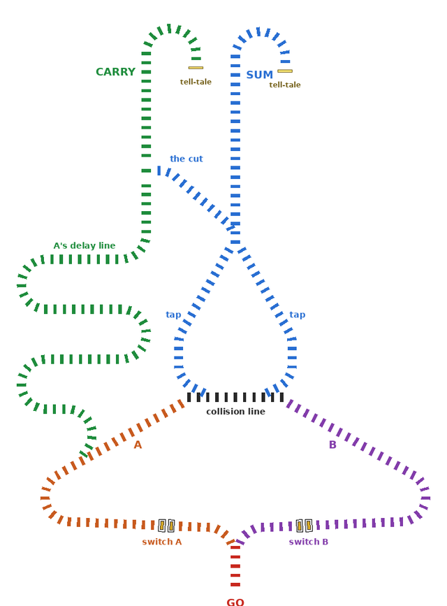
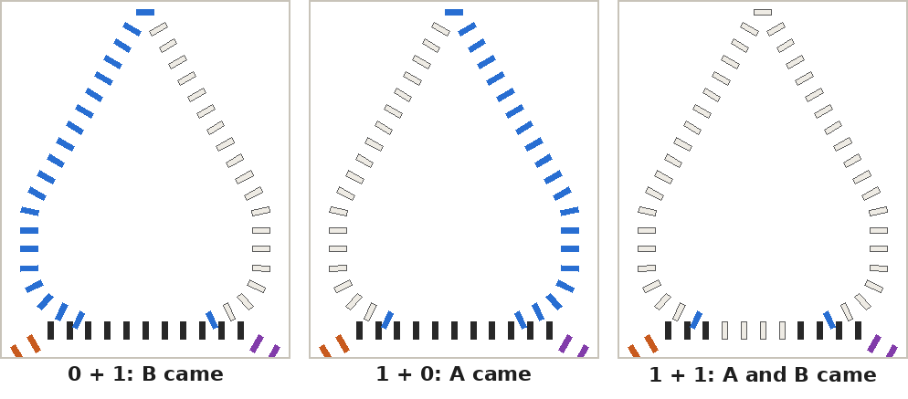
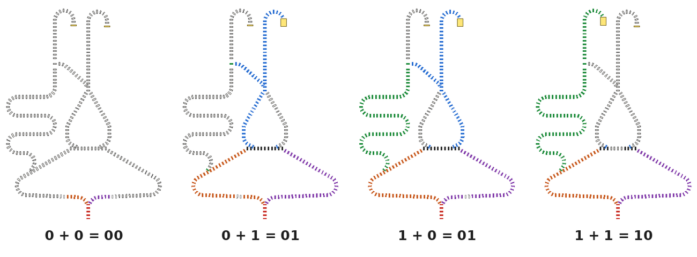
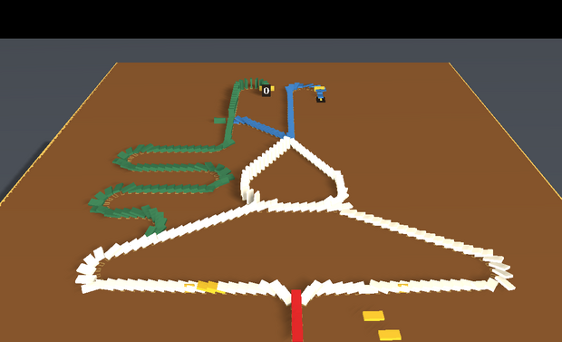

# The Domino Half Adder: a manual

`MANUAL.pdf` beside this file is a typeset copy of it. In Babbage's Hall,
press `H` at the Domino Half Adder to open it.

How a few hundred dominoes standing on a table can add: what a half adder
is, the three tricks it is built from, how to read it, and how to set one
up on your own table. Then the exhibit in the hall.

The plans are drawn from the exhibit's own layout (`domino-layout.lua`),
every domino where the simulation stands it, and the pictures of the four
sums show which dominoes the simulation reported fallen at the end of each
(`manual/make-figures.py`).

**The whole idea in one paragraph.** A falling wave is a 1, no wave a 0.
Two dominoes taken out of a line leave a gap no wave can jump: that is a
switch, an input set to 0. With three tricks (waves meeting head on stop
each other; a branch is taken only by a wave running toward it; one wave
can knock a domino out of another line) the waves can be made to compute
the two figures of A + B, for A and B each 0 or 1.

## 1. What it computes

Adding two one-figure binary numbers has four cases:

| A | B | CARRY | SUM | |
|---|---|---|---|---|
| 0 | 0 | 0 | 0 | 0 + 0 = 0 |
| 0 | 1 | 0 | 1 | 0 + 1 = 1 |
| 1 | 0 | 0 | 1 | 1 + 0 = 1 |
| 1 | 1 | 1 | 0 | 1 + 1 = 10, which is two |

SUM is 1 when exactly one of A and B is 1 (**A XOR B**, "exclusive or"),
and CARRY is 1 when both are (**A AND B**). A circuit that gives both is
a **half adder**: the first step of every adding machine in a computer,
where two of them and an OR make a full adder for one column of a longer
sum.

## 2. The board

The board is about 1.2 by 1.6 m, and holds 268 dominoes, 2.6 cm apart.
From the bottom:

- **GO.** Push the first domino, gently, away from you. A fork sends the
  wave to both inputs.
- **The switches**, two brass dominoes in each input's line. Standing: that
  input is 1. Laid well aside: 0. (One domino missing is not enough: the
  next is within a domino's reach. Two leave a gap of 7.8 cm.)
- **A** and **B**, the two inputs' lines (drawn here in orange and purple),
  mirror images of each other so that both waves arrive together. They
  strike the two ends of
- **the collision line**, across the middle.
- **The taps**, a branch near each end of the collision line, merging into
  **SUM** (blue).
- **The cut**, a branch of SUM running square into
- **A's delay line** (green): a branch of A that winds back and forth, then
  runs up to **CARRY**.
- **The tell-tales**: each output turns back toward you at its end and
  knocks over a tile with 0 on its face and 1 on its back. CARRY is on the
  left, SUM on the right, so together they read as the answer in binary.

## 3. The three tricks

**Waves meeting head on stop each other.** A's wave strikes the
collision line at its left end and runs right; B's strikes the right end and
runs left. If both come, they meet in the middle: each domino falls onto
one already falling the other way, and the two waves stop.

**A branch is taken only by a wave running toward it.** A branch leaves a
line at a shallow angle (25 degrees), its first domino 1.4 cm to the side.
A wave running the way the branch points knocks that domino on and takes the
branch. A wave running the other way only tips the branch's first domino
over backwards, and the branch stays standing. So the right-hand tap is
taken only by A's wave (running right), the left-hand one only by B's.

Together these two make **SUM = A XOR B**: either wave alone reaches SUM;
both together stop each other before either tap.

**One wave can cut another line.** A line that arrives square to another
knocks a domino out of it sideways with its last domino, leaving a gap the
second line's wave cannot cross, if the cut comes first. A's carry branch
is a long way round (the serpentine) on purpose, so that SUM, which is the
short way, can get there first. Where it is cut, the carry line is spaced
wider, 4.25 cm, so that one domino out leaves 8.5 cm, and the cut is aimed
at the middle one of three.

So the carry finishes only when A came and SUM did not: A AND NOT
(A XOR B), which is **A AND B**. (Only A's wave goes the long way: B's does
not need to, since A AND B needs A.)

## 4. The four sums

- **0 + 0.** Both switches open: the wave stops at both gaps. Nothing else
  falls. **00.**
- **0 + 1.** B's wave runs left along the collision line and up the left
  tap to SUM; SUM's branch cuts the carry line, but nothing comes along it
  anyway. **01.** Notice that A's line has fallen too: B's wave, at the
  far end of the collision line, runs on backward down A's line as far as
  A's open switch. It is harmless: it passes A's carry branch the wrong
  way, and that branch is not taken.
- **1 + 0.** A's wave runs right and up the right tap to SUM; its other
  branch starts the long way round, but SUM's cut gets there first, and
  the carry stops at the gap. **01.**
- **1 + 1.** The waves meet on the collision line: no SUM, so no cut, and
  A's wave comes all the way round to CARRY. **10.**

From GO to the answer takes about four seconds.

## 5. Setting one up

You need 268 dominoes of the standard size, 48 × 24 × 7.5 mm (a few boxes
of ordinary dominoes, or printed ones, `domino.stl`, at 30% infill or more
so that they weigh much the same), and a flat, hard table about 1.2 by
1.6 m.

1. **The template.** `./make-stls.sh` makes the placement template as 39
   tiles, 200 mm square and 1.6 mm thick, with a pocket for every domino;
   tile `X-Y` goes X tiles to the right and Y tiles away from you,
   counting from the near left corner. Pin them at the corners. Or print
   `template.svg` 1:1 on paper and tape it down.
2. **Stand a domino in every pocket**, broad face across the line. Start
   at the far end and work toward GO, so that a domino knocked by accident
   does not set the whole board off.
3. **The switches.** The two pockets of each switch are outlined twice.
   For an input of 1, fill them; for 0, leave them empty and put those two
   dominoes well away, across the line (laid along it, they bridge the
   gap).
4. **The tell-tales.** Stand them in their pockets, 0 toward you.
5. **GO.** Push the domino at GO gently away from you, with one finger at
   its top.

What matters, from the simulation: friction between 0.3 and 0.5 (plain
dominoes on a wooden or plastic table); each domino within its pocket; and
above all the wide spacing at the cut, which worked only between 4.1 and
4.4 cm.

## 6. Mistakes to avoid

- **A switch domino left lying along the line:** it bridges the gap, and
  the input counts as 1.
- **The board set off early.** Stand GO's line last, and keep sleeves clear
  of the junctions.
- **A domino out of its pocket at a junction** (the taps, the cut): these
  are the parts that compute, and a few millimetres matter there. If a sum
  comes out wrong, look first at which tap was taken.
- **Pushing GO hard.** A shove can send the first domino sliding instead of
  falling; a gentle push at the top is enough.
- **Different dominoes mixed.** A light or thin domino in a line can stop
  the wave or let it slip through the cut.

## 7. The Domino Half Adder in the hall

The Domino Half Adder stands in the west bay 3. The script stands every
domino up in its pocket, sets the switches, and
pushes GO, as a person would; the tour runs all four sums in turn. In the
exhibit A, B and the collision line are white, the switches brass, GO red,
SUM blue and the carry green.

| Key | |
|---|---|
| `T` | the tour: 0 + 0, 0 + 1, 1 + 0, 1 + 1 |
| `A`, `B` | an input: 1 ↔ 0 (the board is set up again) |
| `G` | GO: push the first domino |
| `R` | stand them all up again, the inputs as they are |
| `Z` | slow motion (a quarter speed) ↔ real time |
| `H` | this manual |

Every domino is a body, 8 g, standing in the template's pockets, whose
walls are in the simulation too; the answer is read from which way the two
tell-tales lie. All four sums came out right at friction 0.3, 0.4 and 0.5,
with every domino placed at random within its pocket. The sliders set the
friction, the simulation's speed, and its steps a second. Resting the
mouse on a domino says which line it belongs to and what that line does.

On its own, outside the hall: `bpp -f domino-adder.lua`.

`README.md` has the parts list, and `FINDINGS.md` how each junction was
tested before it was used.
