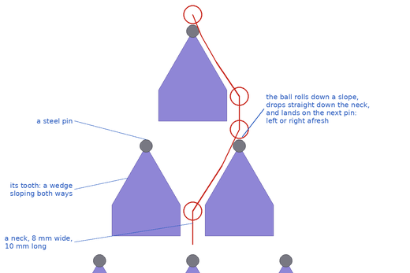

# The Splitter Board: a manual

`MANUAL-splitter.pdf` beside this file is a typeset copy of it. In
Babbage's Hall, press `H` at the splitter board to open it. (The Galton
board, which shares this folder, has its own: `MANUAL.pdf`.)

How the splitter board makes every pin an honest coin, what its five walls
do to the falling balls, and how to read its tubes and bins against the
exact chances. Then the exhibit in the hall.

**The whole idea in one paragraph.** On the Galton board each pin is fair,
but a ball remembers the last pin and goes the same way again two times in
three. The splitter board puts a **neck** above every pin: the ball rolls
off a pin, down a slope, and drops straight down a narrow neck onto the
next pin, forgetting which way it was going. Now every pin is a fair coin
of its own, and the board can show the mathematics of fair coins exactly.
Add **walls**, and it shows more than the binomial: how long a gambler
lasts, where a random walk first reaches a line, and what happens when it
cannot pass one.

## 1. The board

The hopper, the two metering wheels, the crank, the slide, the drawer, the
hand and the sign are the Galton board's. What is new:

- **Twelve rows of splitters** in place of the pins, 30 mm apart.
- **A wall** (in four of its five ways). A wall that **swallows** has an
  **exit block** wherever a ball can reach it; the ball drops onto it and
  rolls down a **ramp** to a **tube** of its own, one tube for each row a
  ball can be caught at. (A tube is single file, except where single file
  couldn't hold its balls with room to spare: gambler's ruin's first tube,
  which takes half of them, is two staggered columns wide.) A wall that
  **sends balls back** has half teeth that tip every ball inward.
- **Thirteen bins** for the balls that get through all twelve rows, and a
  **gold line** in every tube and bin: the exact count for fair coins.

## 2. A splitter

Each splitter is a **steel pin** carrying a printed **tooth**, a wedge
whose sides slope down into straight **necks**, 8 mm wide. A ball lands on
the pin, goes left or right, rolls down that slope, and drops down the neck
onto the pin below, half a pitch to the side. The neck takes away what the
ball remembered: it arrives on the next pin as if fed down the board's
first neck, and splits 50/50 again.

How long a neck must be depends on how lively the balls are, so the teeth
come in sets with necks of 10, 12, 14 or 20 mm, all the same height: the
board is tuned to its balls by choosing the set. `SPLITTERS.md` has how
the shape was found: in the simulation, the chance of going the same way
twice came out 0.49 (0.5 for fair coins), against the Galton board's 0.66.

## 3. The five walls

Think of a ball's place, measured from where it started, as a gambler's
winnings: each row he wins or loses one on the toss of a fair coin.

- **First passage** (a wall 2 places left of the start, that swallows). A
  ball is caught the first time it reaches the wall, and its tube says at
  which row. Of 150 balls the tubes fill to about **38, 19, 12, 8, 6 and
  5** (rows 2, 4, ..., 12): a quarter of all the balls in the first tube,
  then a long thin tail. Most balls are caught sooner or later, but a few
  wander off the other way for a very long time: the *average* wait is
  infinite. The survivors pile up away from the wall, the binomial with its
  **mirror image** in the wall taken away (the reflection principle).
- **Gambler's ruin** (walls that swallow on both sides, 4 places apart).
  A gambler with 1 who stops when he has 4 or nothing. Starting 1 place
  from the left wall, three balls in four go out on the left and one in
  four on the right; starting 2 places in, half each; 3 places, a quarter
  and three quarters. A fair game, so on average he ends with what he
  started with.
- **A wall that sends balls back** (3 places left of the start). Nothing
  is lost: each bin holds its binomial count **plus** its mirror image's in
  the wall. From the wall out, of 150: **47, 42, 31, 19, 8, 2**.
- **The pile goes flat** (reflecting walls 3 places either side). After
  enough rows every bin between the walls is equally likely: **50, 50, 50**.
  With the walls 5 places out, five bins, twelve rows are not yet enough
  (26, 31.5, 35, 31.5, 26): the rows it takes grow as the width squared.
- **No walls.** The binomial exactly: 0.4, 2.4, 8.1, 18.1, 29.0, 33.8, ...
  of 150, the Galton board's gold lines, which the Galton board itself
  misses.

## 4. Reading a run

The **sign** counts, against fair coins: with swallowing walls, the balls
caught (or, for gambler's ruin, those out on the left), those in the first
tube (or out on the right), and the survivors; with reflecting walls, the
bins by the wall, the next, and the rest (or the left, middle and right
bins).

To judge a run, compare each tube and bin with its gold line. 150 balls
wander: a count of about n will often be off by √n (a tube of 19, by 4 or
so). The exhibit's tour judges each run as a statistician would, by a
chi-square test of the counts against the exact chances (small cells
pooled), and calls the run "as expected" unless it is off by more than
chance gives once in a hundred times.

What the simulation counted, one run of each wall (each count with the
exact one in brackets; `L2` is the tube for row 2 on the left, `b7` the
seventh bin, a `+` pools it with the cells after):

| Wall | Counted (exact) | Chi-square (1% level) |
|---|---|---|
| first passage | L2 36 (38), L4 19 (19), L6 15 (12), L8 10 (8), L10+ 11 (11); bins b7 19 (16), b8 16 (21), b9 18 (16), b10+ 6 (10) | 5.5 (20.1) |
| a wall that sends balls back | b6 48 (47), b7 39 (42), b8 30 (31), b9 23 (19), b10+ 10 (11) | 1.4 (13.3) |
| the pile goes flat | b6 43 (50), b7 59 (50), b8 48 (50) | 2.7 (9.2) |
| no walls | b1+++ 6 (11), b5 21 (18), b6 27 (29), b7 44 (34), b8 28 (29), b9 15 (18), b10+ 9 (11) | 6.8 (16.8) |

| gambler's ruin, start 1 | L1 76 (75), L3 21 (19), L5 3 (9), L7++ 13 (8), R3 19 (19), R5 7 (9), R7++ 7 (8), b7+ 4 (2) | 9.4 (18.5) |

Every one "as expected".

## 5. Mistakes to avoid

- **Reading the tubes as a bell.** First passage is not a binomial: it has
  a long thin tail, and the last tubes stay nearly empty however many
  balls you run.
- **Expecting the gold lines exactly.** Judge by how far off a count is
  against √n, or by the tour's verdict.
- **The wrong set of teeth** for the balls: with necks too short the balls
  remember the last pin (going the same way too often); too long and they
  turn back too often. Run it with no walls first and check the binomial.
- **Running it too fast**: as on the Galton board, balls from the two
  wheels can meet over the neck and jam.

## 6. The splitter board in the hall

The splitter board stands in the east bay 7, facing the Galton board. Its
five walls are five ways: `Tab` steps on through them, and the lectern's
label changes with them.

| Key | |
|---|---|
| `Space` | turn the crank: run the balls through (again: stop) |
| `E` | empty the tubes and bins into the drawer, and pour it back |
| `T` | the tour: a run, empty and pour back, a second run |
| `H` or `F1` | this manual |
| `I` | in the hall: the lectern's label close up, and `PgDn` turns its pages |

The 150 balls are 6 mm steel spheres, each a body, and nothing steers
them: every split is the balls bouncing off real teeth. What stands in the
ball space (the exit blocks, ramps, tubes, walls and dividers) is drawn
again over the board in light wood, so that it can be seen.

On its own, outside the hall:

    bpp -f splitter-board.lua                         # first passage
    SB_WALLS=ruin SB_START=1 bpp -f splitter-board.lua
    SB_WALLS=reflect bpp -f splitter-board.lua
    SB_WALLS=flat bpp -f splitter-board.lua           # the pile goes flat
    SB_WALLS=none bpp -f splitter-board.lua

## 7. Making one

The splitter board's printed parts are still to come: its sizes are all in
`splitter-geometry.lua` and its shapes in `parts/splitter.scad`, but the
board (400 by 788 mm) has not yet been cut into printable tiles. The
hopper, wheels, crank, slide and drawer are the Galton board's (its
manual, section 9). `README.md`, "The splitter board", and `SPLITTERS.md`
have the details.
