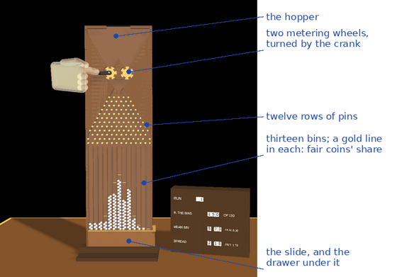
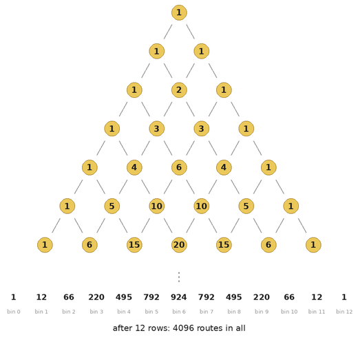
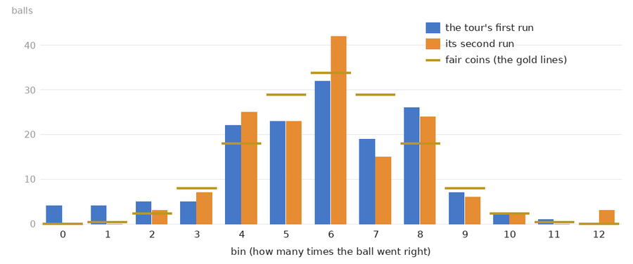

# The Galton Board: a manual

`MANUAL.pdf` beside this file is a typeset copy of it. In Babbage's Hall,
press `H` at the Galton board to open it. (The splitter board, which
shares this folder, has its own: `MANUAL-splitter.pdf`.)

How to run the board, what the pile of balls in its bins means, how to
read the counts, and what this board does that fair coins would not. Then
the exhibit in the hall, and making one.

**The whole idea in one paragraph.** A ball falls through twelve rows of
pins and at each one goes left or right. Its bin counts how many times it
went right. There is only one way to go right every time, but 924 ways to
go right exactly six times out of twelve, so most balls end near the
middle, and the bins fill in a bell. Francis Galton built the board in 1873
to show how many small chances add up to the same shape again and again:
the normal curve.

## 1. The board

- **The hopper** at the top holds the 150 balls.
- **Two metering wheels** under it, geared together and turned by one
  **crank**, let the balls in one at a time, from each wheel in turn,
  through a short neck over the first pin.
- **The pins**: twelve rows, each pin centred under the gap above it.
- **Thirteen bins** at the bottom, numbered 0 on the left to 12 on the
  right. Bin k holds the balls that went right k times. **A gold line** in
  each marks where fair coins would fill it.
- **The slide** under the bins: pulled out, it lets the balls down into
  **the drawer**, which is tipped back into the hopper.

## 2. Running it

1. **Turn the crank** steadily, about half a turn a second. Each turn lets
   in up to twelve balls; all 150 take about half a minute.
2. **Watch the bins fill**, and compare them with the gold lines.
3. **Read the result** (section 4) once every ball is in.
4. **Empty**: pull the slide out, the balls drop into the drawer; push it
   back, and pour the drawer into the hopper at the top.

## 3. Why a bell: counting the routes

Write on each pin the number of routes a ball can take to reach it. The top
pin has 1. Every other pin can be reached from the pin above-left and the
pin above-right, so its number is the sum of theirs: Pascal's triangle.
After twelve rows there are 2¹² = 4096 routes in all, and the bins get

| bin | 0 | 1 | 2 | 3 | 4 | 5 | 6 | 7 | 8 | 9 | 10 | 11 | 12 |
|---|---|---|---|---|---|---|---|---|---|---|---|---|---|
| routes | 1 | 12 | 66 | 220 | 495 | 792 | 924 | 792 | 495 | 220 | 66 | 12 | 1 |
| of 150 balls | 0.0 | 0.4 | 2.4 | 8.1 | 18.1 | 29.0 | 33.8 | 29.0 | 18.1 | 8.1 | 2.4 | 0.4 | 0.0 |

If every pin were a **fair coin**, every route equally likely, each bin's
share would be its routes out of 4096: the **binomial** distribution. The
gold lines are these shares of 150. With more and more rows the shape of
the binomial becomes the normal curve, whatever the coins are, as long as
each choice is small and they add up: that was Galton's point.

## 4. Reading the result

The sign beside the board shows three numbers after a run:

- **In the bins**: how many balls have arrived, of 150.
- **The mean bin**: the average bin number. For fair coins 6.00, the
  middle: a lean to one side moves it.
- **The spread** (the standard deviation): how far, on the whole, balls
  end from the mean. For fair coins √12 / 2 = 1.73. Roughly two balls in
  three land within one spread of the mean, and nineteen in twenty within
  two.

To work them out by hand, multiply each bin's number by its count and add,
then divide by 150 for the mean; for the spread, do the same with the
squared distances from the mean, and take the square root.

## 5. What real balls do

Real balls are not fair coins, and the board shows it:

- **Each pin is fair**: a ball goes right about half the time.
- **The pins are not independent.** A ball leaves a pin still moving
  sideways, meets the next pin off-centre on the same side, and goes the
  same way again about two times in three. So the bins come out **wider**
  than fair coins': a spread of about 1.9 to 2.2 instead of 1.73, with
  more balls in the outer bins.
- **The first two pins nearly always agree**: a ball comes out of the neck
  straight down, the first pin throws it hard to one side, and the second
  sends it on. That favours the **even** bins: in both runs here, bins 5
  and 7 fall short of their gold lines while 4, 6 and 8 overfill.
- **Each run differs.** 150 balls is not many: a bin's count wanders by
  about the square root of its share (in the middle, 34 give or take 5).

`FINDINGS.md`, section 6, has the measurements, from each ball's recorded
path. The splitter board across the hall is built so that each pin *is* an
independent fair coin; its manual is `MANUAL-splitter.pdf`.

## 6. Things to try

- **Turn the crank faster** (the `crank` slider, up to three quarters of
  a turn a second): the faster, the likelier a ball from each wheel meets
  the other over the neck and jams.
- **Change the bounce** (the `bounce` slider): a deader ball remembers
  more of the last pin, and the spread grows.
- **Run it several times** and add the counts: the more balls, the closer
  the shape comes to a smooth curve, and the clearer the difference from
  the gold lines.

## 7. Mistakes to avoid

- **Reading before the last ball is in.** The sign says how many have
  arrived.
- **Cranking too fast**: balls jam at the neck.
- **Expecting the gold lines exactly.** Even fair coins miss them by a few
  balls in each run; judge the shape, the mean and the spread.
- **On a printed board, a joint not flush** between the tiles: the balls
  roll across it, and a step steers them.

## 8. The Galton board in the hall

The Galton board stands in the west bay 7, facing the splitter board. The
operator's hand (drawn half see-through so that it hides little) turns the
crank, pulls and pushes the slide, and carries the drawer up to pour it
back.

| Key | |
|---|---|
| `Space` | turn the crank: run the balls through (again: stop) |
| `E` | empty the bins into the drawer, and pour it back into the hopper |
| `T` | the tour: a run, empty and pour back, a second run |
| `H` or `F1` | this manual |
| `I` | in the hall: the lectern's label close up, and `PgDn` turns its pages |

The 150 balls are 6 mm steel spheres, each a body, bouncing on the pins as
they are; nothing steers them. The tour passes when every ball reaches a
bin and each run's mean is within 0.6 of 6 and its spread between 1.4 and
2.6. Rest the mouse on the board, a wheel, a ball or the sign to see each
bin's count beside the fair coins'. The sliders set the crank's speed,
the balls' bounce and friction, and the simulation's speed.

On its own, outside the hall: `bpp -f galton.lua`.

## 9. Making one

`./make-stls.sh` makes the parts from `parts/galton.scad`: the board in
three tiles (each under 200 mm) with the pins printed standing up from the
back plate, two wheels, two gears, the crank, the slide, the drawer and a
stand. You also need 150 steel balls of 6 mm, a 3 mm clear acrylic front
sheet (167 × 510 mm, its outline in `stl/cut-front.svg`), 22 M3 screws and
3 mm steel rod for the axles.

1. Glue the three tiles together with a splice across each joint, their
   faces flush.
2. Fit the wheels on their axles and the gears behind, meshing, the right
   wheel's slots half a slot behind the left's.
3. Screw the front sheet on, press the crank on, and put in the slide and
   the drawer.
4. Stand the board up, pour in the balls, and turn the crank.

`README.md` has the details, and `FINDINGS.md` how the sizes were found.
