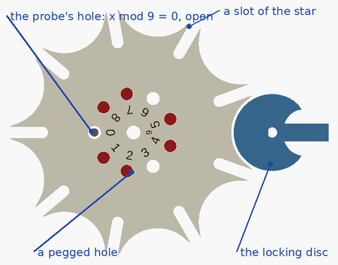
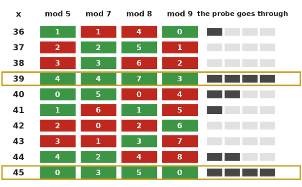
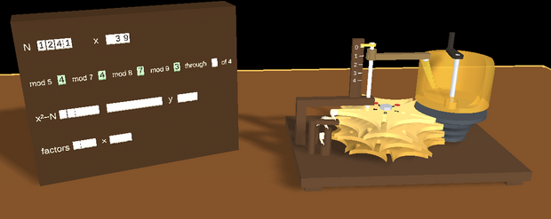

# Lehmer's Number Sieve: a manual

`MANUAL.pdf` beside this file is a typeset copy of it. In Babbage's Hall,
press `H` at Lehmer's sieve to open it.

How to factor a number with the sieve: Fermat's way of factoring, why a
square leaves only a few remainders, how to peg the wheels, how to run
the sieve and check what it finds. Then the exhibit in the hall, and making
one.

The pictures of the machine are OpenSCAD's drawings of the printed parts
(`manual/views.scad`), the wheels pegged for 1241 by the exhibit's own rule
and turned to where it finds the answer; the table of the tour is what the
simulation printed (`manual/make-figures.py`).

**The whole idea in one paragraph.** To factor N, look for an x that makes
x² − N a perfect square, y²: then N = (x − y)(x + y). Trying every x by
hand is slow, but most x can be ruled out at a glance, because a square
leaves only a few remainders when divided by 5, or 7, or 8, or 9. Derrick
Lehmer built machines that rule them out by the thousand: wheels of 5, 7,
8 and 9 places, one hole for each remainder, the holes that cannot lead to
a square plugged. Turn all the wheels on together, one place for each x,
and when every wheel has an open hole at the reading place at once, a probe
falls right through: that x is worth trying.

## 1. Fermat's way of factoring

Any odd number that is not prime is a product a × b of two odd numbers,
and then

    N = a × b = x² − y²,   with x = (a + b)/2 and y = (b − a)/2.

So a factor can be found by looking for x. Start at the first whole number
whose square is past N, and try each x in turn: is x² − N a square? For
N = 1241, √1241 is 35.2, so start at 36:

| x | x² − N | a square? |
|---|---|---|
| 36 | 55 | no |
| 37 | 128 | no |
| ... | ... | |
| 45 | 784 | yes, 28²: 1241 = (45 − 28)(45 + 28) = 17 × 73 |

When the two factors are close together, x is found within a few tries.
Fermat used this in 1643. The sieve does the trying.

## 2. Squares leave only a few remainders

Divide the squares by 8 and look at what is left over:

| k | 0 | 1 | 2 | 3 | 4 | 5 | 6 | 7 |
|---|---|---|---|---|---|---|---|---|
| k² mod 8 | 0 | 1 | 4 | 1 | 0 | 1 | 4 | 1 |

A square can only leave 0, 1 or 4. So if x² − N leaves 2, 3, 5, 6 or 7 when
divided by 8, it is not a square, and x is ruled out without working
anything out. And x² − N's remainder depends only on x's remainder. So for
each remainder r of x, work out r² − N's remainder; if it is not one a
square can leave, every x with that remainder is ruled out. For N = 1241:

| Wheel | Squares leave | Open holes (x mod m) | Pegged |
|---|---|---|---|
| 5 | 0, 1, 4 | 0, 1, 4 | 2, 3 |
| 7 | 0, 1, 2, 4 | 2, 3, 4, 5 | 0, 1, 6 |
| 8 | 0, 1, 4 | 1, 3, 5, 7 | 0, 2, 4, 6 |
| 9 | 0, 1, 4, 7 | 0, 3, 6 | 1, 2, 4, 5, 7, 8 |

(For the wheel of 9: x = 3 gives 9 − 1241 = −1232, which leaves 1 when
divided by 9: a square could, so 3 is open.) An x survives only if it is
open on every wheel. The wheels of 9, 8, 7 and 5 repeat together only every
2520 turns; of those, only 144 pass all four for 1241, one in seventeen.

## 3. The machine

- **Four wheels** on one axle, one above the other: 9 places at the
  bottom, then 8, 7 and 5. Each wheel has a ring of **holes**, one for
  each place, numbered 0 up. **Pegs** fill the holes that fail.
- **The drive**: a shaft beside the wheels, with the **handle** on top.
  One turn of the handle moves *every* wheel on by exactly one place,
  whatever its size (see below).
- **The probe**: a steel rod over the reading place. The **cam** on top of
  the drive lifts it before the wheels move and lets it down after they
  stop. It falls through as many wheels as have an open hole under it; all
  four, and it rings the **bell** at the bottom.
- **A detent** for each wheel, a printed leaf spring, puts each wheel
  exactly on its place between turns.

**A Geneva drive.** Each wheel is a star with a slot for each place.
Under it, the drive shaft carries a crank with a pin: once a turn, the pin
enters a slot, turns the star on by one place, and leaves. In between, a
**locking disc** on the shaft rides in the star's curved edge, so the star
cannot turn out of step. That is how one turn moves wheels of 9, 8, 7 and
5 places each by one: the same drive as a cinema projector's film.

## 4. Setting it up for a number

1. **Find where to start**: the first whole number x whose square is past
   N.
2. **Peg the wheels.** For each wheel of m places and each hole r (0 to
   m − 1), work out r² − N, its remainder by m, and whether a square can
   leave that remainder. Peg the holes where it cannot.
3. **Set the wheels** to the starting x: each wheel's hole marked x mod m
   at the reading place (for 36: hole 1 on the 5, 1 on the 7, 4 on the 8,
   0 on the 9).

## 5. Running it, and checking a stop

Turn the handle, one x a turn, and watch the probe. When it falls right
through, **stop and check**: is x² − N really a square? The sieve only says
"maybe": with four wheels, some x pass all of them and still fail. If it is
not a square, turn on.

**1241.** From 36 the probe goes 1, 0, 0 wheels deep, then right through
at **39**: 39² − 1241 = 280, not a square (16² = 256, 17² = 289), so turn
on. Right through again at **45**: 45² − 1241 = 784 = 28², and so
**1241 = 17 × 73**.

The exhibit's other numbers, to try:

| N | starts at | the factors | found at x | x² − N |
|---|---|---|---|---|
| 1679 | 41 | 23 × 73 | 48 | 625 = 25² |
| 1157 | 35 | 13 × 89 | 51 | 1444 = 38² |
| 2813 | 54 | 29 × 97 | 63 | 1156 = 34² |

## 6. Mistakes to avoid

- **Taking a stop for an answer.** Always check x² − N. More wheels rule out
  more x, but nothing but the check says yes.
- **A peg in the wrong hole**: the sieve then skips the answer. Work the
  pegging out on paper first, and check one x by hand against the wheels.
- **The wheels set to the wrong start**: every wheel must show x mod m for
  the same x.
- **An even N.** Fermat's way needs an odd number (take out the 2s first).
- **Turning the handle part way.** One whole turn is one x; a part turn
  leaves the probe up, or a wheel between places.

## 7. The sieve in the hall

Lehmer's sieve stands in the west bay 8. A hand turns the handle, a whole
turn at a time. The board on the table shows what an operator would write
up: N and x, each wheel's hole at the reading place (green open, red
pegged), how many wheels the probe went through, and at a stop x² − N,
whether it is a square, y and the factors. A depth scale on the probe's
guide, part of the machine, reads 0 to 4.

| Key | |
|---|---|
| `Space` | one turn of the handle |
| `G` | go: turn until the probe falls right through (`G` again: stop) |
| `N` | choose the next number: 1241, 1679, 1157, 2813 (re-pegs the wheels and sets them to its first x) |
| `R` | set the wheels back to the first x |
| `T` | the tour for the number chosen: it turns until the factors are found, past any false stop |
| `Z` | slow motion (a quarter speed) on and off |
| `H` or `F1` | this manual |
| `I` | in the hall: the lectern's label close up, and `PgDn` turns its pages |

The wheels, the drive, the detents and the probe are bodies; the probe
falls by its own weight, and at every turn the exhibit checks that it went
exactly as far as the pegs say, and that the wheels, read on their own,
show the x the hand has counted to. Resting the mouse on a wheel shows
which hole is under the probe and which are open.

On its own, outside the hall: `bpp -f lehmer-sieve.lua`, and `LS_N=1679`
for another number.

## 8. Making one

`./make-stls.sh` makes every part from `parts/lehmer-sieve.scad`: the four
wheels, their cranks and locking discs, the detents and their posts, the
cam, the handle, the probe's arm and pointer, the guide, washers and
bearings, the bell, and pegs. You also need steel rod: 8 mm for the
wheels' axle, 6 mm for the drive shaft (with a flat filed along it for the
D-shaped bores) and 5 mm for the probe.

1. Stand the axle and the drive shaft in the base.
2. Thread the wheels on the axle, 9 places at the bottom, with washers
   between; on the shaft, each wheel's crank and locking disc at its
   level, then the cam and the handle.
3. Screw a detent beside each wheel, its nose in the slot opposite the
   drive.
4. Fit the probe through its guide, its arm resting on the cam.
5. Peg the wheels for your number, set them to its first x, and turn.

`README.md` has the details, and `FINDINGS.md` what was measured in the
simulation.
