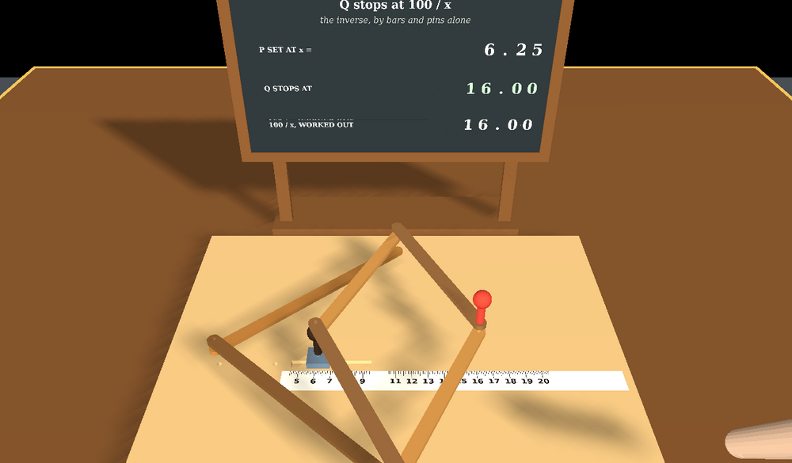
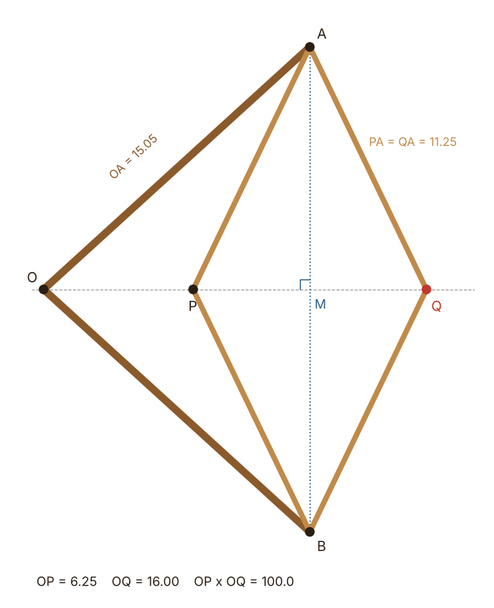
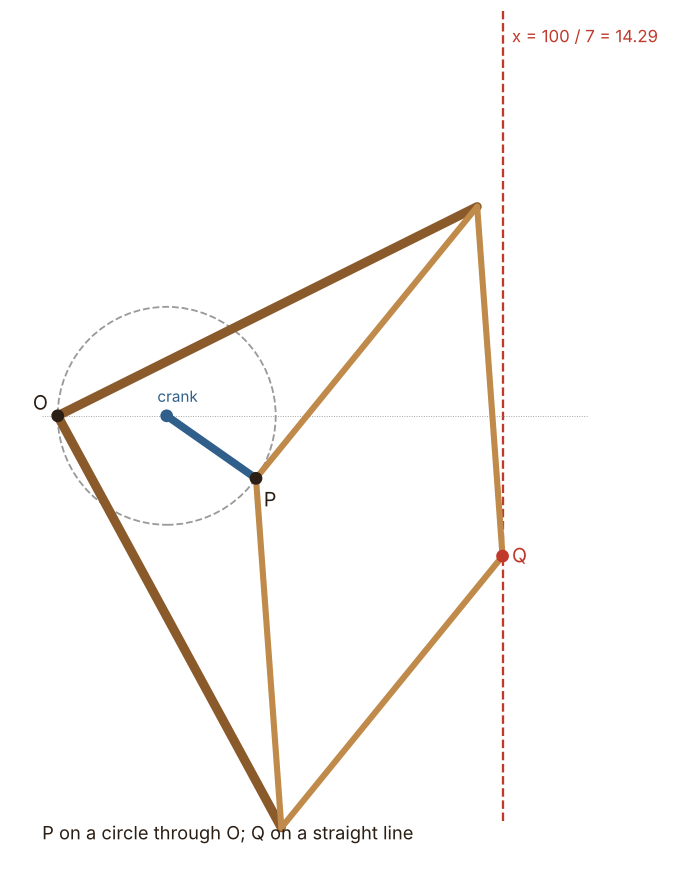
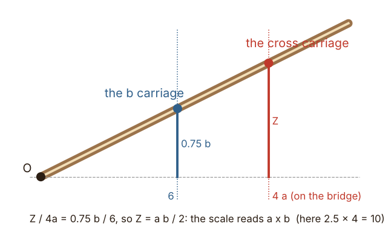

# Linkages That Compute: a manual

`MANUAL.pdf` beside this file is a typeset copy of it. In Babbage's Hall,
press `H` at the linkages to open it.

How three linkages compute: Peaucellier's inverter, which works out
100 / x; the same linkage drawing an exact straight line; and a lever
that multiplies. Why each gives the answer it does, how to use the
exhibit, and making one.

The pictures are drawn by `manual/make-figures.py` with the exhibit's
sizes.

**The whole idea in one paragraph.** A linkage is bars joined by pins.
Fix one pin to the board and move another, and the rest have only one
place each to go: the bars' lengths decide it. Choose the lengths well,
and that place is the answer to a sum. Peaucellier's six bars keep two
points on a line through a fixed pin with the product of their distances
from it always the same: move one, and the other goes to its reciprocal.
A slotted lever turning about a pin keeps every point on it in the same
proportion: tilt it with b, read it at a, and you have a times b.

**Contents**

1. The inverter
2. Why OP × OQ stays the same
3. The straight line
4. The multiplier
5. Using the exhibit
6. What the exhibit shows you
7. Making one

## 1. The inverter

A fixed pin **O** at the left of the board. Two long **arms**, 15.05 cm
each, go from O to the corners **A** and **B** of a **rhombus**: four
short bars, 11.25 each, pinned in a diamond. Its other two corners are
**P**, nearer O, and **Q**, farther away.

P rides a carriage in a slot along the board, under a scale. Put P at 5,
and Q is at 20; at 6.25, Q is at 16; at 8, Q is at 12.5. Always
OP × OQ = 100: Q is at 100 / x. Nobody worked out 100 / 6.25: the bars
did.

## 2. Why OP × OQ stays the same

A is 11.25 from P and 11.25 from Q; so is B. Points the same distance
from P and from Q lie on the line square across the middle of PQ: so A
and B both lie on it, and it is the line AB. O is 15.05 from A and from
B, so O lies on the line square across the middle of AB, which is the
line PQ. So O, P and Q are on one line, and AB crosses it square at its
middle, **M**.

Now two right-angled triangles share the side AM:

- OA² = OM² + AM²
- PA² = PM² + AM²

Take one from the other: OA² − PA² = OM² − PM² = (OM − PM)(OM + PM).
OM − PM is OP; OM + PM is OM + MQ, which is OQ. So

**OP × OQ = OA² − PA² = 15.05² − 11.25² = 100**,

whatever the shape of the diamond. It works out the reciprocal of
anything P can reach.

The exhibit's arms are 15.052 cm, not 15.05: the constant is the
difference of two squares, so a small error in a long bar becomes a
larger one in the answer (`FINDINGS.md`).

## 3. The straight line

Take P off its carriage and put it on a **crank**, 3.5 long, pivoted on
the board 3.5 from O: P's circle then passes through O itself.

Turning the cell's rule round, a point at distance r from O in some
direction sends Q to 100 / r in the same direction. The crank's far
point, 7 from O, sends Q to 100 / 7 = 14.29. As P goes round its circle
toward O, r gets smaller and Q farther away, in just the right way: every
point of a circle through O goes to a point on one straight line, square
across O's line through the crank's pivot. That is geometry's
**inversion**, and Q draws its line exactly.

James Watt's linkage of 1784 guided his engine's piston rod near a
straight line, but only near; for eighty years no one could do better.
Peaucellier's, in 1864, was the first exact one, and Lipkin found it
again in 1871. When Sylvester showed a model to William Thomson (later
Lord Kelvin), Thomson would not give it back.

In the exhibit Q carries a pen that dots the board as it moves. Return
turns the crank from −80° to 80° and back; the slate shows how far the
pen is from the line, now and at its worst. It stays within a few
thousandths of a millimetre.

## 4. The multiplier

A long **lever**, with a slot down its middle, turns about a fixed pin
**O**. Across the board, 6 from O, the **b carriage** slides on a slot
square across the board; its pin rides in the lever's slot, so setting it
tilts the lever. Set to b, it stands 0.75 b across (b's scale is marked
so).

Along the board runs a **bridge**, which slides to **a** (it stands at 4
a). On the bridge the **cross carriage** slides across; its pin rides the
lever's slot too, so it goes wherever the lever is at the bridge.

The lever is straight, so the triangle under it at the bridge has the
same shape as the triangle under it at the b carriage:

Z / 4a = 0.75 b / 6, so **Z = a b / 2**.

The cross carriage grips a rod that runs across the board to a scale at
its right edge, out from under the lever; the scale is marked double, so
the rod's end reads **a × b**.
Negative b tilts the lever the other way, and the product goes negative
with it. Set a and b the same and it **squares**.

The pins in the slot are little blocks that slide along the lever, one
under it and one over it, so they can pass each other; the cross
carriage stays beyond the b carriage (a from 2), so they never need to.

## 5. Using the exhibit

In the hall, walk to east bay 4 and step in; Tab steps through the three
ways, each with its own lectern card.

**The inverter.** Type x, from 5 to 9 (a point for the decimals), and
press Return. The hand slides P to x; the slate shows x, where Q
stopped, and 100 / x worked out.

**The straight line.** Press Return: the hand turns the crank across and
back. Type a smaller angle first (10 to 80) for a shorter sweep.

**The multiplier.** Type a (2 to 5), Space, b (−5 to 5), and Return. The
hand sets the bridge to a and the b carriage to b; the slate shows a, b,
what the cross carriage reads, and a × b worked out.

| Key | |
|---|---|
| `0`–`9`, `.`, `-` | a number |
| `Space` | between a and b |
| `Return` | set it (the line: sweep) |
| `Backspace` | a figure off |
| `R` | a setting at random |
| `T` | the tour |
| `H` | this manual |

## 6. What the exhibit shows you

Every bar, carriage and block is a body in the simulation, every pin a
hinge and every slot a slider: the hand pushes only the input, and the
output goes wherever the bars put it. The slate's answer is read from
where the output pin stands, and checked against the sum worked out.
Each reading is right to within 0.01 cm (the inverter) or 0.02 (the
multiplier).

The board lies flat, as a real one would on a table: the bars' weight
presses them on their pins, and none of it pulls the linkage out of
shape.

## 7. Making one

Every part prints (`README.md` lists them; `make-stls.sh` makes the
files): a board in quarters, bars 8 mm wide and 3 mm thick with a 3 mm
hole at each end, a carriage, a crank, the lever and the bridge in
halves. Buy 3 mm steel pins.

Cut no corners on the bars' lengths: the inverter's arms must be 150.52
mm between the holes' centres, the sides 112.5. Stack the bars on their
pins in the order of their planes, with a 4 mm spacer where a bar passes
over one it isn't pinned to, so that each lies flat and swings without
rocking. Glue the scales (printed at 10 pixels a millimetre) beside the
slots.
