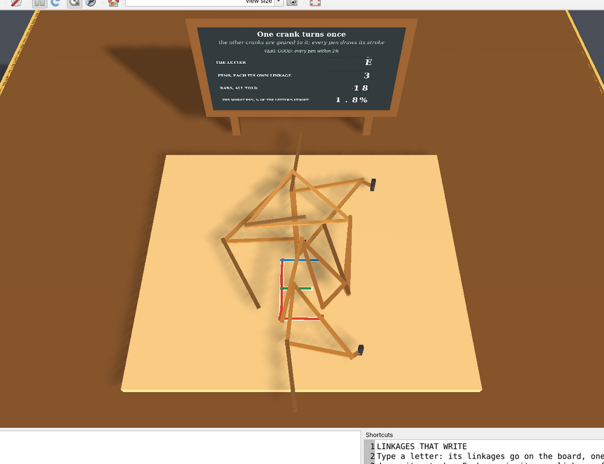
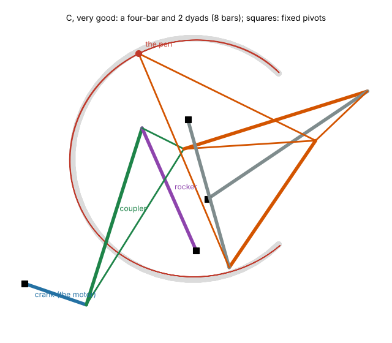
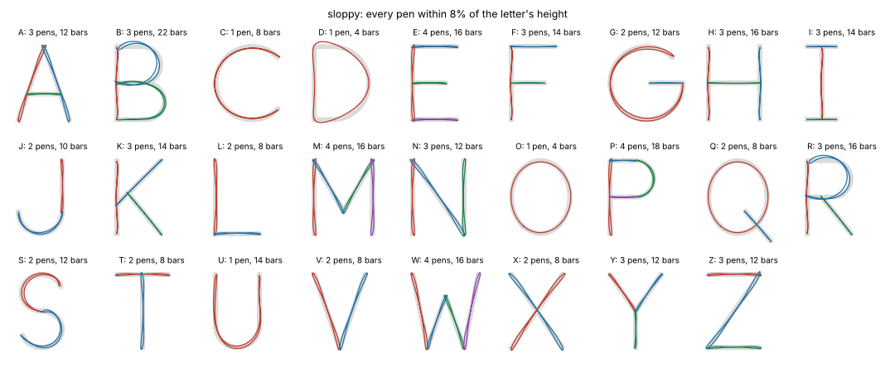
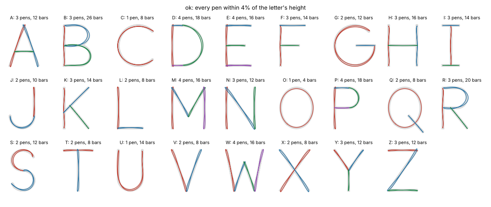
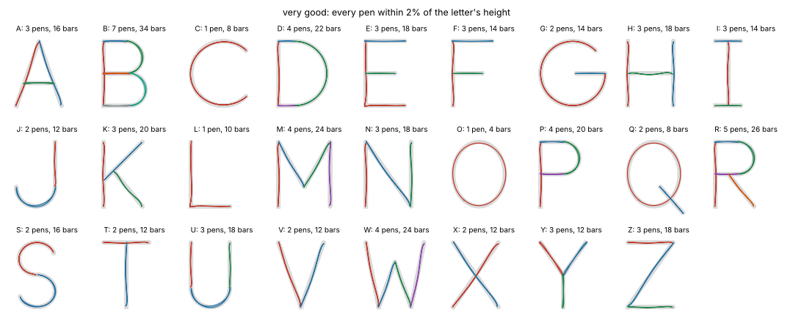

# Linkages That Write: a manual

`MANUAL.pdf` beside this file is a typeset copy of it. In Babbage's Hall,
press `F1` at the linkages that write to open it.

How bars and pins, turned by one crank, can draw a letter; why a letter is
split among pens; what the slider shows; and how the linkages were found.

**The whole idea in one paragraph.** Pin a few bars together, fix two of
the pins to a board, and turn one bar round: every point of the others
goes round a closed curve, the same one every turn. Choose the bars'
lengths, and where the fixed pins go, and the curve can be almost any
shape: an oval, a kidney, an L traced out and back. A search finds the
lengths whose curve is nearest a letter. A letter whose strokes meet in
junctions is too much for one such curve, so it is split, a pen to each
stroke, each pen with its linkage, all turned by the one crank.

**Contents**

1. One linkage, one curve
2. Finding the bars
3. Why more than one pen
4. Sloppy, ok, very good
5. Using the exhibit
6. What the exhibit shows you
7. Kempe, and how far this is from him

## 1. One linkage, one curve

The simplest linkage that moves is the **four-bar**: the board between two
fixed pins is one bar, the **crank** turns round one pin, the **rocker**
swings on the other, and the **coupler** joins their ends. Turn the crank
once and every point on the coupler, or on a plate fixed to it, goes once
round its own closed curve: a coupler curve. Some are ovals, some figures
of eight, some nearly straight for part of the way.

Hang two more bars on that point, the second pinned to the board: a
**dyad**. A point on its first bar goes round a new curve, made from the
old one. Each dyad gives the curve more to bend with. The pens here have up
to four or five dyads: up to fourteen bars.

## 2. Finding the bars

There is no formula that gives the bars for a letter. William Spears's
**synthesizer** searches for them: thousands of linkages are tried, the
better ones kept and mixed (differential evolution), until the pen's curve
lies nearest the letter, after turning, sizing and moving it to fit. It
keeps only linkages that a crank can drive all the way round, and whose
loops never come near the point where two bars line up and the linkage
could fold the other way.

The search ran for every letter and every way of splitting it, for every
size of linkage, before the exhibit was built: `alphabet.lua` holds what it
found. Typing a letter only fetches its linkages.

## 3. Why more than one pen

A pen on one linkage never lifts, and its curve is smooth: it can't stop
and turn back on itself sharply. Round letters suit it: O, C, D, S, U. A
letter whose strokes meet at junctions doesn't: to draw E with one pen, the
pen must go up the stem, out along an arm, back along it, and on, turning
back three times. One linkage can't, however many bars it has.

So the letter is split where its strokes meet. Each pen draws one
unbranched stroke, out and back: an L, a straight line, an arc. A single
linkage does that well. E is three or four pens; M and W four.

Every pen's crank turns once, together: in a built machine, a timing belt
or gears from the one crank; here each crank is held at the first crank's
angle.

## 4. Sloppy, ok, very good

The slider chooses how close every pen must keep to its stroke: within 8%,
4% or 2% of the letter's height, at its worst. For each, the exhibit uses
the cheapest way found, the fewest bars, then the fewest pens. A better
letter takes more bars, and more pens: B is 3 pens and 22 bars sloppy, 7
pens and 34 bars very good. O is one four-bar at every setting: an oval is
what a four-bar draws best.

## 5. Using the exhibit

Type a letter. Its linkages go on the board, a faint grey guide shows the
letter, and the crank turns once: each pen leaves dots in its own colour.
The slate shows the letter, the setting, how many pens and bars it took,
and how far its worst pen strayed.

| Key | |
|---|---|
| `A`–`Z` | a letter |
| `1`, `2`, `3` | sloppy, ok, very good |
| `Space` | draw it again |
| `0` | the tour: B at each setting, then K |
| `F1` | this manual |

## 6. What the exhibit shows you

Every bar is a body and every pin a hinge; one motor turns the first
crank, and the other cranks are kept at its angle. Where each pen goes is
where the bars put it: the dots are its path. After each turn the exhibit
measures how far each pen strayed from its stroke, and checks it against
what the search computed (`FINDINGS.md`).

The linkages pass through one another here. A built machine puts each on
a layer of its own, the pens reaching down to the paper.

## 7. Kempe, and how far this is from him

Alfred Kempe proved in 1876 that a linkage can draw any curve given by a
polynomial: some linkage will trace your signature. His proof builds it:
reversors that double and add angles, parallelograms that add vectors.
Drawn his way, a cursive word needs some 340 bars, and braces to keep his
crossed parallelograms from folding. The linkages here are the other end:
small, found by search, nearly right, and a pen to each stroke when one
linkage can't manage.
