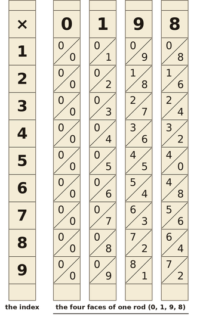
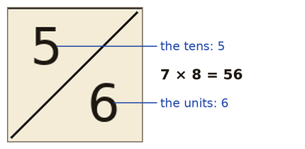
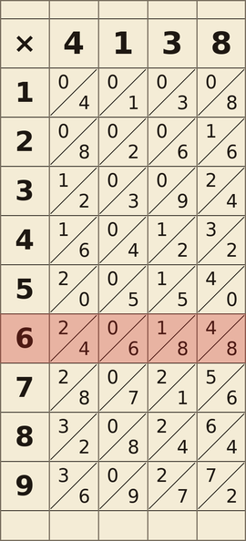
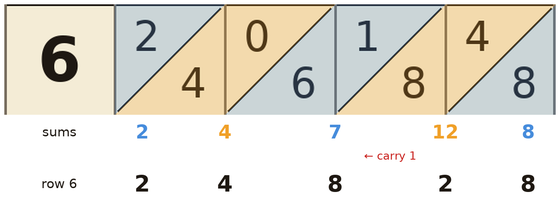
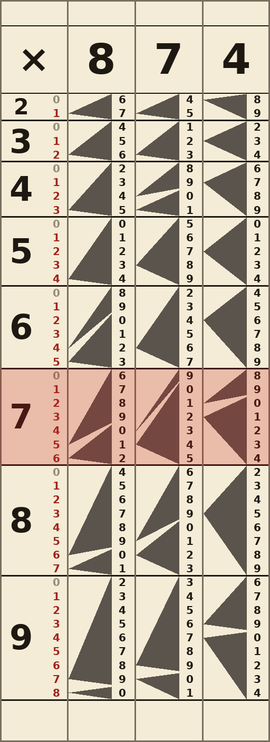
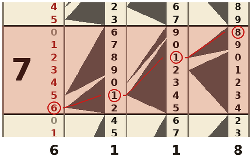
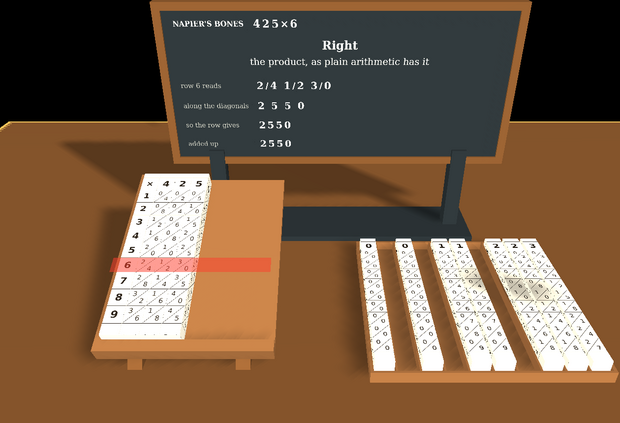

# Napier's Bones: a manual

`MANUAL.pdf` beside this file is a typeset copy of it. In Babbage's Hall,
press `H` at Napier's bones to open it.

How to multiply with Napier's bones, then with Genaille's rods, which do
the carrying for you; dividing with the bones; then the exhibit in the
hall, and making a set.

The rods in every picture are the simulation's own faces, the same
pictures that are printed to wrap the rods (`make-faces.py`), and the
sums and the path are worked by the exhibit's own arithmetic
(`bones.lua`); only the red strip, the tints and the labels are added
(`manual/make-figures.py`).

**The whole idea in one paragraph.** A rod is one column of the
multiplication table: the multiples of one digit, × 1 to × 9. Lay the rods
for a number side by side, and one row across them holds that number's
digits each times the same digit, all at once. What is left is the
adding, of each product's tens to the product on its left, and the rods
are drawn so that the numbers to be added sit together, along diagonals.
John Napier published them in 1617, in *Rabdologiae*.

## 1. The rods

A rod (a "bone") is a square bar with a table on each of its four faces.
At the top of a face is its digit; below it, nine cells hold that digit
× 1 to × 9, one to a cell. The **index** rod beside the board numbers the
rows, 1 to 9.

Each cell is split by a diagonal, from its lower left to its upper right.
The product's **tens** are written above it, the **units** below. A
product under 10 has a 0 above.

**The set.** Napier's set has ten rods, four tables each:

| Rod | 1 | 2 | 3 | 4 | 5 | 6 | 7 | 8 | 9 | 10 |
|---|---|---|---|---|---|---|---|---|---|---|
| Faces | 0 1 9 8 | 0 2 9 7 | 0 3 9 6 | 0 4 9 5 | 1 2 8 7 | 1 3 8 6 | 1 4 8 5 | 2 3 7 6 | 2 4 7 5 | 3 4 6 5 |

Every digit is on four rods, so any number of four figures can be laid
(2222 takes four different rods with a 2 on them), and nearly every
longer one. A number with five of the same digit, such as 11111, cannot.
Opposite faces of a rod always make 9.

## 2. Laying a number

Lay the rods for the number left to right beside the index, each turned
so that the digit you want is at the top, as you would write it. For
4138: a rod with a 4 face up, then a 1, a 3 and an 8. Push them together
and down against the board's ledge so that their rows line up with the
index's.

Now every row is a times table for 4138: row 6 holds 4 × 6 = 24,
1 × 6 = 06, 3 × 6 = 18 and 8 × 6 = 48 side by side. A strip of paper or a
ruler laid under the row helps the eye.

## 3. Reading a row: 4138 × 6

Read the row from the **right**, adding along each diagonal band: each
band holds one product's units and the next product's tens, which belong
to the same place.

1. The last units alone: **8**.
2. The next band: 4 + 8 = 12. Write **2**, carry 1.
3. The next: 1 + 6 = 7, and the carry: **8**.
4. The next: 0 + 4 = **4**.
5. The first tens alone: **2**.

Read off: **24828**, which is 4138 × 6. The rods did every multiplication;
you added pairs of digits, and a carry is never more than 1.

## 4. A longer multiplier: 4138 × 567

Read a row for each figure of the multiplier, and add them as in long
multiplication, each row a place further left than the one after it:

| Row | Reads | In its place |
|---|---|---|
| 5 | 20690 | 2069000 |
| 6 | 24828 | 248280 |
| 7 | 28966 | 28966 |
| | **total** | **2346246** |

A 0 in the multiplier needs no row; it only moves the rows after it a
place. Write the rows down as you read them: the rods hold only the
number, not the partial products.

## 5. Genaille's rods: no adding

In 1891 Henri Genaille, a French railway engineer, drew rods that do the
carrying themselves (Édouard Lucas set him the problem). They lay out like
Napier's, with the same set of ten rods, but each face looks different.

A face has rows for **2 to 9** (for × 1, the number itself is the
answer). Row m holds m small numbers, one under the other: one for each
carry, 0 to m − 1, that the rod on its right can send. Each is the units
of digit × m + that carry. Beside them are dark **triangles**, one for each
tens digit among them; each triangle points left, its tip at the number on
the next rod that its tens select.

**To read a row:**

1. Start at the **top** number of the row on the **last** (rightmost) rod
   (nothing is carried into the last place).
2. Follow the triangle beside it to the left: its tip points at a number
   on the next rod. Go on, rod by rod.
3. On the index rod the tip points at a small red number: the last carry,
   the product's first figure (if it is a grey 0, there is none).
4. The numbers passed, read left to right, are the product.

**874 × 7.** 4 × 7 = 28: the top number is 8, and its triangle (for the 2
carried) points to the 1 on the 7's rod, which is 7 × 7 + 2 = 51. That
triangle (5) points to the 1 on the 8's rod: 8 × 7 + 5 = 61; and its
triangle (6) to the index's 6. **6118.** You never add anything: the
carries are drawn. A multiplier of several figures still takes a row for
each, added up as in section 4.

## 6. Dividing with the bones

The rows are also a table for dividing. Lay the **divisor**: its rows are
its multiples, × 1 to × 9. To divide 24828 by 4138, read down the rows
(with the diagonals added) for the largest that is not more than the part
being divided: row 6 is 24828, exactly; the quotient is **6**. With a
longer number, as in long division, take the figures from the left a few
at a time, find the row, subtract, and bring down the next figure. Only
the multiples are the rods' work; the subtracting is yours. (The exhibit
multiplies only.)

## 7. Mistakes to avoid

- **A rod a row out.** If a rod is not down against the ledge, its rows
  sit beside the wrong ones of the index. Push each rod home.
- **The wrong face up**, or the rods in the wrong order: read the digits
  at the top as a number before you start.
- **Adding across a cell instead of along the diagonal.** The tens of a
  cell go with the units of the cell on its **left**.
- **Forgetting a carry.** Work from the right, and say the carry out loud.
- **On Genaille's rods, starting anywhere but the top** of the last rod's
  row, or reading a number from the wrong row: keep to the row marked.
- **In a longer multiplier, a row in the wrong place.** Each row moves a
  place left for each figure of the multiplier after it.

## 8. Napier's bones in the hall

Napier's bones are the third machine on the walk, in the west bay 2. A
hand takes each rod from the tray, turns it to the face it needs, lays it
on the board beside the last and presses it home. A red strip marks the
row being read, and a slate behind shows each step: the row's cells, the
sums along the diagonals, each row's product and the total. On
Genaille's rods, red dots mark the path instead. There are two ways, and
`Tab` steps from one to the other: Napier's bones, and Genaille's rods.

| Key | |
|---|---|
| `0`–`9` | a number (up to six figures), then `X`, then the multiplier (up to three), then `Return` |
| `Backspace` | a figure off |
| `C` | clear the board: the rods back in the tray |
| `M` | the camera close to the board, to read the rods; again: back |
| `T` | the tour. Napier's bones: 425 × 6, 6785 × 8, 2222 × 9, 4138 × 567. Genaille's rods: 52749 × 4, 874 × 7, 874 × 73 |
| `H` or `F1` | this manual |
| `I` | in the hall: the lectern's label close up, and `PgDn` turns its pages |

The rods are bodies, laid and pressed by the hand, and every reading is
taken from where they lie: which face is up, and which cell is level with
the index's row. A rod turned wrong or lying a row out would give a wrong
answer, and the slate would say so. Resting the mouse on a rod says which
tables it carries. A number the set cannot lay is said so on the slate.

On its own, outside the hall: `bpp -f napiers-bones.lua`, and
`NB_WAY=genaille` for Genaille's rods.

## 9. Making a set

`./make-stls.sh` makes the parts from `parts/napiers-bones.scad`; all fit
a 200 mm printer.

| Part | Print | |
|---|---|---|
| `rod.stl` | 11 | the ten rods and the index, 16 × 16 × 176 mm; printed standing |
| `board.stl` | 1 | the board, with a ledge along its bottom and a rim on its left |
| `foot.stl` | 2 | its feet, tilting it toward you |
| `tray.stl` | 1 | ten slots for the rods |
| `slate-*.stl` | | optional: the slate, its stand and frame |

**The faces.** Print `napier-faces.pdf` (or `genaille-faces.pdf`) at
100%, with no "fit to page", and check that its bar measures 100 mm. Cut
out each rod's strip of four faces, fold it on its faint lines, and wrap
it round its rod with the digits at the top end; glue it down. The index
strip has one face. For both ways, make two sets of rods, or wrap the
second strips over the first.

A set can just as well be cut from 16 mm square wood, with the strips
glued on; old sets were often wood or ivory, the tables written straight
on the faces.

`README.md` has the details, and `FINDINGS.md` what was measured in the
simulation.
