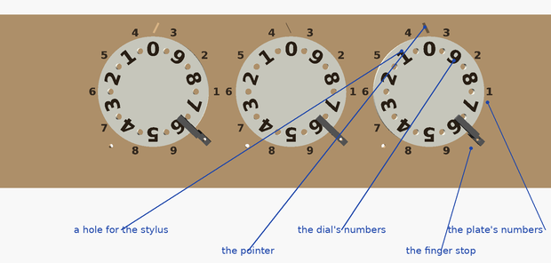
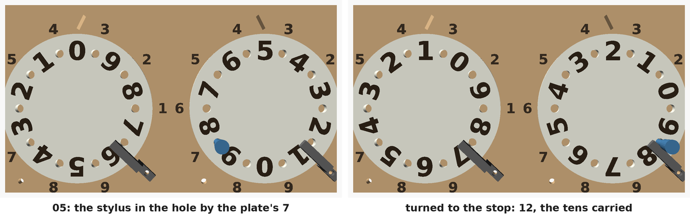
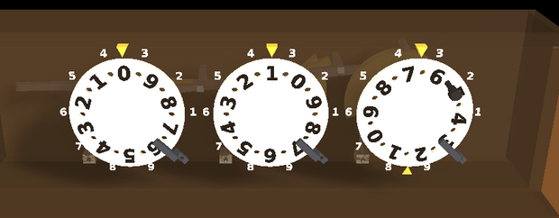

# The Pascaline: a manual

`MANUAL.pdf` beside this file is a typeset copy of it. In Babbage's Hall,
press `F1` at the Pascaline to open it (its `H` chooses the hundreds).

How to add on Blaise Pascal's machine of 1642 with a stylus, how it
carries by itself, how Pascal subtracted on a machine that only goes
forward, and what goes wrong. Then the exhibit in the hall, and making
one.

Every picture of the machine is OpenSCAD's drawing of the printed parts,
put together as in `parts/pascaline.scad` and set to a state
(`manual/views.scad`, `manual/make-figures.py`). The pictures of its works
are set to the angles the simulation reported for its levers at the end of
each step of its tour.

**The whole idea in one paragraph.** Each digit is a wheel. To add, you
turn a wheel on by the digit you are adding: a stylus in the right hole,
turned until it meets a stop, does exactly that. When a wheel passes 9 it
must turn the next wheel on by one: the carry. Pascal's carry does not push
the next wheel from the first, which jams when carries ripple through many
wheels at once (999 + 1); instead each wheel, as it counts up, slowly lifts
a weighted lever, the **sautoir**, and as it passes 9 lets it fall. The
falling weight kicks the next wheel on. Every carry is paid for in advance.

## 1. The front

Three **dials**, the hundreds on the left and the units on the right. The
number is read at the top of each dial, under the **pointer**: here 000.

Each dial has ten **holes** between its numbers. Round each dial, the
plate itself has the numbers **1 to 9**, which never move, and a **finger
stop** at about 4 o'clock.

## 2. Adding with the stylus

To add a digit to a wheel:

1. Find the plate's number for it, round that dial.
2. Put the stylus in the dial's hole beside it.
3. Turn the stylus clockwise until it meets the stop, and take it out.

The wheel has gone on by exactly that digit, whatever it showed before:
the hole beside the plate's 7 is always seven holes short of the stop.

To add a number of several figures, add each figure to its own wheel, in
any order: to add 84, 4 on the units and 8 on the tens. The carries look
after themselves.

## 3. The carry: the sautoir

Behind each dial its wheel carries ten **pins** and, behind them, a **snail
cam**, a disc whose edge climbs steadily for nearly a whole turn and then
drops straight back. A long lever, the **sautoir** ("jumper"), rests on the
cam, pivoted at its far end and carrying a weight.

- **Counting up**, 0 to 9, the cam lifts the sautoir a little at each
  step, raising its weight.
- **Passing 9**, the cam's step drops away under the sautoir. The weight
  falls, and a **pawl** on the lever's end catches a pin of the next wheel
  and kicks it on by one.
- **On the way up** again the pawl yields: it is hinged so that it folds
  back over the next pin instead of catching it, and a small tail weight
  swings it back ready.

So the hand does the work of lifting, a little at each step, and the carry
spends it. 99 + 1 = 100 needs no more force than 1 + 1: the units' weight
kicks the tens, the tens pass 9 and their weight kicks the hundreds. The
machines before Pascal's carried by gearing one wheel straight to the next,
and a long ripple of carries took the force of turning every wheel at once.

The sautoir also means the wheels turn one way only: turned backward, the
lever's nose would meet the cam's steep step.

## 4. Subtracting: the complement

The wheels go forward only, so Pascal subtracted by adding. On three
wheels, taking away a number is the same as adding its **complement**,
1000 less that number, and letting the carry out of the hundreds fall
away:

| To take away | add instead | for example |
|---|---|---|
| 3 | 997 | 100 + 997 = 1097: reads 097 |
| 25 | 975 | 140 + 975 = 1115: reads 115 |
| 99 | 901 | 250 + 901 = 1151: reads 151 |

The complement is quick to find: take each figure from 9, then add 1 (for
25: 974, then 975). Pascal's own machines made it easier still: a
strip could be slid over the windows to show each wheel's nines'
complement instead, so that the same additions read as subtractions.

If the answer comes out below 0, the machine shows its complement instead:
5 − 7 shows 998, which is 1000 − 2.

## 5. Worked: the exhibit's tour

| Step | Strokes | Reads | What carries |
|---|---|---|---|
| 7 | 7 on the units | 007 | |
| + 8 | 8 on the units | 015 | the units pass 9: their sautoir kicks the tens |
| + 84 | 4 on the units, 8 on the tens | 099 | |
| + 1 | 1 on the units | 100 | the units carry, the tens pass 9 and carry too |

## 6. Mistakes to avoid

- **Stopping short of the stop.** The wheel goes on by how far it is
  turned: always turn until the stylus meets the stop.
- **The wrong hole.** Count from the plate's numbers, which stay put, not
  from the dial's, which turn.
- **Turning backward.** It is built to go forward only; to subtract, add
  the complement.
- **Reading mid-carry.** The carry falls as the units pass 9, so read once
  the stylus is out and everything has settled.
- **On a printed one, too light a weight.** The drop must carry the next
  wheel a full step (about 60 g here); too light, and the next digit stops
  half-way.

## 7. The Pascaline in the hall

The Pascaline stands in the west bay 6. The stylus works it as yours
would, and lies on the table in front between strokes.

- **With the mouse:** rest it on a hole of any dial. The stylus goes into
  that hole, and the tooltip says what it will add ("add 7 to the units:
  000 becomes 007"). Press `Space` and it turns to the stop. Nothing turns
  until you press `Space`.
- **With the keys:** `U`, `T` or `H` chooses the units, tens or hundreds (a
  brass mark appears below that dial); `1` to `9` adds that much to it, in
  one stroke.

| Key | |
|---|---|
| `U` `T` `H` | choose the units, tens or hundreds |
| `1` to `9` | add that much to the chosen wheel |
| `Space` | turn the stylus in the hole the mouse chose to the stop |
| `R` | back to 000 |
| `D` | the tour again: 7, + 8, + 84, + 1 |
| `Z` | slow motion (a quarter speed) on and off |
| `F1` | this manual |
| `I` | in the hall: the lectern's label close up, and `PgDn` turns its pages |

The wheels, the pins, the cams, the sautoirs and their pawls are bodies,
and every carry is done by a sautoir falling, never by the script; the
reading is taken from where the wheels are. The sliders set the friction,
the hand's turning rate and the simulation's speed.

On its own, outside the hall: `bpp -f pascaline.lua`.

## 8. Making one

`./make-stls.sh` makes every part from `parts/pascaline.scad`; the
largest are 230 × 140 mm. The plates can instead be cut from 6 mm acrylic
or plywood.

| Part | Print | |
|---|---|---|
| `digit-cam.stl` | 2 | the units and tens: pins, cam and hub in one |
| `digit-last.stl` | 1 | the hundreds (no cam) |
| `dial.stl` | 3 | pressed onto each hub; paint the raised numbers |
| `sautoir-0.stl`, `sautoir-1.stl` | 1 each | the carry levers |
| `pawl-0.stl`, `pawl-1.stl` | 1 each | their pawls |
| `detent.stl` | 3 | leaf springs that hold each wheel at a digit |
| `stop.stl` | 3 | the finger stops |
| `stylus.stl` | 1 | or any 4 mm rod |
| `frame-*.stl` | | front and back plates, base and ends |

Also: two 60 g weights on M6 bolts (the sautoirs'), two 8 g pawl tail
weights (an M5 nut), 3 mm steel rod for the pivots, and M3 screws.

1. Fit the sautoirs on their pins in the back plate, and the pawls on
   theirs.
2. Slide each digit through the front plate from behind, and press its
   dial on with 0 under the pointer.
3. Set the units and tens to 0 with each sautoir resting at the bottom of
   its cam.
4. Screw a detent behind each wheel, its nose between two pins at 9
   o'clock, and a finger stop beside each dial.
5. Join the plates, then add with the stylus and watch the tens step on
   as the units pass 9.

`README.md` has the details, and `FINDINGS.md` what was measured in the
simulation.
