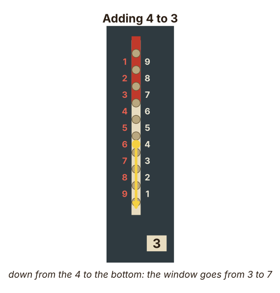
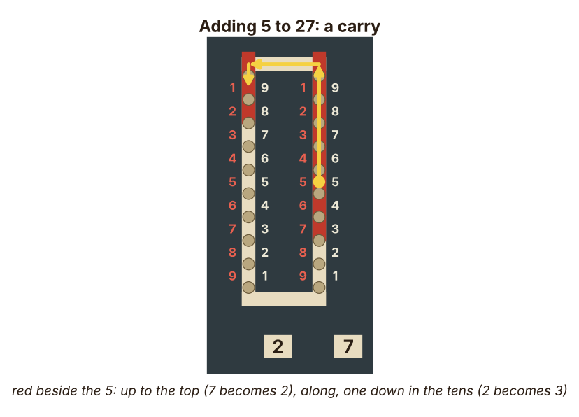
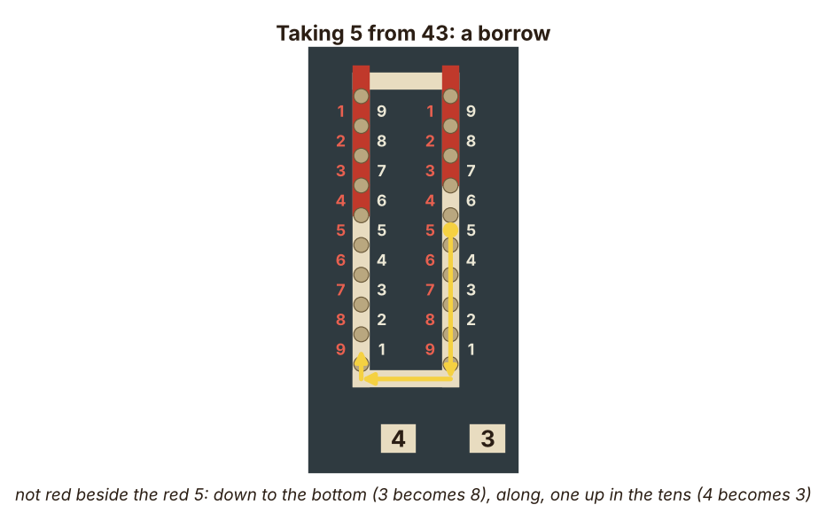

# The Slide Adder: a manual

`MANUAL.pdf` beside this file is a typeset copy of it. In Babbage's Hall,
press `H` at the slide adder to open it.

How to add and subtract on a slide adder (Troncet's arithmographe, the
Addiator, and their many copies): putting a digit on, the carry round the
hook, a carry that runs on, subtracting and borrowing, and what a number
less than nothing looks like. Then the exhibit in the hall, and making
one.

The pictures are drawn by `manual/make-figures.py` with the exhibit's
sizes, and the moves are the ones the exhibit's operator makes.

**The whole idea in one paragraph.** Each column of the adder is a band
that slides up and down behind a cover, with pegs a step apart and the
digits 0 to 9 on it, one showing in the column's window. Put a stylus
between two pegs and move it, and the band moves with it: down d steps,
and the window shows d more. A band can only go down nine steps, so when
d more would pass 9 you push it up 10 − d steps instead (the same digit,
less ten), and put the ten into the next column by hand: round the hook
at the top and one step down. The hook is the whole trick: it turns "carry
one" into a single movement of the stylus.

**Contents**

1. The adder
2. Putting a digit on
3. The carry
4. A carry that runs on
5. Adding a number
6. Subtracting, and the borrow
7. Less than nothing
8. Mistakes to avoid
9. The slide adder in the hall
10. Making one

## 1. The adder

The **cover** has six slots, one for each column: the units at the right,
then tens, hundreds, and so on to hundred thousands at the left. Through
each slot you see the pegs on that column's **band**, and below it, in a
small **window**, the digit the band shows. Beside each slot are two rows
of digits printed on the cover:

- on the right, white, going **up** from 1 to 9: the digits to **add**;
- on the left, red, going **down** from 1 to 9: the digits to
  **subtract**.

The slots are joined across the top by a channel, and across the bottom by
another: the **hooks**. On the Addiator each hook is a little curve at the
top of the slot, bending over into the next slot to the left; here the
curves run together into one channel, but each carry still goes one
column over.

Behind the pegs, each band is painted red from its tenth gap on. When a
band is far down (its window shows a large digit), the red shows in the
upper part of its slot: a red gap beside the digit you want to add means
"too many: carry".

At the right, under the cover, a **zeroing bar** lies under the bands'
feet. Lift it by its tab and it pushes every band to the top: every window
shows 0.

## 2. Putting a digit on

To add a digit d to a column:

1. Put the stylus into the slot, between the two pegs beside the d on the
   right.
2. Draw it down to the bottom of the slot.

The band goes down d steps (the stylus took the peg below it down that
far), and the window, which shows the band's digits from 0 at the top to 9
at the bottom, shows d more. Nothing else moves: each column is on its
own.

## 3. The carry

A band goes down at most nine steps, from 0 to 9. If the window already
shows 7 and you want to add 5, there is no room: the gap beside the 5 is
red. Then:

1. With the stylus beside the 5, push **up** to the top of the slot. The
   band goes up 10 − 5 = 5 steps, from 7 to 2. That is 7 + 5 = 12 with
   the ten left out.
2. Without lifting the stylus, take it **along the top**, over the hook,
   into the next slot to the left (the tens).
3. Push it **one step down**. The tens band goes down one: the ten is
   carried.

Red means carry; white means just go down. You never need to work out a
sum in your head: the colour tells you which way to go.

## 4. A carry that runs on

Add 1 to 99999. The units carry: up, along, and the stylus tries to go one
step down in the tens. It **won't go**: the tens band is already at 9, at
the bottom. That is the adder telling you the tens are full too. Do what
you would do on paper:

1. Lift the stylus out, and put it beside the 1 in the tens (it is red,
   of course).
2. Push up to the top: the tens go from 9 to 0.
3. Along the top into the hundreds, and one step down.

And so on: each 9 in turn becomes 0, until a column takes the carry. The
exhibit's tour does exactly this (99999 + 1, five nines), and so does its
operator whenever a carry lands on a 9: it feels the stylus stop, as you
would.

The leftmost column has no column to carry into: the channel ends there.
A carry out of it is lost, and the adder is full (it shows only the last
six figures of the sum).

## 5. Adding a number

To add a number, add its digits one column at a time, starting with the
units. To add 85358 to 47295, put 47295 on first (on a cleared adder every
digit simply goes down: nothing is red yet). Then the digits of 85358,
from the units leftward:

| Column | Add | Shows | Red? | What the hand does | The windows then |
|---|---|---|---|---|---|
| units | 8 | 5 | yes | up (5 becomes 3), over the hook; the tens show 9 and won't go down, so the tens' 1 up (9 becomes 0), over, one down in the hundreds (2 becomes 3) | 47303 |
| tens | 5 | 0 | no | down | 47353 |
| hundreds | 3 | 3 | no | down | 47653 |
| thousands | 5 | 7 | yes | up (7 becomes 2), over, one down in the ten thousands (4 becomes 5) | 52653 |
| ten thousands | 8 | 5 | yes | up (5 becomes 3), over, one down in the hundred thousands (0 becomes 1) | 132653 |

The windows read 132653.

To clear the adder, lift the zeroing bar (`C` in the exhibit).

## 6. Subtracting, and the borrow

Subtracting is adding upside down. Use the red digits on the left of each
slot, which go downward:

1. Put the stylus beside the red d.
2. If the gap is red, push **up** to the top: the band goes up d steps,
   and the window shows d fewer.
3. If the gap is not red, there aren't d to take: draw it **down** to the
   bottom instead (10 − d steps down: d fewer, plus ten), then **along the
   bottom** into the next slot to the left, and **one step up**. That
   column shows one fewer: the ten borrowed.

A column at 0 won't go up: it has nothing to lend. Lift the stylus out,
put it beside that column's red 1, draw it down to the bottom (0 becomes
9), and borrow from the column after. 100000 − 1 borrows through five
noughts and leaves 99999.

To take one number from another, put the first on by adding it, then
subtract the second.

## 7. Less than nothing

Take 4729 from 853. The borrows run on past the thousands, and the last
one, out of the hundred thousands, has nowhere to come from: the channel
ends. The windows read **996124**. That is not nonsense: it is a million
less 3876, and 853 − 4729 = −3876. A number that has borrowed past the
last column shows as its **complement**: subtract what the windows show
from 1000000 and put a minus sign on it. Pocket adders like this show
negative answers the same way, and the person using one has to know.

## 8. Mistakes to avoid

- **Start at the units.** Going from the left, a carry from a later column
  can land on one you have already done; it still comes out right, but
  you lose track. The units first, leftward, always.
- **Go all the way.** Down to the very bottom, up to the very top: a band
  left half a step short shows the right digit in its window but is not in
  step, and the stylus won't go into its gaps from the channel.
- **One step, not two, when carrying.** The step down after the hook is
  one gap. Two would carry twenty.
- **Clear before a new sum.** Nothing zeroes the adder but the bar; the
  windows go on from wherever they were.
- **Read the colour, not your arithmetic.** Red beside the digit: up and
  over. Not red: straight down (or, subtracting, straight up).

## 9. The slide adder in the hall

The slide adder stands in the west bay 4, after the Domino Half Adder. A
hand works the stylus, and a slate beside the adder shows what the windows
read, the number being added or subtracted, and what the hand is doing,
in a line: down from the digit, or up and over the hook, or "the next
column shows 9: the stylus won't go down". Type a number and press Return.

| Key | |
|---|---|
| `0`–`9` | a number, up to six figures |
| `Return` | add it (in the second way, subtract it) |
| `+`, `-` | add it; subtract it |
| `Backspace` | a figure off |
| `C` | the zeroing bar: every band to 0 |
| `R` | a number at random |
| `T` | the tour: 47295 + 85358, 99999 + 1, 1889 + 2026 (subtracting: 132653 − 85358, 100000 − 1, 853 − 4729), each from 0 |
| `H` or `F1` | this manual |

In the hall, `Tab` steps from adding to subtracting. The bands, the stylus
and the bar are bodies: the stylus moves a band only by pushing its pegs,
and a carry gets into the next column only along the channel. The
operator (the script) reads the windows, makes the moves a person would,
and feels when the stylus will go no further. The sliders set the hand's
speed, the bands' friction, and the simulation's speed.

## 10. Making one

Everything is printed (`./make-stls.sh`): six bands, the cover and the
back in two parts each, five islands (the cover between two slots, cut
off on every side by the channels), the zeroing bar, the stylus and two
feet. The labels are printed on paper at full size and glued on; the red
behind the bands' upper gaps is paint or tape. A band must slide with a
firm push and stay where it is left, upright: more than its own weight of
friction. `README.md` has the parts, the sizes and the assembly.
