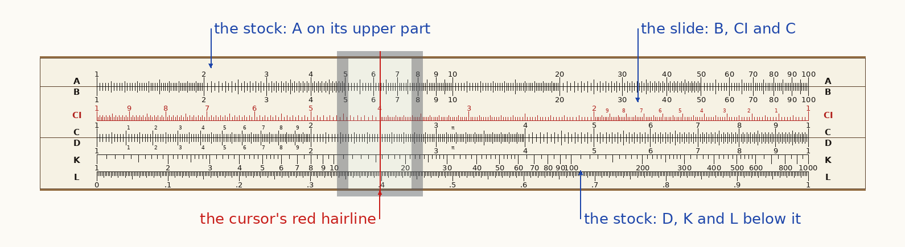
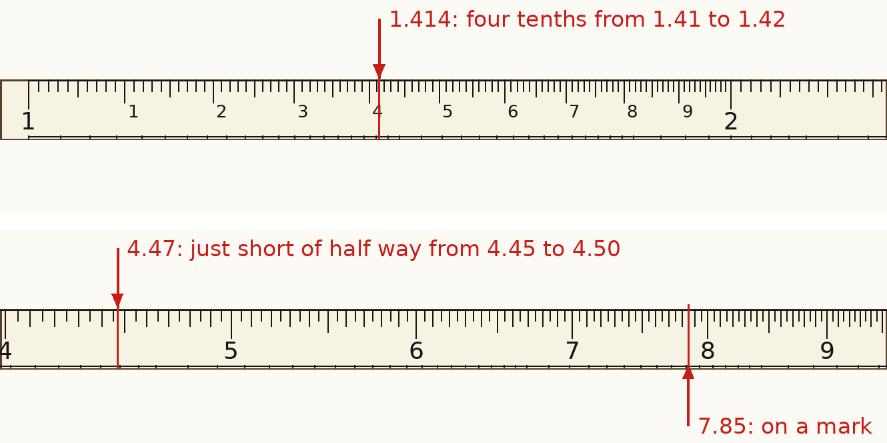
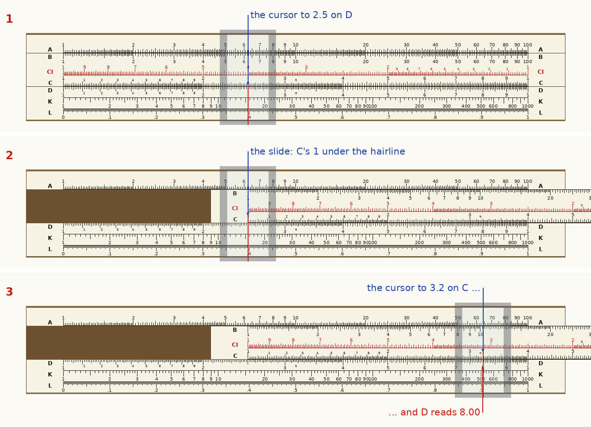
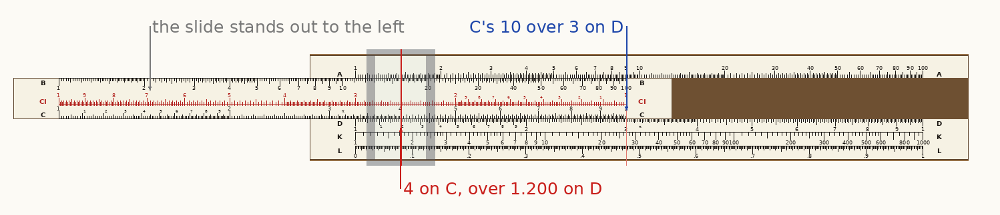
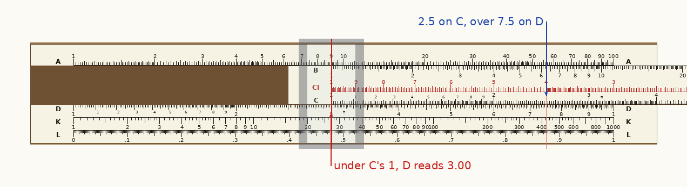
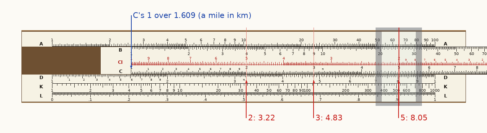
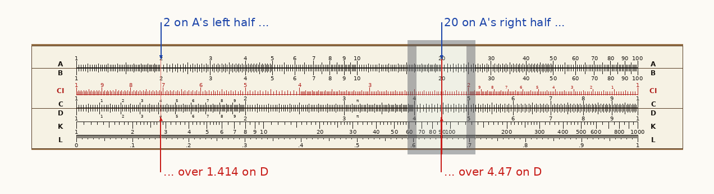
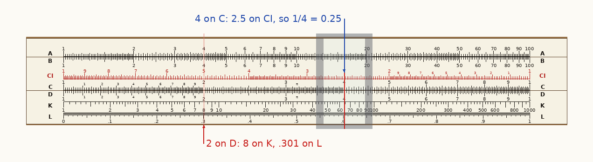
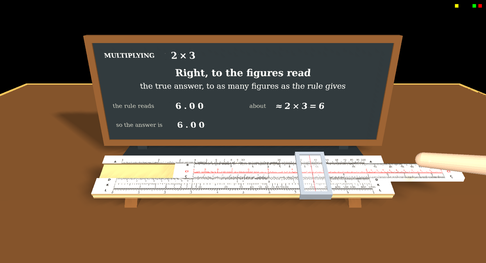

# The Slide Rule: a manual

`MANUAL.pdf` beside this file is a typeset copy of it. In Babbage's Hall,
press `H` at the slide rule to open it.

How to work a slide rule: reading its scales, multiplying and dividing,
squares and square roots, cubes, reciprocals and logarithms, and where to
put the decimal point. Then the exhibit in the hall, and making one.

Every picture of the rule is drawn by the same code that draws the
simulation's scales and the printed ones (`manual/make-figures.py`), with
the slide and the cursor set as the text says; only the arrows and labels
are added.

**The whole idea in one paragraph.** On the D scale, every number stands
as far along as its logarithm: over the rule's 25 cm, 2 stands at 7.5 cm,
4 at 15.1 cm, 10 at the end. C, on the slide, is the same scale. Slide C
along so that its 1 stands over a number on D, and every number on C then
stands over that number times itself: the slide has added two lengths, and
adding logarithms multiplies. Everything else on the rule is that idea
again, with scales made from other functions.

**Contents**

1. The rule and its scales
2. Reading a scale
3. Multiplying
4. When the answer runs off the end
5. Dividing
6. A whole table at one setting
7. Squares and square roots
8. Cubes, reciprocals and logarithms
9. How precise
10. Mistakes to avoid
11. The slide rule in the hall
12. Making one

## 1. The rule and its scales

A slide rule has three parts. The **stock** is the body: its upper part
carries the A scale, its lower part D, K and L. The **slide** runs in a
groove between them and carries B, CI and C. The **cursor** is a clear
window that slides along the whole rule, with a red **hairline** across it
that lines up any scale with any other.

| Scale | Where | What it is |
|---|---|---|
| D | stock, just below the slide | the main scale: 1 to 10, the number v at log v of the way along |
| C | slide, at the bottom | the same as D, on the slide |
| CI | slide, middle, in red | C backward: it runs 10 to 1, so over x on C it shows 1/x |
| B | slide, at the top | A on the slide |
| A | stock, above the slide | squares: 1 to 100 in the same length (two copies of D at half size) |
| K | stock, below D | cubes: 1 to 1000 (three copies of D at a third the size) |
| L | stock, at the bottom | logarithms: 0 to 1, evenly divided |

The ends of C and D are called the **indexes**: the **left index** is the 1
at the left; the **right index** is the 1 (meaning 10) at the right.

## 2. Reading a scale

The marks on D are not evenly spaced, and not equally fine all along:

| On D (and C) | A long mark every | A short mark every |
|---|---|---|
| 1 to 2 | 0.1 (numbered 1 to 9 in small figures) | 0.01 |
| 2 to 4 | 0.1 | 0.02 |
| 4 to 10 | 0.5 | 0.05 |

Between marks you judge by eye. 1.414 lies four tenths of the way from
1.41 to 1.42; 4.47 is a little short of half way from 4.45 to 4.50. A
careful reader gets three figures everywhere, and four between 1 and 2.

**The rule shows figures, not numbers.** 2.5, 25, 250 and 0.025 all stand
at the same place on D, because they have the same figures. The rule
never tells you where the decimal point goes: you decide that yourself
(section 3).

## 3. Multiplying

To multiply 2.5 by 3.2:

1. **Set the cursor** so the hairline is over 2.5 on D.
2. **Move the slide** until C's left index (its 1) is under the hairline.
3. **Move the cursor** to 3.2 on C. Read D under the hairline: **8.00**.

The slide doesn't move in step 3; only the cursor does.

**Placing the point.** The rule gave the figures 8, 0, 0. Round each
number to one figure and multiply in your head: 2.5 × 3.2 is about
3 × 3 = 9. Of 0.800, 8.00 and 80.0, the one near 9 is **8.00**. A second
example: 0.25 × 36 is about 0.3 × 40 = 12, the rule reads the figures 9,
0, 0, and the answer is **9.00**.

## 4. When the answer runs off the end

Try 3 × 4 the same way and the 4 on C lies past the right end of the
stock: there is no D under it. Use the **right index** instead: move the
slide so that C's 10 is under the hairline at 3 on D. The slide now
stands out to the left. Move the cursor to 4 on C and read D: the figures
1, 2, 0, 0, and by estimate the answer is **12.00**.

Which index to use: if the two numbers' first figures multiply to less
than 10 (2 × 3), the left index; if to more (3 × 4), the right. If you
choose wrongly, nothing breaks: the second number is simply off the rule,
and you change index.

## 5. Dividing

Dividing is multiplying backward. To divide 7.5 by 2.5:

1. **Set the cursor** over 7.5 on D.
2. **Move the slide** until 2.5 on C is under the hairline.
3. **Move the cursor** to C's left index and read D: **3.00**.

If C's left index is off the end of the stock, use C's right index
instead. For example, 2 ÷ 8 has its answer under C's 10: the figures 2, 5,
0, and by estimate (2 ÷ 8 is about a quarter) **0.250**.

## 6. A whole table at one setting

Once the slide is set for one multiplication, it is set for every
multiplication by the same number. A mile is 1.609 kilometres: put C's 1
over 1.609 on D, and 2 miles on C stands over 3.22 km on D, 3 over 4.83,
5 over 8.05. Only the cursor moves. Read the other way, from D to C, the
same setting converts kilometres to miles. Any fixed rate works the same
way: exchange rates, recipes scaled up, a map's scale.

## 7. Squares and square roots

A holds two copies of D, each half as long, so whatever number is under
the hairline on D, its square is above it on A.

**A square:** cursor to the number on D, read A. 3 on D: A reads 9.

**A square root:** cursor to the number on A, read D. The question is
which half of A: 2 and 20 have different square roots (1.414 and 4.47),
though both "start with 2". Split the number's figures into pairs,
starting at the decimal point:

| Number | In pairs | The first pair that isn't 00 | Half of A |
|---|---|---|---|
| 2 | 2 | one figure | left |
| 20 | 20 | two figures | right |
| 200 | 2 00 | one figure | left |
| 0.25 | .25 | two figures | right (√ = 0.5) |
| 0.025 | .02 5 | one figure | left (√ = 0.158) |

Each pair before the point gives one figure of the root before its point:
√2000 (20 00) is 44.7.

## 8. Cubes, reciprocals and logarithms

**Cubes:** cursor to the number on D, read K. 2 on D: K reads 8. K has
three thirds (1 to 10, 10 to 100, 100 to 1000), and cube roots work like
square roots, with the figures grouped in threes.

**Reciprocals:** cursor to the number on C, read CI (or the other way).
4 on C: CI reads 2.5, and by estimate 1/4 is **0.25**. CI runs from right
to left: its numbers grow toward the left end.

**Logarithms:** cursor to the number on D, read L for the figures after
the point. 2 on D: L reads .301, so log 2 = 0.301. The whole number in
front comes from where the decimal point is: log 2000 = 3.301, log 0.2 =
0.301 − 1 = −0.699.

## 9. How precise

A 25 cm rule gives three figures, four between 1 and 2 on C and D. That
asks for each setting to be right to about a twentieth of a millimetre.
In the exhibit's tests, settings left up to 0.05 mm off still gave the
right third figure about 99% of the time, and up to 0.1 mm off, about
90%. A multiplication makes three settings and their errors add, so
multiplying is less forgiving than reading a square (`FINDINGS.md` has the
measurements). The left end of D, read to four figures, is the most
demanding place on the rule.

## 10. Mistakes to avoid

- **The wrong index.** If the second number is off the rule, change to
  the other index (section 4). It is not an error, only a choice.
- **The decimal point.** Always make the one-figure estimate; the rule
  will happily show 8.00 for 0.8 × 1.
- **CI read the wrong way.** Its numbers increase to the left.
- **The wrong half of A** for a square root: group the figures in pairs
  (section 7).
- **Parallax.** Look straight down through the window at the hairline;
  from an angle it seems to sit on a different mark.
- **Moving the slide when you meant to move the cursor** (in step 3 of a
  multiplication, or a table): the setting is lost and you start again.

## 11. The slide rule in the hall

The slide rule stands in the hall's east bay 1, facing the suanpan. A
finger works it; a slate behind it shows the problem, each step, what the
rule reads, the estimate that places the point, and the answer. It has
two ways, and `Tab` steps from one to the other:

- **Multiplying and dividing.** Type a number, `X` or `/`, a second number,
  and `Return`: for example `2.5 X 3.2 Return`.
- **Squares, roots, cubes, reciprocals and logarithms.** Type a number,
  then `S` (its square), `R` (square root), `K` (cube), `I` (reciprocal) or
  `L` (logarithm).

| Key | |
|---|---|
| `0`–`9`, `.` | a number |
| `Backspace` | a figure off |
| `C` | close the rule: the slide home, the cursor to the left |
| `M` | the camera close to the hairline, following it, to read the scales; again: back |
| `T` | the tour: each kind of problem in turn |
| `H` or `F1` | this manual |
| `I` | in the hall, in the first way: the lectern's label close up, and `PgDn` turns its pages (in the second way `I` is the reciprocal) |

The finger sets each part against the other as it stands, as a person
does, and every reading is taken from where the slide and the cursor
actually are, so a careless setting would give a wrong answer, and the
slate would say so. Resting the mouse on a part says what every scale
reads under the hairline.

## 12. Making one

Every part can be printed except the cursor's window, a small piece of
2 mm clear acrylic. The stock and the slide are each printed in two
halves, joined by splice bars underneath; there are a cursor frame, two
feet that tilt the rule toward you, and a slate. The scales are printed
on paper from `scales.pdf` at 100% (check its 100 mm bar), cut out, and
glued on, as many old rules were faced with printed card. Sand and wax the
slide so it moves with a firm push and stays where it is left.

`README.md` has the parts list, the printing notes and the assembly in
full; `./make-stls.sh` makes the STL files.
