# The Suanpan: a manual

`MANUAL.pdf` beside this file is a typeset copy of it. In Babbage's Hall,
press `H` at the suanpan to open it.

How to work a Chinese abacus: reading it, the rules for adding and taking
away, and multiplying. Then the exhibit in the hall, and making one.

Every picture of the abacus is worked by the exhibit's own rules
(`plan.lua`, the same code that tells the finger which beads to move):
`manual/states.lua` runs each example through them, and
`manual/make-figures.py` draws the abacus to the proportions of the
printed parts. A bead that has just moved is **orange**, with a red arrow
for the way it went.

**The whole idea in one paragraph.** Each rod holds one digit. Beads count
only when they are pushed to the beam: a heaven bead (above it) 5, an
earth bead (below it) 1. To add, you work from the left, one rod at a
time, and on each rod you never do arithmetic: you know, as a pupil knew
by heart, which beads to move for "+8 when there are 4", and that it
carries 1 to the next rod. There are only a few such rules, and four of
them do all of adding.

## 1. The abacus

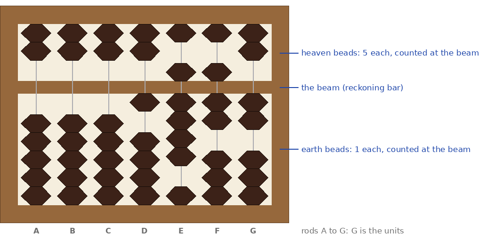

The frame holds seven rods. Across it runs the **beam** (the reckoning
bar). On each rod, above the beam, are two **heaven beads**; below it,
five **earth beads**. The rods are named A to G from the left, and G is
the units: F is the tens, E the hundreds, and so on, as in writing a
number.

**A clear abacus** has every heaven bead up against the top bar and every
earth bead down against the bottom one: nothing touches the beam, so every
rod reads 0. (To clear it quickly, tilt it toward you so that the earth beads
fall to the bottom bar, lay it flat, and run a finger along just above
the beam, pushing the heaven beads up.)

## 2. Reading a rod

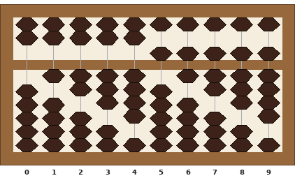

Add up the beads at the beam: 5 for a heaven bead, 1 for each earth bead.
So 0 to 4 use only earth beads; 5 is the heaven bead alone; 6 to 9 are
the heaven bead and one to four earth beads. Then read the rods from the
left as a number: in section 1, D shows 1, E 9, F 7, G 2: **1972**.

A rod needs only one heaven bead and four earth beads for 0 to 9. The
second heaven bead and the fifth earth bead are spares: old methods used
them to hold 10 to 15 on a rod for a moment, in division. The rules here
never use them (nor does the Japanese soroban, which dropped them).

## 3. The two pairs you must know

Every rule rests on two small tables:

| | | | | | |
|---|---|---|---|---|---|
| **Fives** (two numbers that make 5) | 1 and 4 | 2 and 3 | | | |
| **Tens** (two numbers that make 10) | 1 and 9 | 2 and 8 | 3 and 7 | 4 and 6 | 5 and 5 |

The other number of a pair is the **complement**: the complement of 3 in
5 is 2; of 8 in 10, 2.

## 4. Adding on one rod: the four rules

To add a digit to a rod, look at the rod and use the first rule that
fits. Each picture shows rods F and G, a picture for each move.

**1. Direct.** If there are enough beads free to push to the beam, push
them. +3 when there is 1: three earth beads up.

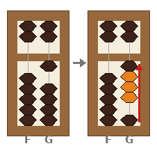

+7 when there are 2: 7 = 5 + 2, so the heaven bead down and two earth
beads up.

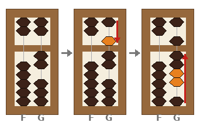

**2. Five-complement.** If there are not enough earth beads free, but the
heaven bead is free: bring the heaven bead down (+5) and take away the
complement in 5. +3 when there are 3: +5, then −2.

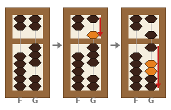

**3. Ten-complement.** If the rod would go past 9: take away the
complement in 10 from this rod, and add 1 to the rod on the left (the
**carry**). +8 when there are 4: −2, then carry 1.

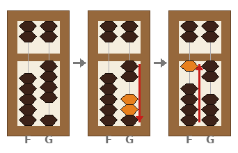

**4. Ten- and five-complement together.** As rule 3, but taking away the
complement needs the heaven bead. +6 when there are 5: take away 4, the
complement of 6; but 5 is the heaven bead alone, with no earth beads to
take, so −4 is done as −5 + 1 (rule 2 backward). One earth bead up, the
heaven bead up, carry 1.

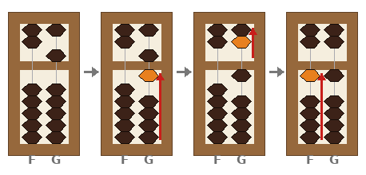

The carry is itself an addition, of 1 to the rod on the left, and follows
the same rules: if that rod holds 9 it becomes 0 and carries again.

Say the moves as you make them ("plus eight: minus two, carry one"), not
the sum. Nobody works out 4 + 8 on an abacus: that is its whole speed.

## 5. Adding a number

Set the first number. Then add the second **from its left**: its first
digit on the rod of the same place, then the next digit on the next rod to
the right, and so on. Working from the left lets you read the number
aloud as you add it, and the carries go to rods you have already done.

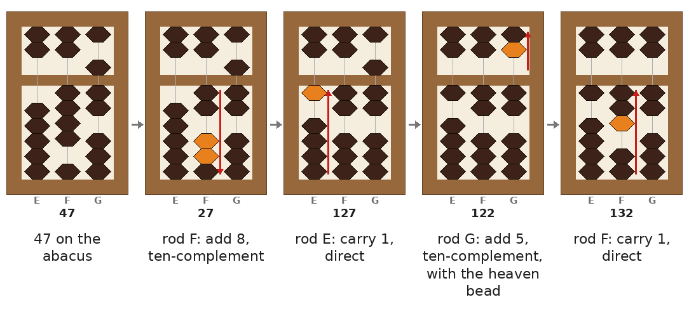

**47 + 85.** Set 47 on rods F and G. The 8 goes on F, the tens: F has 4,
4 + 8 passes 9, so take away 2 (the complement of 8) and carry 1 to E.
The 5 goes on G: G has 7, 7 + 5 passes 9, so take away 5 (the complement
of 5) and carry 1 to F. Taking away 5 from 7 is the heaven bead up: rule 4
is not needed, the heaven bead was there to take. **132.**

## 6. Taking away

The same rules, backward. Set the larger number, and take the smaller one
away from its left.

**1. Direct.** If the beads are there to take, take them: −3 when there
are 4, three earth beads away from the beam.

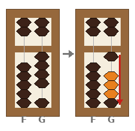

**2. Five-complement.** Not enough earth beads, but the heaven bead is at
the beam: push the heaven bead up (−5) and add the complement in 5.
−3 when there are 6: −5, then +2.

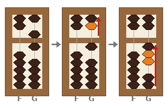

**3. Ten-complement.** Not enough on the rod: take 1 from the rod on the
left (the **borrow**), and add the complement in 10 to this rod. −8 when
there are 2 (and 1 on the left): borrow 1, then +2.

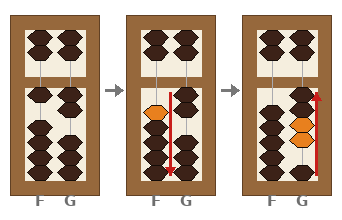

**4. Ten- and five-complement.** As rule 3, but adding the complement
needs the heaven bead: −7 when there are 4 is borrow 1, then +3 done as
+5 − 2.

The borrow is done **first**, as it is taught, so the rod on the left
never needs to be looked at twice. If the rod on the left is 0 it borrows
in its turn:

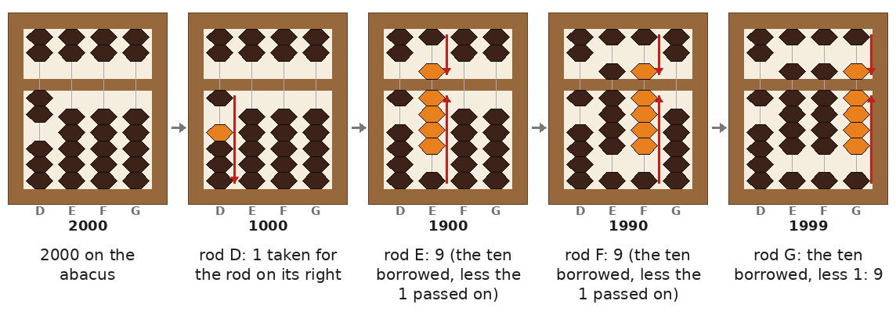

**2000 − 1.** G has nothing to take 1 from, nor do F and E: the borrow
goes all the way to D, which drops to 1. Each 0 between becomes 9 (the
ten it borrowed, less the 1 it passed on to the right), and G gets the
complement of 1 in 10: 9. **1999.**

To check a subtraction, add the smaller number back: you should come to
the larger again.

## 7. Multiplying

There are many methods. This is the modern Japanese one, as in Takashi
Kojima's *The Japanese Abacus* (1954); the exhibit uses it. You need the
times table up to 9 × 9 and the adding rules.

1. **Set the multiplier** on the rods at the far left, and the
   **multiplicand** further right, leaving as many free rods after it as
   the multiplier has digits, plus one.
2. Take the multiplicand's **last** digit. Multiply it by each digit of the
   multiplier, from the left. Say each product as two digits (3 × 2 is
   "zero six") and **add** it on two rods: for the multiplier's first
   digit, on the two rods just right of the multiplicand's digit; for its
   second, one rod further right.
3. Clear that digit of the multiplicand (it is used), and do the same with
   the digit to its left. Go on until the multiplicand is gone.
4. The product is on the rods at the right. Clear the multiplier.

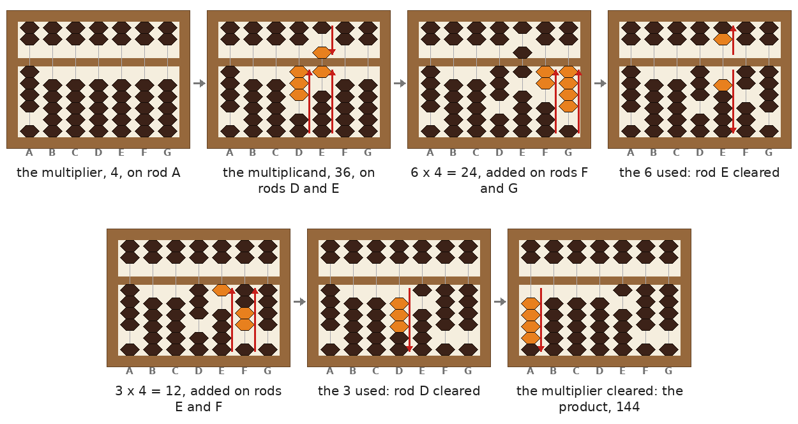

**36 × 4.** 4 on A; 36 on D and E. The last digit, 6: 6 × 4 = 24, added
on F and G (just right of E). Clear E. Then the 3: 3 × 4 = 12, added on E
and F (just right of D): F had 2, +2 is 4; E had nothing, +1 is 1. Clear
D. Clear A: **144.**

With a two-figure multiplier, **23 × 45**: 45 on A and B, 23 on C and D,
three rods free. Each digit of the multiplicand now gives two products,
one for the 4 and one for the 5. For the 3: 3 × 4 = 12 is added on E and
F (just right of D), and 3 × 5 = 15 one rod further right, on F and G,
overlapping it, by the adding rules. Clear D. The same for the 2:
2 × 4 = 08 on D and E, 2 × 5 = 10 on E and F. Clear C, then A and B:
**1035.** Seven rods hold up to 99 × 99, or 9999 × 9.

To check, **cast out nines**: add the digits of each
number until one digit is left (36: 3 + 6 = 9; 4: 4); multiply those and
do the same (9 × 4 = 36: 9). The product's digits must give the same
(144: 1 + 4 + 4 = 9). It catches most slips, not all.

## 8. Mistakes to avoid

- **Doing the sum in your head and setting the answer.** It is slower,
  and the rules are there so that you need not. Say the moves.
- **Forgetting the carry**, or carrying to the wrong rod: the carry goes
  to the rod immediately on the left, and is itself added by the rules.
- **The wrong rod for a digit.** Line the units up: the units of both
  numbers on G (or the rod you chose as the units). A mark every third
  rod helps on a long abacus.
- **Beads half-way.** A bead that does not touch the beam does not count.
  Push each one firmly home, and the others firmly away.
- **In multiplying, the products on the wrong rods.** Each product's tens
  go on the rod just right of the multiplicand digit being used (one rod
  further for each later digit of the multiplier). If the product comes
  out ten times too big or small, this is why.

## 9. The suanpan in the hall

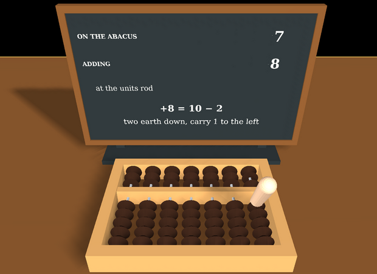

The suanpan is the first machine on the walk, in the west bay 1. A finger
works it; a slate behind it shows the number on the abacus, the number
being added, the rod the finger is at, and the rule it is using, in the
words of section 4. It has three ways, and `Tab` steps through them: adding,
taking away, and multiplying.

| Key | |
|---|---|
| `0`–`9` | a number (the slate shows it) |
| `Return` | add it (taking away: take it away; multiplying: multiply) |
| `X` | multiplying: times, between the two numbers: `36 X 4 Return` |
| `A` | taking away: add the number instead, to have something to take from |
| `Backspace` | its last digit off |
| `C` | clear the abacus |
| `T` | the tour. Adding: 3, 4, 8, 6, 79 and 1234, a rule of its own each, to 1334. Taking away: 2000, then 1, 4, 3, 7, 8 and 5 taken away, to 1972. Multiplying: 36 × 4, 23 × 45, 99 × 99 |
| `H` or `F1` | this manual |
| `I` | in the hall: the lectern's label close up, and `PgDn` turns its pages |

The beads are bodies that slide on their rods; the finger takes hold of
one bead and moves it, and that bead pushes the others ahead of it, as a
finger does. The number is read from where the beads actually are after
every step and checked against the rules, so a bead that stuck would
show. Resting the mouse on a bead, the frame, the slate or the finger
says what it is and what the abacus reads. The sliders set the beads'
friction on their rods, the finger's speed, and the simulation's speed.

On its own, outside the hall: `bpp -f suanpan.lua`, and
`SU_WAY=subtract` or `SU_WAY=multiply` for the other ways.

## 10. Making one

Every part is printed but the rods; `./make-stls.sh` makes the STL files
from `parts/suanpan.scad`, each turned to lie on the bed, and all fit a
200 mm printer.

| Part | Print | |
|---|---|---|
| `bead.stl` | 49 | 20 mm across, 12 mm thick; darker than the frame |
| `bar-near.stl`, `bar-far.stl` | 1 each | the rods' ends go in their blind holes |
| `bar-side.stl` | 2 | |
| `beam.stl` | 1 | the rods pass through it |
| `slate-*.stl` | 1 each | optional: the slate, its board and frame in halves |

Buy seven 3 mm steel rods, 136 mm long.

1. Thread five beads on each rod, then the beam, then two beads.
2. Push the rods' ends into the near and far bars, and glue the side bars
   between the bars' ends.
3. Glue the beam to the side bars 74 mm from the near bar's inner face.
4. The beads should slide freely but not fall along a rod held upright;
   if they are loose, print them with a 3.2 mm hole.

`README.md` has the details, and `FINDINGS.md` what was measured in the
simulation.
