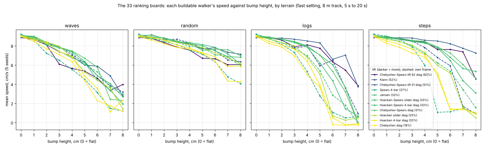

# Walking machines over rough ground: a fair comparison

William Spears, 1 November 2026

## Summary

Yes: among walkers braced the same way, more foot lift goes with more speed over rough ground. Across the 9 diag builds, the order by lift matches the order by speed with a rank correlation of 0.85. On flat ground all 11 buildable walkers walk within 0.35 cm/s of each other; as bumps rise, the lead passes to the walkers with more lift. At 8 cm, the walker with the most lift (62% of its stride) leads on waves and logs, though on small bumps it is among the slowest.

The second finding is about bracing. Tying each pair of diagonal legs together, as real braces do, makes a walker robust: none of the Spears diag builds nearly stalls on any of the nine rough grounds. A linkage that cannot lift its feet over an obstacle on its own gains most from it.

All 21 builds of 12 linkages were simulated in the Bullet physics engine under one set of rules, on nine rough grounds, 5 runs each; the 11 that could really be built were also run on 33 grounds. William Spears designed the Spears linkages, set the rules and ran the final tables.

## The question

Do walking linkages whose feet rise higher (more lift) do better over higher bumps, and does a longer stance (a higher duty factor) help too? Lift here is how high a foot's lowest point rises over one crank turn, as a share of its stride. Duty factor is the share of the turn a foot spends on the ground.

Answering it fairly meant first making every walker the same size, weight rule, power and simulation, so that only the linkage and its bracing differ. Most of the work went there.

## The walkers

Twelve four-legged linkages, nine of them built two ways. A **diag build** joins each pair of diagonal legs with real outside braces. A **guides build** holds each leg to the body with guides that are not really there, so it cannot be built. Klann, Jansen and Spears 4-bar stand on their **own frames**.

| Linkage | Mark | Links | Lift (% of stride) | Builds |
| --- | --- | --- | --- | --- |
| Chebyshev-Spears lift 62 | C-S | 4 | 62 | diag, guides |
| Klann | K | 6 | 52 | own frame |
| Chebyshev-Spears lift 51 | C-S | 4 | 51 | diag, guides |
| Spears 4-bar | S | 4 | 37 | own frame |
| Hoecken-Spears 4-bar duty 85 | H-S | 4 | 34 | diag, guides |
| Jansen | J | 8 | 33 | own frame |
| Hoecken-Spears slider | H-S | 2S | 33 | diag, guides |
| Hoecken-Spears 4-bar | H-S | 4 | 33 | diag, guides |
| Chebyshev-Spears | C-S | 4 | 31 | diag, guides |
| Hoecken slider | H | 2S | 25 | diag, guides |
| Hoecken 4-bar | H | 4 | 20 | diag, guides |
| Chebyshev | C | 4 | 19 | diag, guides |

The Spears linkages are William Spears' changes to the classic Chebyshev and Hoecken linkages: a shorter ground link, a longer coupler and rocker, the leg turned 90 degrees off the coupler and the ground link tilted 45 degrees. The two lift builds were hill-climbed from Chebyshev-Spears for more lift. Duty 85 came from a search of the Hoecken-Spears family; its stance is 85% of the turn.

Lift was measured the same way for every build: the body held still, one slow crank turn, the rise of each foot's lowest point as a share of its centre's travel. An older measure in the linkages' own units gave smaller numbers, about 1.18 times smaller, which is where the old names lift 44 and 53 came from.

Each body carries its marks: the family letters in the middle, the links top left, the lift top right, a triangle on diag builds, and G on guides builds.

## Making it fair

Every walker runs under the same rules:

- the same motor: 0.5 a crank (weight × stride units), trot gait {0, 180, 180, 0}, walking forward;
- the same links: 1.0 cm wide, no damping on links or braces;
- the same feet: an ankle spring (42000 stiffness, 4200 damping) and an ankle stop at 30–150° against the leg, the angle a real clevis allows, so a foot can never fold through its leg;
- the same ground: an 8 m track, bumps 15 cm apart, 20 s runs, speed measured from 5 s to 20 s;
- the same solver settings for all (next section).

Some helpers are not visible parts. Each stands in for something a real build would have, or holds a leg where the simulator lets it drift.

| Helper | Used on | What it stands in for |
| --- | --- | --- |
| Ankle spring | all | A foot held level to the body, as a parallel link would. |
| Yaw damping (1) | all | Damps the body's turning. |
| Pendant hold | diag builds | Rigid braces. Over a long chain of joints the solver lets the braced pendants give; the hold keeps each pendant's angle to the body. |
| Guides | guides builds | Hold each leg to the body. Not buildable; kept for comparison only, not for demos. |

The pendant hold was tested by taking it away (8 diag builds, 9 grounds, 5 seeds). Speeds fell by 2.76 cm/s on average, the order of the walkers changed almost entirely (rank correlation 0.24), and some walkers turned round and walked backwards. So it stays.

Three fixes along the way also made it fairer:

- the motor torque had been read about the crank's centre, which showed half the real torque; it is now read about the pivot;
- Spears 4-bar's leg welds were locked sliders that blew up under the faster solver; they are now fixed joints;
- one damping rule for all links, where Spears 4-bar had had its own.

## The simulation, and how it was checked

The runs use bpp (Bullet Physics Playground) with Bullet 3.24, at centimetres and seconds, gravity 981 cm/s².

The standard setting is called **warm40fast**: a solver that starts each joint from 0.85 of its force at the last step (`si-warm`), 40 iterations, a step of 1/1920 s, stopping early once settled (residual 0.01). Bullet's own solver starts every joint from zero each step and needed 200 iterations at 1/3840 s to hold the linkages together.

warm40fast was checked against that slower setting on the 13 builds ranked at the time, nine rough grounds, 5 seeds (585 runs a setting):

| Setting | Mean change (cm/s) | Typical change | Rank correlation | Builds moved past their ± | Time a run |
| --- | --- | --- | --- | --- | --- |
| Bullet, 200 iterations, 1/3840 s | — | — | — | — | about 4× slower |
| warm, 40, 1/3840 s | +0.08 | 0.14 | 0.97 | 3 of 13 | 42 s |
| warm40fast | 0.00 | 0.13 | 0.96 | 0 of 13 | 23 s |

Only builds within about 0.1 cm/s of each other swapped places. The changes since then were each checked the same way:

| Change | Mean change (cm/s) | Rank correlation | Past their ± |
| --- | --- | --- | --- |
| Ankle stop at 30–150° | −0.03 | 0.98 | Jansen only (−0.32, logs 7) |
| One damping rule (0) | 0.00 | 0.99 | none |
| Spears 4-bar's fixed welds | −0.15 ± 0.26 | — | — |

Jansen's loss is what a buildable ankle costs it on high logs: without the stop, one foot folded through its rod.

Each result below is the mean of 5 seeds; ± is about one standard error. A run watched in the viewer differs in detail from a table run (narrower track, moving marks), so it can land above or below its figure.

## The ranking: 21 builds on nine rough grounds

More lift goes with more speed, most clearly among builds braced the same way. Speeds in cm/s, mean of nine grounds (waves 2/4/6, logs 3/5/7, steps 3/5/7 cm) and 5 seeds; "hardest three" is the mean of waves 6, logs 7 and steps 7. All trot, forward.

| Rank | Walker | Bracing | Timing | Direction | Lift % | Mean | ± | Hardest three |
| --- | --- | --- | --- | --- | --- | --- | --- | --- |
| 1 | Chebyshev-Spears lift 51 | guides | trot | forward | 51 | 7.90 | 0.07 | 6.97 |
| 2 | Chebyshev-Spears lift 51 diag | outside, held | trot | forward | 51 | 7.77 | 0.05 | 6.88 |
| 3 | Chebyshev-Spears lift 62 | guides | trot | forward | 62 | 7.30 | 0.07 | 6.38 |
| 4 | Chebyshev-Spears lift 62 diag | outside, held | trot | forward | 62 | 7.00 | 0.09 | 5.83 |
| 5 | Chebyshev-Spears diag | outside, held | trot | forward | 31 | 6.97 | 0.12 | 5.00 |
| 6 | Hoecken-Spears 4-bar diag | outside, held | trot | forward | 33 | 6.84 | 0.16 | 4.74 |
| 7 | Hoecken-Spears 4-bar duty 85 diag | outside, held | trot | forward | 34 | 6.61 | 0.09 | 4.08 |
| 8 | Hoecken-Spears 4-bar | guides | trot | forward | 33 | 6.44 | 0.13 | 3.37 |
| 9 | Hoecken-Spears slider | guides | trot | forward | 33 | 6.38 | 0.20 | 3.82 |
| 10 | Hoecken-Spears slider diag | outside, held | trot | forward | 33 | 6.23 | 0.19 | 3.42 |
| 11 | Klann | own frame | trot | forward | 52 | 6.05 | 0.25 | 3.40 |
| 12 | Jansen | own frame | trot | forward | 33 | 5.91 | 0.19 | 3.52 |
| 13 | Chebyshev-Spears | guides | trot | forward | 31 | 5.90 | 0.18 | 2.51 |
| 14 | Hoecken slider | guides | trot | forward | 25 | 5.58 | 0.15 | 2.41 |
| 15 | Hoecken slider diag | outside, held | trot | forward | 25 | 5.39 | 0.14 | 2.08 |
| 16 | Hoecken 4-bar | guides | trot | forward | 20 | 5.00 | 0.19 | 1.84 |
| 17 | Hoecken-Spears 4-bar duty 85 | guides | trot | forward | 34 | 4.92 | 0.15 | 1.55 |
| 18 | Hoecken 4-bar diag | outside, held | trot | forward | 20 | 4.88 | 0.16 | 1.57 |
| 19 | Chebyshev | guides | trot | forward | 19 | 4.86 | 0.14 | 1.82 |
| 20 | Chebyshev diag | outside, held | trot | forward | 19 | 4.50 | 0.16 | 1.14 |
| 21 | Spears 4-bar | own frame | trot | forward | 37 | 4.10 | 0.16 | 1.69 |

**Lift against speed** (rank correlation with the mean):

| Group | Builds | Correlation |
| --- | --- | --- |
| Diag builds | 9 | 0.85 |
| All | 21 | 0.64 |
| Not guides (diag and own frame) | 12 | 0.49 |

The weaker figure without guides comes from the own-frame builds: Klann has 52% lift but is 11th, Spears 4-bar has 37% and is last. Their frames are different linkages, so lift is not the only thing changing.

**Spears' changes help every original**, guides and diag alike (cm/s, guides / diag):

- Chebyshev → Chebyshev-Spears: +1.04 / +2.47
- Hoecken 4-bar → Hoecken-Spears 4-bar: +1.44 / +1.96
- Hoecken slider → Hoecken-Spears slider: +0.80 / +0.84

## Ranking boards: every ground, every height

On flat ground the walkers are nearly equal. As the bumps grow, the lead passes to the walkers with more lift.

The 11 buildable walkers were run on four grounds (waves, random, logs, steps) at every height from 1 to 8 cm, and on flat: 33 boards, 5 seeds each (trot, forward, warm40fast).

- **Flat:** all 11 within 0.35 cm/s (Spears 4-bar 9.21 down to Chebyshev-Spears lift 62 diag 8.86).
- **Low-lift originals fall off first,** at 4–5 cm: Chebyshev diag, Hoecken 4-bar diag, Hoecken slider diag (19–25% lift).
- **Logs 2–7 cm and steps 2–8 cm:** Chebyshev-Spears lift 51 diag leads.
- **Waves and logs at 8 cm:** Chebyshev-Spears lift 62 diag leads (the most lift, 62%), though it is among the slowest on low bumps.
- **Random ground** stays close (7.1 to 4.3 cm/s at 8 cm) and the leader changes from height to height.
- **Spears 4-bar** falls off early on steps (1.07 cm/s at 5 cm).

The viewer shows the board for its ground when each walker starts, and at 20 s says where this run would place.

## Guides, braces and tied legs

Tying each pair of diagonal legs together is what the diag builds' braces mostly do, and it is what helps. It helps linkages that cannot clear the obstacle alone, and costs the high-lift ones on logs.

**Diag against guides, pair by pair** (diag − guides, mean of nine grounds, cm/s): duty 85 +1.69, Chebyshev-Spears +1.07, Hoecken-Spears 4-bar +0.40 (these three past their ±); Chebyshev −0.36, lift 62 −0.30, Hoecken slider −0.19, Hoecken-Spears slider −0.15, lift 51 −0.13, Hoecken 4-bar −0.12. Mean +0.21 ± 0.24.

The three that gain have middling lift (31–34%): about 5 cm of foot lift under a 7 cm obstacle.

**Taking the braces apart.** Two test switches: ties (each diagonal pair of legs welded together by a joint that weighs and touches nothing) and ghost braces (the diag braces kept, weight and all, but touching nothing). Logs 7 and steps 7 cm, 5 seeds, cm/s:

| Walker | Ground | Guides | Guides + ties | Diag | Diag, ghost braces |
| --- | --- | --- | --- | --- | --- |
| Chebyshev-Spears | logs 7 | 0.29 | 2.13 | 3.21 | 3.08 |
| Chebyshev-Spears | steps 7 | 2.56 | 5.85 | 6.05 | 6.05 |
| Hoecken-Spears 4-bar | logs 7 | 0.74 | 4.33 | 3.67 | 3.69 |
| Hoecken-Spears 4-bar | steps 7 | 5.74 | 5.49 | 5.65 | 5.65 |
| Hoecken-Spears 4-bar duty 85 | logs 7 | 0.02 | 0.29 | 1.18 | 1.82 |
| Hoecken-Spears 4-bar duty 85 | steps 7 | 0.74 | 4.00 | 5.73 | 5.73 |
| Chebyshev-Spears lift 62 | logs 7 | 7.14 | 4.77 | 5.48 | 6.04 |
| Chebyshev-Spears lift 62 | steps 7 | 7.14 | 7.33 | 7.38 | 7.37 |

All trot, forward. On steps the ghost-brace runs matched the diag runs exactly: the braces never touched anything. So the braces catching on the ground matters little; the tie between the legs matters most.

**Why duty 85 with guides stalls on steps 7.** Its front feet climb the step and the body tips about 11° nose up. One rear foot, still about 9 cm behind on the low ground, folds to the ankle stop and props on its heel; its crank stops and the walker slides back. The diag build's same foot folds to 59° and swings back.

**Diag builds are more robust.** Near-stalls (a ground under 1 cm/s): 7 of 81 for the guides builds, 3 of 81 for the diag builds, and those 3 are only the low-lift originals on logs 7. None of the Spears diag builds nearly stalls anywhere.

## Conclusions

1. **Yes, more lift helps over higher bumps.** Among the diag builds, lift and speed rank together at 0.85. On flat ground lift costs almost nothing (all within 0.35 cm/s); from about 4 cm up, low lift falls behind.
2. **The best buildable walker here is Chebyshev-Spears lift 51 diag**: 7.77 cm/s over the nine rough grounds, leading on most logs and steps. Lift 62 diag leads only on the highest bumps.
3. **Spears' changes help every original linkage tried**, by 0.8 to 2.5 cm/s.
4. **Tying diagonal legs together helps middling-lift linkages most**, and makes the diag builds the more robust choice.
5. **Duty factor alone did not help.** Duty 85 (85% stance) has about the lift of Hoecken-Spears 4-bar (34% against 33%) and is slower in both builds (6.61 against 6.84 diag, 4.92 against 6.44 guides).
6. **Klann and Jansen sit mid-table** (11th and 12th of 21), behind the Spears-family diag builds.

## Limits and open questions

- **A simulation, not a build.** Bullet lets long chains of joints give; the pendant hold corrects that on the diag builds, and without it the results change completely. Nothing here has been checked against a real walker.
- **Motor strength** is 0.5 a crank for every walker, with no real motor to match it to.
- **The braces' weight** (6–10 on bodies of 90–128) was not tested on its own.
- **Duty 85 on logs 7** still stalls with tied legs; the cause is not known.
- **Own-frame builds** (Klann, Jansen, Spears 4-bar) differ in more than lift, so they weaken the lift correlation without saying why.
- **One gait** (trot) and one stride (15 cm) for all; other gaits were not ranked.
- **Speed of the simulation:** one walker runs at about half real time, four at 0.15×. Bullet here is built without threads; that is the next investigation.

## How to see it yourself

In bpp, from `demo/WyomingWill/WalkerRoom`:

| File | What it shows | Keys |
| --- | --- | --- |
| `test-ranking.lua` | The 11 buildable walkers on the test track, one at a time, with the board for the ground | Tab / Shift+Tab next walker (board order), 1–4 ground, N seed, B board, O overview, F follow |
| `room-four.lua` | Klann, Jansen and two others walking together in the room | F next of the four, Tab / Shift+Tab swap the followed walker, 1–4 ground, O overview |

The TerrainHeight slider sets the bump height. `VIEWS_ALL = true` at the top of `test-ranking.lua` adds the guides builds.

To rerun the tables: `runs/run-table.sh` (warm40fast by default), then `runs/table.py`. The full record is in `handover/HANDOVER.md`.
